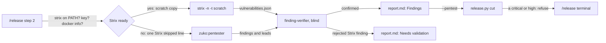
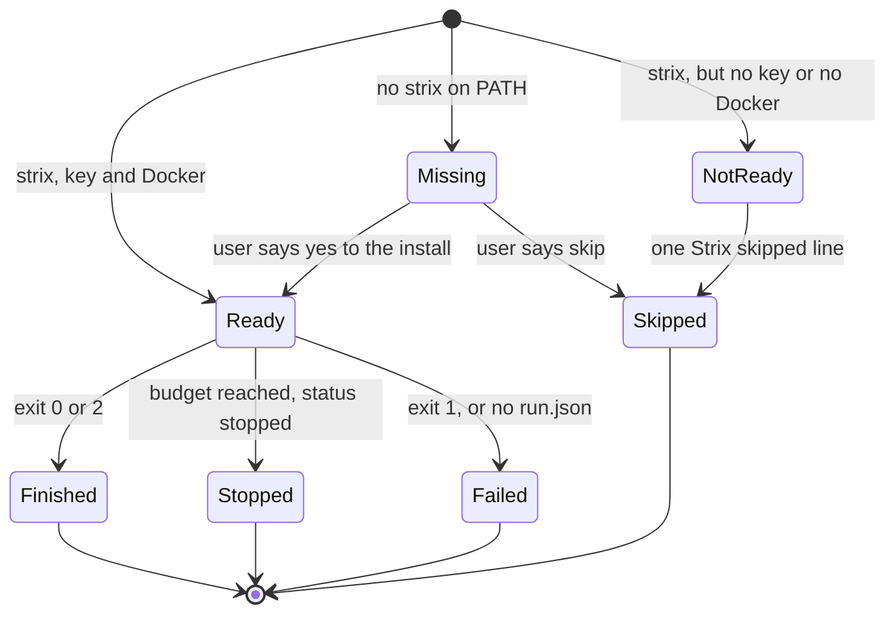
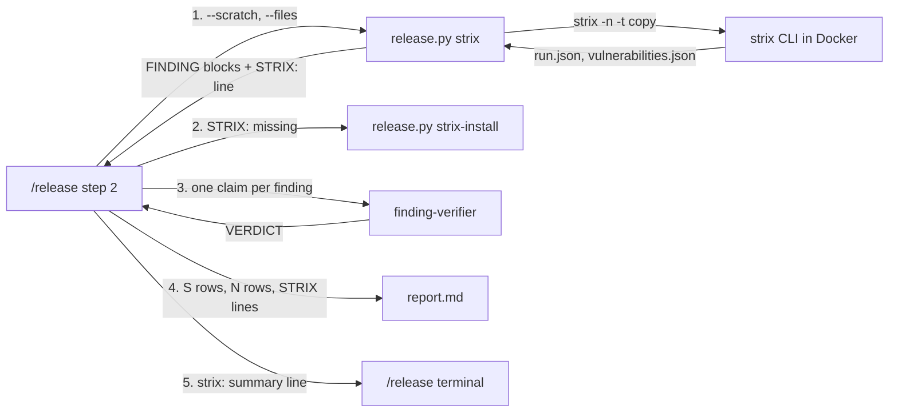
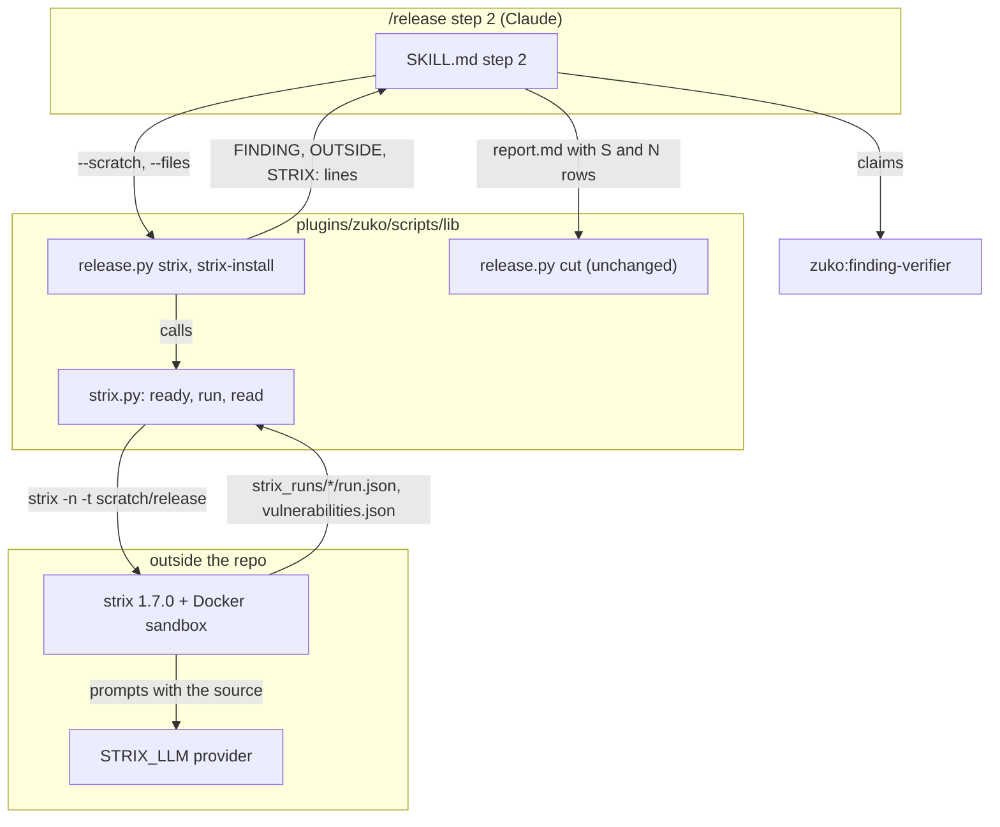
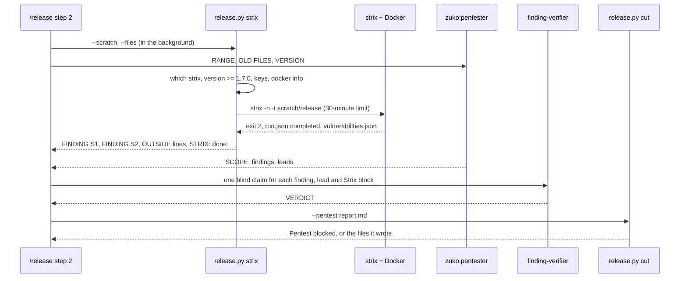
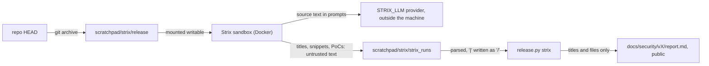

# Strix code

**Version:** v1 · **Status:** Built · **Type:** Feature · **Project type:** CLI/Library

**Shape doc:** docs/specs/pentest-depth/shape.md
**Depends on:** attack-classes, needs-validation

When Strix, an LLM key and Docker are present, `/release` also runs Strix on the scratch copy of the release. zuko's blind verifier checks each Strix finding, and the confirmed ones go into the same report and block the release by the same rule (D10).

## Problem

The release pentest has one attacker: the zuko pentester, which runs on Claude Code. A user with an LLM key cannot add a second attacker. Strix is an open-source pentest tool that runs its agents in Docker and calls an LLM with the user's own key. On this machine, `strix` 1.4.1 and Docker 29.9.2 are installed, and `~/.strix/cli-config.json` sets `STRIX_LLM` and `LLM_API_KEY`. No zuko stage runs Strix, so those credits find nothing.

## Slice test

| Check                         | Result                                                                                                                                  |
| ----------------------------- | --------------------------------------------------------------------------------------------------------------------------------------- |
| Cuts every layer it needs     | yes — `/release` step 2 checks for Strix and runs it, the verifier judges its findings, the report holds them, and `release.py cut` enforces them |
| One e2e test walks it         | yes — one e2e test cuts a release of a scratch repo with a stub `strix` that writes two findings, and checks the report and the block |
| Worth shipping alone          | yes — the next zuko release gets a second attacker that the user already pays for                                                       |
| Fits (≤5 scenarios, ≤2 areas) | yes — 5 scenarios, 2 areas: the `/release` skill, and `release.py`                                                                      |

**Path:** full — the slice adds an outside tool, a new input to the report, and a new reason for `cut` to refuse.

## User story

As the person who runs `/release` with an LLM key, I want Strix to attack the release next to the zuko pentester, so that a hole that one attacker misses can still block the release.

## Flow



`/release` checks for Strix, its key and Docker. When all three are present, Strix attacks the scratch copy next to the zuko pentester. The blind verifier judges each finding from both, and `cut` blocks on a confirmed critical or high from either.

## States



A Strix run starts missing, not ready or ready. A ready run finishes, stops at its budget, or fails. Each end goes into the report.

## Acceptance criteria

```gherkin
Scenario: a confirmed Strix finding goes into the report
  Given zuko is tagged v2.6.0, and v2.6.0..HEAD has 4 commits
  And strix 1.7.0 is on PATH, ~/.strix/cli-config.json sets STRIX_LLM and LLM_API_KEY, and docker info answers
  When the user runs /release, says yes to 2.6.1 and picks code-level
  Then /release runs Strix on the scratch copy of v2.6.1 with --scan-mode standard and --max-budget 10
  And Strix reports 2 vulnerabilities, and the verifier confirms 1 medium in plugins/zuko/scripts/lib/release.py and rejects the other
  And the report lists the medium under Findings as S1, and the rejected one under Needs validation
  And the summary prints "strix: 1.7.0 standard · $3.80 of $10 · 2 found · 1 confirmed · 1 needs validation"

Scenario: a confirmed high from Strix blocks the release
  Given the verifier confirms a high from Strix in plugins/zuko/scripts/lib/git-command.py
  And the zuko pentester confirms nothing
  When /release runs release.py cut with that report
  Then cut prints "Pentest blocked v2.6.1: 1 high" and the S1 row
  And cut writes nothing

Scenario: no key or no Docker skips Strix with one line
  Given strix is on PATH, and neither the environment nor ~/.strix/cli-config.json sets LLM_API_KEY
  When the user runs /release and says yes to 2.6.1
  Then /release prints "Strix skipped: no LLM_API_KEY in the environment or ~/.strix/cli-config.json"
  And the zuko pentest runs as it does today
  And the report lists "STRIX — skipped: no LLM_API_KEY" under Not assessed
  And with strix 1.4.1 on PATH, /release prints "Strix skipped: strix 1.4.1 may erase keys stored in ~/.strix/cli-config.json; 1.7.0 or newer is needed"

Scenario: zuko offers to install a missing Strix
  Given strix is not on PATH
  When the user runs /release and says yes to 2.6.1
  Then /release asks "Strix is not installed. Install strix-agent 1.7.0 with uv tool install? yes / skip"
  And on yes it installs strix-agent 1.7.0, prints the installed version, and goes on to the key and Docker checks
  And on skip it prints "Strix skipped: not installed" and the zuko pentest runs as it does today

Scenario: a Strix run that fails or stops early is said, not hidden
  Given Strix exits 1 with "Docker daemon not reachable" on its last line
  When /release reads the Strix run
  Then /release prints "Strix did not finish: exit 1 · Docker daemon not reachable"
  And the release goes on with the zuko pentest only, and the report lists "STRIX — did not finish: exit 1" under Not assessed
  And a run that stopped at its budget still sends each finding it wrote to the verifier, and the report says "stopped at the $10 budget"
```

## Scope

**In:**

- `/release` step 2 checks for `strix`, `STRIX_LLM` and `LLM_API_KEY` in the environment or in `~/.strix/cli-config.json`, and `docker info`.
- With all present, Strix runs on the scratch copy of the release, with a fixed scan mode and a budget cap.
- With no `strix`, zuko asks once for each release, and installs a pinned version on yes, as D80 does for Node.
- The blind verifier judges each Strix finding, as it does for the pentester's findings.
- Confirmed Strix findings go into the Findings table, and block the release by D10. Rejected ones go under Needs validation (O4). Info findings are dropped (O7). Findings outside the release's files go to the terminal only (O13).
- `/release` refuses a `strix` older than 1.7.0, because 1.4.1 erases keys from its config file (O12).
- The report says whether Strix ran, was skipped, stopped at its budget, or did not finish, and the run's cost.

**Out:**

- Strix against a running app on a host the user names — slice 5 `strix-live`.
- Strix in place of the zuko pentester — not doing (shape, Not doing).
- Strix through a proxy to a Claude subscription — not doing (shape, Not doing).
- The managed `strix cloud` platform — not doing. It uploads the code to a third party, and the shape chose an API key only.
- Strix runs marking files in the coverage ledger — not doing (O6). Strix does not say which files it read.
- Strix in `/review` — not doing. The shape keeps extra attackers to the release (shape O7).

## Interface

The slice adds two `release.py` commands, two prompts and three terminal lines in `/release`, and Strix rows in the report. `cut` reads the report as it does today.



`/release` calls `release.py strix`, which runs Strix on its own copy and prints one block for each finding. `/release` sends each block to a verifier, and writes the verdicts into the report. On `STRIX: missing`, `/release` offers `release.py strix-install` first.

Each field below is in the `vulnerabilities.json` and `run.json` of Strix 1.4.1 and 1.7.0, read from their source on 2026-11-09.

### 1. `release.py strix`

```text
python3 release.py strix <repo-root> --scratch <dir> --files <path>,<path>,...
```

- `--scratch` is an empty folder. `release.py` puts `git archive HEAD` into `<scratch>/release`. Strix mounts its target writable, so it never shares the pentester's copy.
- `--files` is the range files and the `OLD FILES`. They go into the Strix instruction as the files to attack first (O8). They also decide which findings `/release` sees (O13).
- It runs `strix -n -t <scratch>/release --scan-mode standard --max-budget 10 --scope-mode full --instruction-file <scratch>/instruction.md`, from `<scratch>`. Strix writes `strix_runs/` there, never in the repo.
- It kills Strix after 30 minutes (O11). Spike run 3 took 10 minutes, and the $10 budget ended it.

It prints one block for each finding that is not info and that names a file in `--files`. It prints one `OUTSIDE:` line for each other finding that is not info. Then it prints one last `STRIX:` line. `/release` branches on that line and nothing else, as it does on `NEXT:`.

```text
FINDING S1
STRIX-ID: vuln-0001
SEVERITY: medium
CWE: CWE-78
TITLE: tests_gate runs the overview's test row through bash -c
FILE: plugins/zuko/scripts/lib/release.py:260
SNIPPET: code = subprocess.run(["bash", "-c", command], cwd=project,
POC: /tmp/…/strix_runs/zuko-a1b2/vulnerabilities/vuln-0001.md
```

`FILE` is the first entry of Strix's `code_locations` whose file is in `--files`, with its `start_line`. A finding with no code location gets a block with `FILE: none`. A finding whose locations are all outside `--files` gets this line, and no block (O13):

```text
OUTSIDE: plugins/zuko/scripts/lib/board.py:100 · medium · Symlinked spec/shape file bypasses slice-name-path fix
```

Each title has its `|` written as `/`, and its line breaks as spaces, because the title goes into a table cell.

| Last line | Means | `/release` does |
| --- | --- | --- |
| `STRIX: missing · strix-agent 1.7.0` | no `strix` on PATH; the version to install | the install prompt (2) |
| `STRIX: skipped · no LLM_API_KEY in the environment or ~/.strix/cli-config.json` | no key in either place | prints `Strix skipped: …`, goes on |
| `STRIX: skipped · no STRIX_LLM in the environment or ~/.strix/cli-config.json` | no model in either place | prints `Strix skipped: …`, goes on |
| `STRIX: skipped · strix 1.4.1 may erase keys stored in ~/.strix/cli-config.json; 1.7.0 or newer is needed` | a `strix --version` below 1.7.0 (O12) | prints `Strix skipped: …`, goes on |
| `STRIX: skipped · docker info failed: Cannot connect to the Docker daemon` | the first line of the `docker info` error | prints `Strix skipped: …`, goes on |
| `STRIX: failed · exit 1 · Docker daemon not reachable` | Strix exit 1, with its last output line | prints `Strix did not finish: …`, goes on (O5) |
| `STRIX: failed · vulnerabilities.json unreadable: <why>` | a run file that the parser does not know | prints `Strix did not finish: …`, goes on |
| `STRIX: done · 1.7.0 · standard · anthropic/claude-sonnet-5-5 · $3.80 of $10 · 3 found · 1 info dropped · 9 outside` | `run.json` status `completed` | sends the blocks to verifiers, and prints the `OUTSIDE:` lines |
| `STRIX: stopped · 1.7.0 · standard · anthropic/claude-sonnet-5-5 · $10.00 of $10 · 1 found` | `run.json` status `stopped` | sends the blocks to verifiers |
| `STRIX: failed · timed out after 30 minutes` | Strix ran for 30 minutes (O11) | sends the blocks it wrote to verifiers, then prints `Strix did not finish: …` |
| `STRIX: failed · exit 1 · caido_sdk_client.errors.health.InstanceNotReadyError: Instance not ready after 5 attempts` | `run.json` status `failed`, seen in the spike | prints `Strix did not finish: …`, goes on (O5) |

The count after `found` is every finding, info and outside included. `info dropped` and `outside` are left out when they are 0. When Strix's `coverage.json` says `complete: false`, the line ends `· incomplete`, as in spike run 3.

### 2. The install prompt and `release.py strix-install`

On `STRIX: missing · strix-agent 1.7.0`, `/release` asks once, with the version yes:

```text
Strix is not installed. Install strix-agent 1.7.0 with uv tool install? yes / skip
```

- yes → `python3 release.py strix-install <repo-root>`. It runs `uv tool install strix-agent==1.7.0` and prints `Strix 1.7.0 installed`. Then `/release` runs `release.py strix` again.
- skip → `Strix skipped: not installed`.
- An install that fails prints `Strix install failed: uv not found`, or the last line from `uv`. `/release` treats it as a skip.

### 3. One claim for each Strix finding

`/release` sends each `FINDING` block to its own `finding-verifier`, blind, as it does for a pentester finding:

- the claim: `TITLE`
- `CATEGORY`: the OWASP 2025 category that `/release` picks from `owasp.md`, then Strix's CWE in brackets (O9)
- `SEVERITY`, `FILE` and `SNIPPET`, from the block
- `SYMBOL`: the function around `FILE`'s line, which `/release` reads in the repo
- `PROOF`: the Proof of Concept section of the `POC` file
- `BASE`: the same rule as a pentester finding. It is the last tag, or none for a file in `OLD FILES` (O8)

A block with `FILE: none` goes to no verifier. It goes under Needs validation.

### 4. The report

| Strix result | Where it goes | Example |
| --- | --- | --- |
| confirmed finding | `## Findings`, ID `S1`, `S2` and on | `\| S1 \| medium \| A05:2025 Injection (CWE-78) \| plugins/zuko/scripts/lib/release.py:260 tests_gate \| tests_gate runs the overview's test row through bash -c \|` |
| rejected finding, or `FILE: none` | `## Needs validation`, the next free `N` ID | `\| N2 \| A05:2025 Injection (CWE-78) \| plugins/zuko/scripts/lib/release.py:260 tests_gate \| Strix: tests_gate runs the overview's test row through bash -c \| whether Strix's proof reaches this line: zuko's verifier could not trace it in the code \|` |
| info finding | nowhere; counted on the `STRIX:` line | — |
| finding outside the range and `OLD FILES` | nowhere; the terminal prints its `OUTSIDE:` line, and the `STRIX:` line counts it (O13) | — |
| a run that finished | `## Assessed` | `- STRIX 1.7.0 (standard, anthropic/claude-sonnet-5-5) — 3 found, 1 confirmed, 1 needs validation, 1 info dropped · $3.80 of $10` |
| a run that stopped | `## Assessed` | `- STRIX 1.7.0 (standard, anthropic/claude-sonnet-5-5) — stopped at the $10 budget · 1 found, 1 confirmed` |
| skipped or failed | `## Not assessed` | `- STRIX — skipped: no LLM_API_KEY` · `- STRIX — skipped: not installed` · `- STRIX — did not finish: exit 1` |

Needs validation rows keep `N` IDs, because `cut` refuses any other ID there. The `Strix:` prefix in the Description says where the row came from. The report never carries a Strix PoC, as it never carries a `PROOF`. `/release` prints each confirmed Strix PoC path to the terminal, after the pentester's proofs.

### 5. Terminal lines

Before the run, which took about 10 minutes in the spike:

```text
Strix running: standard · up to $10 · in the background, next to the pentester
```

In the step 2 summary, one more line under `old files:`:

```text
              strix: 1.7.0 standard · $3.80 of $10 · 3 found · 1 confirmed · 1 needs validation · 1 info dropped · 9 outside
```

On a skip or a failure, the line reads `strix: skipped · no LLM_API_KEY` or `strix: did not finish · exit 1`.

In the step 7 report, one more line under `pentest`:

```text
  strix     1.7.0 standard · $3.80 of $10 · 1 confirmed · 1 needs validation
```

## Technical plan

### Approach

A new module, `strix.py`, holds all the Strix logic: the readiness check, the run with its timeout, and the parser. `release.py` gets two thin commands, as it did for `coverage.py` and `pick`. The `/release` skill starts `release.py strix` in the background next to the pentester. It then judges the Strix blocks with the verifiers that it already uses, and writes Strix rows into the report format that `cut` already reads. `cut` and `coverage.py` do not change: `cut` takes any Findings ID and blocks on critical or high (`release.py:907`), and it skips a lead whose file is not a ledger unit (`coverage.py:105`).

Relies on: D4, D10, D12, D14, D15, D80, D94, D100, D102, D103, D105, D106, D107, D109, and the drafted D112, D113, D114, D115.



The skill calls `release.py`, which runs Strix through `strix.py` and prints lines that the skill can read. The verdicts go into the report, and `cut` reads it as it does today.



Strix and the pentester run at the same time. The skill waits for both, then sends every claim to its own verifier.



The release's source leaves the machine only in Strix's prompts to the provider that `STRIX_LLM` names. Strix's output is untrusted text. Only its titles, files and lines reach the committed report, and its PoCs stay in the scratchpad.

### Changes

| File | What changes | Why |
| --- | --- | --- |
| `plugins/zuko/scripts/lib/strix.py` (new) | `PIN = "1.7.0"`, `MINIMUM = (1, 7, 0)`, `TIMEOUT = 30 * 60`. `ready()` runs `program.argv(["strix", "--version"])` (D107): `FileNotFoundError` means no `strix`. It reads the version, looks for `STRIX_LLM` and `LLM_API_KEY` in `os.environ`, then in the `env` block of `~/.strix/cli-config.json`, and runs `program.argv(["docker", "info"])`. It never prints a value from the file. `run()` writes `git archive HEAD` into `<scratch>/release`, writes the instruction file, and runs Strix from `<scratch>` with the 30-minute limit. `read()` parses the newest `strix_runs/*/run.json`, `vulnerabilities.json` and `coverage.json`, drops info, splits the rest into blocks and `OUTSIDE:` lines by `--files`, and writes each `\|` as `/`. `install()` runs `program.argv(["uv", "tool", "install", "strix-agent==1.7.0"])`. Each call to `strix`, `docker` and `uv` goes through `program.argv`, as D107 says for `gh` and `bash`. | scenarios 1, 3, 4, 5; O7, O11, O12, O13 |
| `plugins/zuko/scripts/lib/release.py:1-63` | The docstring names `strix` and `strix-install`, their output, and their exit codes. | the file's own usage text |
| `plugins/zuko/scripts/lib/release.py:85-96` | `strix = load("strix")` next to `program = load("program")`; `USAGE` gains the two commands. | — |
| `plugins/zuko/scripts/lib/release.py:1249-1279` | `main` gets two branches: `strix` with exactly `--files` and `--scratch`, and `strix-install` with none. `strix-install` takes `<project-dir>` like each other command, so the dispatcher stays one shape. | scenarios 1, 4 |
| `plugins/zuko/skills/release/SKILL.md:106-116` | After **Pick the old files**, a new **Start Strix** paragraph. Run `release.py strix` with `run_in_background`, `--files` from the range and `pick`, and `--scratch` from `mktemp -d`. Branch on the `STRIX:` line. On `missing`, ask the install question, run `strix-install` on yes, and run `strix` again. Print each skip or failure line. | scenarios 3, 4, 5 |
| `plugins/zuko/skills/release/SKILL.md:117-137` | Wait for the Strix run and the pentester. Send each `FINDING` block as a claim, as interface 3 says: OWASP category from `owasp.md` with the CWE, `SYMBOL` read in the repo, `PROOF` from the `POC` file, and the pentester's `BASE` rule. A block with `FILE: none` goes to Needs validation unjudged. Print the `OUTSIDE:` lines. | scenarios 1, 2; O4, O8, O9, O13 |
| `plugins/zuko/skills/release/SKILL.md:138-216` | The report example gains an `S1` row, a `Strix:` row under Needs validation, a `STRIX` line under Assessed, and one under Not assessed. Text says where each Strix result goes. After the pentester's proofs, the terminal shows each confirmed Strix PoC path. | scenarios 1, 2, 5 |
| `plugins/zuko/skills/release/SKILL.md:218-234` | The summary example and its counts gain the `strix:` line. | scenario 1 |
| `plugins/zuko/skills/release/SKILL.md:322-339` | The step 7 example gains the `strix` line. | scenario 1 |
| `plugins/zuko/scripts/tests/test-strix.sh` (new) | Unit tests through `release.py strix` and `strix-install`, with a stub `strix`, `docker` and `uv` on PATH and a fake `HOME`. | scenarios 3, 4, 5 |
| `plugins/zuko/scripts/tests/test-e2e-strix-code.sh` (new) | The walk: skill text checks, then a scratch invoice-cli repo, a stub `strix` that files two findings and one info, `release.py strix`, a report built from its blocks, and `cut` twice: once with a medium, which passes, and once with a high, which blocks. | scenarios 1, 2 |
| `plugins/zuko/scripts/tests/fixtures/strix-code/` (new) | `run.json`, `vulnerabilities.json` and `coverage.json` in the 1.7.0 shape of spike run 3, with made-up invoice-cli findings. The spike's real zuko findings are never committed (D12). | scenarios 1, 2, 5 |

Reusing: `load()` (`release.py:76`), `program.argv()` (`program.py`, D107), the `main` option-pair parser (`release.py:1250`), `git` from `changelog.py`, the `run.sh` helpers and the PATH-stub pattern of `test-release.sh:28`, the report format and `read_report` (`release.py:859`) unchanged, and the verifier dispatch of step 2.2 unchanged.

### Earn-it

| Added | Triggered by |
| --- | --- |
| `strix.py` | Scenarios 1, 3, 4 and 5 need a readiness check, a run and a parser that a stub `strix` can test. `release.py` already keeps such logic in sibling modules, such as `coverage.py`. |
| `release.py strix-install` | Scenario 4. The pin lives in `strix.py` only, so the skill never spells the version. |
| The 30-minute limit | O11. Spike run 1 hung on the sandbox proxy, and the budget does not stop a run that spends nothing. |
| The 1.7.0 floor | O12. Spike run 1, on 1.4.1, erased the user's keys. |
| The `OUTSIDE:` lines | O13. Spike run 3 filed 12 findings, nearly all in older files. |
| `· incomplete` from `coverage.json` | Spike run 3 said `completed` in `run.json` and `complete: false` in `coverage.json`. A partial run must not read as a full one (lesson: a gate that scanned nothing is not a pass). |

### Non-functionals

|                      |                                                                               |
| -------------------- | ----------------------------------------------------------------------------- |
| **Load**             | One Strix run for each `/release`: about 10 minutes and $9.14 in spike run 3, with 282 LLM requests. |
| **Breaks first**     | The $100 a month of credits, at an 11th release in a month. Then the provider refuses, Strix exits 1, and `/release` prints `Strix did not finish`. The user can also remove `LLM_API_KEY` to get the skip line. On a 10 times bigger repo, the same $10 covers less, and the line says `incomplete`. |
| **Security surface** | Only the user, through `/release`, runs it. `strix.py` reads `~/.strix/cli-config.json` for two key names and never prints a value. Strix sends the release's source to the `STRIX_LLM` provider. Its titles, snippets and PoCs are untrusted text: they reach read-only verifiers (D9) and table cells, with each `\|` as `/`, and they cannot steer a tool call (D6). The copy and `strix_runs/` stay in the scratchpad. No PoC is committed (D12). |
| **Proof it works**   | The next zuko release report has `- STRIX 1.7.0 (standard, anthropic/claude-sonnet-5-5) — …` under Assessed, and step 7 prints its `strix` line. |
| **Rollout**          | No flag. Strix runs only when `strix` 1.7.0 or newer, both keys and Docker are present. Rollback: remove `LLM_API_KEY` for the skip line, or revert the slice's squash commit. |

### Test plan

| Scenario | Test | Command |
| --- | --- | --- |
| 1 a confirmed Strix finding goes into the report | `test-e2e-strix-code.sh`: the blocks, the report with `S1` medium and a `Strix:` N row, `cut` passes, and the Security line names `S1`'s file | `bash plugins/zuko/scripts/tests/run.sh e2e-strix-code` |
| 2 a confirmed high blocks | `test-e2e-strix-code.sh`: `S1` high, `cut` prints `Pentest blocked v2.6.1: 1 high` and writes nothing | `bash plugins/zuko/scripts/tests/run.sh e2e-strix-code` |
| 3 no key or no Docker | `test-strix.sh`: no key in either place, a key only in the config, no `STRIX_LLM`, strix 1.4.1, and `docker info` failing | `bash plugins/zuko/scripts/tests/run.sh strix` |
| 4 install offer | `test-strix.sh`: no `strix` gives `STRIX: missing`; `strix-install` calls the stub `uv` with exactly `tool install strix-agent==1.7.0`; no `uv` gives `Strix install failed: uv not found` | `bash plugins/zuko/scripts/tests/run.sh strix` |
| 5 a failed or stopped run | `test-strix.sh`: exit 1 with its last line; status `stopped` and `failed`; an unreadable `vulnerabilities.json`; `complete: false`; info dropped; `OUTSIDE:` filtering; `\|` in a title. The timeout case loads `strix.py` and calls `run()` with a 1-second limit on a stub that sleeps, because a 30-minute test cannot run. | `bash plugins/zuko/scripts/tests/run.sh strix` |
| whole suite | every test file | `bash plugins/zuko/scripts/tests/run.sh` |

**E2E:** `test-e2e-strix-code.sh` walks `release.py strix` → blocks → report → `cut`, with the skill text checks in front, as `test-e2e-coverage-ledger.sh` does. The verifiers are LLM agents, so the e2e writes the report as the skill would. The first real zuko release with a key is the live proof.

### Chunks

Single chunk. The e2e test calls the module that the unit tests cover, so a split would make one chunk depend on the other.

### Risks

| Risk | Mitigation |
| --- | --- |
| Claude Code's sandbox may block the Docker socket, so `docker info` fails in a sandboxed `/release`. | The skip line names the `docker info` error. The pentester still runs. |
| A newer Strix changes its run files. | `read()` fails closed: `STRIX: failed · vulnerabilities.json unreadable: …`, never a silent pass. Installs stay pinned to 1.7.0. |
| Windows with Docker Desktop is not tested (O1). | The first Windows release shows `done`, `skipped` or `did not finish`. A failure never stops the release (O5). |
| The Strix sandbox has network access, and zuko cannot hold it to one host. D28 does not cover Strix. | The target is a folder, and the instruction says to send no request to any host. Strix against a live host is slice 5, with its own D-entry (shape O6). |
| One measured run only: the $10 stop and the 10 minutes may vary. | The 30-minute limit covers three times the run. The summary and the report show the real cost each time. |

### Decisions to record

Recorded as D112, D113, D114, D115.

## Open items

| ID | What | Type | Raised at | Owner | Status | Answer |
| --- | --- | --- | --- | --- | --- | --- |
| O1 | Strix lists Claude Opus 5.5 as "needs CVP access". Do Claude models work in Strix with an API key, without CVP, on Windows with Docker Desktop? This machine sets `STRIX_LLM` to `anthropic/claude-sonnet-5-5`. (from shape O8) | unproven | shape | poc | Resolved | Yes, on Linux. Spike run 3, 2026-11-09: Strix 1.7.0 with `anthropic/claude-sonnet-5-5` and an API key, no CVP, made 282 requests and filed 12 findings. Windows with Docker Desktop is not tested. 2026-11-09 |
| O2 | What does one code-level Strix run cost, and does one run for each release fit in $100 a month? The answer also sets the default `--scan-mode`. (from shape O9) | unproven | shape | poc | Resolved | `--scan-mode standard --max-budget 10`. At most 10 runs fit in $100 a month, and a run stops cleanly at the cap. Measured in spike run 3: $9.14 of the $10 cap, 41.0M tokens, 39.6M of them cached. Strix's `coverage.json` says `complete: false`: one agent stopped at the budget reserve. So the $10 cap ends the run, and 10 runs use about $91 of the $100 a month. 2026-11-09 |
| O3 | How does zuko install Strix? Its main installer is `curl \| bash`, and it also ships as the `strix-agent` package. The lean is `uv tool install` or `pipx install` of `strix-agent` at a pinned version. (from shape O12) | question | shape | user | Resolved | `uv tool install strix-agent==1.7.0`, pinned. The D-entry is drafted at pause 3, 2026-11-09 |
| O4 | The verifier returns only CONFIRMED or REJECTED. Where does a Strix finding go that the verifier rejects? The needs-validation spec said this slice puts it under Needs validation. | question | spec p1 | user | Resolved | Under Needs validation, with no severity, and it never blocks. Strix ran a proof in its sandbox, so a rejection can mean only that the verifier could not trace it. The D-entry is drafted at pause 3, 2026-11-09 |
| O5 | When Strix fails or stops early, does the release go on with the zuko pentest only, or ask for a reason as it does when the pentester fails? | question | spec p1 | user | Resolved | The release goes on with the zuko pentest only. `/release` prints why Strix did not finish, and the report lists Strix under Not assessed. The D-entry is drafted at pause 3, 2026-11-09 |
| O6 | Does a Strix run mark files in the coverage ledger? Strix does not say which files it read. The coverage-ledger spec handed this question to this slice. | question | spec p1 | user | Resolved | No. Only the zuko pentester's `FILES CHECKED` line marks the ledger, 2026-11-09 |
| O7 | Strix grades findings critical, high, medium, low or info. zuko's grid (D4) has no info. What happens to an info finding? | question | spec p1 | user | Resolved | Dropped. An info finding goes to no verifier and not into the report. The summary counts it, 2026-11-09 |
| O8 | Strix attacks the whole copy. The verifier rejects an issue that was in the code before the range (D15). Which `BASE` does a Strix finding get? | question | spec p2 | user | Resolved | The same rule as the pentester's findings: the last tag, or none for a file in `OLD FILES`. Strix attacks the range and old files first. A hole in other old code is rejected as pre-existing and goes under Needs validation. The D-entry is drafted at pause 3, 2026-11-09 |
| O9 | Strix gives a CWE, not an OWASP category. The verifier returns no category. What goes in the Category column for a Strix row? | question | spec p2 | user | Resolved | `/release` picks the OWASP 2025 category from `owasp.md`, and keeps Strix's CWE in brackets: `A05:2025 Injection (CWE-78)`, 2026-11-09 |
| O10 | This machine has `strix` 1.4.1, put in `~/.local/bin` by pip. The pin is 1.7.0. What does `/release` do when the `strix` on PATH is not the pinned version? | question | spec p2 | user | Resolved | Run the `strix` on PATH, and name its version in the report and the summary. A run file that the parser cannot read gives `STRIX: failed`, 2026-11-09 |
| O11 | `--max-budget` caps Strix's spend, not its time. How long does a standard code-level run take, and after how long does `release.py` stop it? | unproven | spec p3 | poc | Resolved | Spike 2026-11-09, not answered. Run 1 (1.4.1): exit 1 after 193 s, `InstanceNotReadyError: Instance not ready after 5 attempts` from the Caido proxy in the sandbox, `run.json` status `failed`, $0. Run 2 (1.7.0): exit 1 after 124 s, `STRIX_LLM is not set`, because run 1 had erased the config (O12). The spike stopped there. Run 3 (1.7.0, key restored): exit 2 after 586 s, about 10 minutes, `run.json` status `completed`, $9.14. The budget ends a standard run before time does. `release.py` kills a run after 30 minutes, three times the measured run. The $10 budget still stops the spend on its own; the timeout catches a run that hangs before it spends, as run 1 did. The D-entry is drafted at pause 3, 2026-11-09 |
| O12 | O10 is wrong. Strix 1.4.1 erased `~/.strix/cli-config.json` in the spike: `persist_current()` (`strix/config/loader.py:56`) rewrites the file from the shell environment only, so keys stored only in the file are dropped. 1.7.0 keeps file values when the env var is unset. Does `/release` refuse a `strix` older than 1.7.0? | flag | spec p3 | user | Resolved | Yes. `release.py strix` reads `strix --version`. Below 1.7.0 it prints `STRIX: skipped · strix 1.4.1 may erase keys stored in ~/.strix/cli-config.json; 1.7.0 or newer is needed`, and the zuko pentest goes on. This replaces O10's answer. The D-entry is drafted at pause 3, 2026-11-09 |
| O13 | In spike run 3, nearly all 12 Strix findings were in code older than the range. By O8, each release would put them all under Needs validation again. What happens to a Strix finding in a file outside the range and `OLD FILES`? | question | spec p3 | user | Resolved | It goes to no verifier and not into the report. `/release` prints its title and file to the terminal, and the summary counts it. The D-entry is drafted at pause 3, 2026-11-09 |
| O14 | The skip line for an old strix said "strix 1.4.1 erases keys stored in ~/.strix/cli-config.json; 1.7.0 or newer is needed". Only 1.4.1 was seen to erase them, and the line names whatever version is below 1.7.0. | flag | build | user | Decided alone | Chose: "strix X may erase keys stored in ~/.strix/cli-config.json; 1.7.0 or newer is needed", true for each version below 1.7.0. Other: "erases" for every version. Undo: change the text in `strix.py` `not_ready()` and the test in `test-strix.sh`. 2026-11-09 |
| O15 | Pause 2 approved `STRIX: missing`, a `STRIX: done` line with no model, `Strix running: 1.7.0 standard · …`, and `release.py strix-install` with no argument. The skill needs the pin for its install question and the model for the report, and it would have to read the key file for the model. The version is not known before the run. | flag | build | user | Decided alone | Chose: `STRIX: missing · strix-agent 1.7.0`, the model after the scan mode on the done and stopped lines, `Strix running: standard · …` with no version, and `strix-install <repo-root>` like each other command. Other: the skill spells the pin, and reads `STRIX_LLM` from the config file itself. Undo: drop `MISSING` and `model()` in `strix.py`, and change the skill and both tests to match. 2026-11-09 |

_Never delete this section or its rows. See references/ledger.md._

## Glossary

- **Strix** — an open-source AI pentest tool (`usestrix/strix`). It runs its agents in Docker and calls an LLM with your own key.
- **Pentest** — a penetration test: an attack on your own code to find holes before someone else does.
- **OWASP** — the Open Worldwide Application Security Project. Its Top 10 is a list of the most common web security risks.
- **CWE** — Common Weakness Enumeration: a numbered list of kinds of code weakness, such as CWE-78 for OS command injection.
- **Blind verifier** — an agent that judges one finding from the claim and the code only, without the reasoning of whoever found it.
- **Scratch copy** — the copy of the release that `git archive` puts in a temporary folder, where the pentester runs its proofs.
- **CVP** — Anthropic's Cyber Verification Program. Strix says that Claude Opus 5.5 needs this access for pentest work.
- **Scan mode** — Strix's `--scan-mode`: `quick` takes minutes, `standard` about 30 minutes, and `deep` hours.
- **uv** — a Python package manager. `uv tool install` puts a Python command on PATH in its own environment.
- **e2e** — end-to-end: one test that walks the whole slice as a user would.
