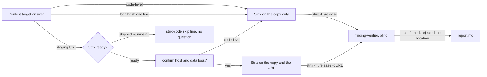
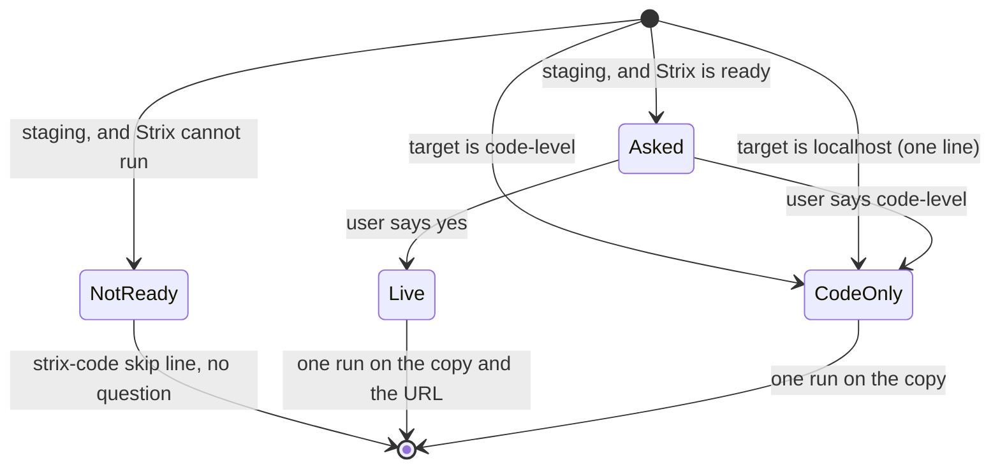
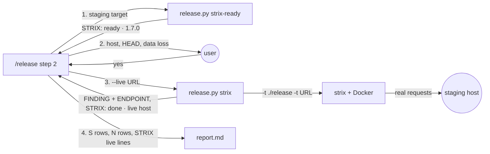

# Strix live

**Version:** v1 · **Status:** Draft · **Type:** Feature · **Project type:** CLI/Library

**Shape doc:** docs/specs/pentest-depth/shape.md
**Depends on:** strix-code

When the release pentest has a staging URL as its target, the Strix run also attacks that URL, next to the scratch copy. Each run, `/release` names the host and asks the user to confirm ownership and data loss, because zuko cannot hold Strix to one host or to reads only.

## Problem

`strix-code` runs Strix on the scratch copy only, and its instruction tells Strix to send no request to any host. A user who names a staging URL gets live A01 and A07 checks from the zuko pentester only. Strix can attack a URL with real requests in the same run (`strix -t ./release -t https://staging…`), but no zuko stage passes it one. Strix's requests go out from its Docker sandbox, so the `block-pentest-target.sh` guard (D28) never sees them, and no hook can hold them to reads only (D29).

## Slice test

| Check                         | Result |
| ----------------------------- | ------ |
| Cuts every layer it needs     | yes — `/release` step 2 asks the confirmation and passes the URL, `release.py strix` gives it to Strix, and the report and `cut` hold the live findings |
| One e2e test walks it         | yes — one e2e test cuts a release of a scratch repo with a staging target and a stub `strix` that checks its two targets and files two live findings, then checks the report and the block |
| Worth shipping alone          | yes — a staging release gets a second live attacker that the user already pays for |
| Fits (≤5 scenarios, ≤2 areas) | yes — 5 scenarios, 2 areas: the `/release` skill, and `release.py` with `strix.py` |

**Path:** full — the slice sends real requests to a host that no zuko guard covers, and adds a question and a report row.

## User story

As the person who runs `/release` against staging with an LLM key, I want Strix to attack the staging app next to the zuko pentester, so that a hole that only shows up in a live request can still block the release.

## Flow



`/release` asks the confirmation only for a staging target, and only when Strix can run. On yes, one Strix run attacks the copy and the URL. On every other path, Strix attacks the copy only, as `strix-code` does.

## States



Strix goes live only from `Asked`, and only on a yes. Every other state ends in the `strix-code` run on the copy, or in its skip line.

## Acceptance criteria

```gherkin
Scenario: a confirmed staging host gets one live Strix run
  Given invoice-api is tagged v2.6.0, and strix 1.7.0, STRIX_LLM, LLM_API_KEY and docker info are all ready
  And the user says yes to 2.6.1 with the target https://staging.invoice-api.example.net
  When /release asks "Strix will attack staging.invoice-api.example.net with real requests. zuko cannot hold it to this host or to reads only, and it may change or delete data there. Staging should run a1b2c3d, the release HEAD. Do you own this host and accept data loss on it? yes / code-level"
  And the user says yes
  Then one Strix run attacks ./release and https://staging.invoice-api.example.net, with --scan-mode standard and --max-budget 10
  And the summary prints "strix: 1.7.0 standard · live staging.invoice-api.example.net · $6.20 of $10 · 2 found · 1 confirmed · 1 needs validation"
  And the report lists "- STRIX 1.7.0 (standard, live · https://staging.invoice-api.example.net, anthropic/claude-sonnet-5-5) — 2 found, 1 confirmed, 1 needs validation · $6.20 of $10" under Assessed

Scenario: a live finding blocks by its code, and one with no code goes under Needs validation
  Given the live run files a high "Invoice of another customer readable by id" at invoice_api/routes.py:88, and the verifier confirms it
  And it files a medium "Admin export reachable without a session" with no code location, at GET /admin/export
  When /release runs release.py cut with that report
  Then cut prints "Pentest blocked v2.6.1: 1 high" and the S1 row, and writes nothing
  And the report lists the medium under Needs validation, with "GET /admin/export" as its Where and "Strix: Admin export reachable without a session" as its Description
  And the terminal prints the PoC path of each live finding

Scenario: the user keeps Strix to the code
  Given Strix is ready and the target is https://staging.invoice-api.example.net
  When the user answers code-level to the confirmation
  Then Strix attacks ./release only, as strix-code does, with no request to any host
  And the report lists "- STRIX live — code-level chosen for staging.invoice-api.example.net" under Not assessed
  And the zuko pentester's live run on staging goes on as it does today

Scenario: a localhost target keeps Strix to the code
  Given the user says yes to 2.6.1 with the target localhost, which starts "uv run flask --app invoice_api run --port 5000"
  When /release starts Strix
  Then it asks no confirmation, and prints "Strix live skipped: the Strix sandbox cannot reach 127.0.0.1:5000; Strix attacks the code only"
  And the report lists "- STRIX live — skipped: localhost target" under Not assessed

Scenario: no confirmation when Strix cannot run or the target is code-level
  Given the target is https://staging.invoice-api.example.net, and neither the environment nor ~/.strix/cli-config.json sets LLM_API_KEY
  When /release starts Strix
  Then it asks no confirmation, and prints "Strix skipped: no LLM_API_KEY in the environment or ~/.strix/cli-config.json"
  And with the target code-level, /release asks no confirmation and runs Strix on the copy as strix-code does
```

## Scope

**In:**

- One confirmation question for each run, for a staging target, only when Strix is ready. Its answers are `yes` and `code-level`.
- On yes, the one Strix run of the release gets the URL as a second target, with the same standard mode and $10 budget (D115).
- The Strix instruction for a live run names the one host, and asks Strix to read, and to change only data that it created. This is a request in a prompt, not a guard.
- Live findings go through the `strix-code` path: a code location in the release's files goes to a blind verifier and blocks by D10. No code location goes under Needs validation, with the method and endpoint as its Where (D113).
- A localhost target keeps Strix to the code, with one line that says why.
- The report and the summary say whether Strix went live, and on which host.

**Out:**

- Strix against localhost — not doing in this slice. On Linux, `host.docker.internal` reaches the Docker bridge, not an app bound to 127.0.0.1. A later slice can add it with a reachability check.
- Test accounts from zuko — not doing. Strix has the source in the copy and can find seed accounts itself. No secret goes to the LLM provider.
- A guard that holds Strix to one host or to reads only — not doing. Strix sends its requests from its own sandbox. The confirmation is the control (shape O6).
- A second Strix run, or a larger budget, for a live release — not doing. One run with $10 keeps 10 releases a month (D115).
- Blocking on a live finding with no code location — not doing. It has no verifier, so it never blocks (D113).

## Interface

The slice adds one `release.py` command, one flag on `release.py strix`, one question in `/release`, and a `live` part in the Strix lines and the report. `cut` reads the report as it does today.



For a staging target, `/release` checks that Strix can run before it asks. On yes, it passes the URL to `release.py strix`, which gives Strix two targets. The blocks come back with an endpoint, and the report says where Strix went live.

### 1. `release.py strix-ready`

```text
python3 release.py strix-ready <repo-root>
```

It runs the readiness check of `release.py strix`, and runs no scan. It prints one line and exits 0:

| Line | Means | `/release` does |
| --- | --- | --- |
| `STRIX: ready · 1.7.0` | `strix` 1.7.0 or newer, both keys, and `docker info` answer | asks the confirmation (2) |
| `STRIX: missing · strix-agent 1.7.0` | no `strix` on PATH | the `strix-code` install question, then `strix-ready` again |
| `STRIX: skipped · <why>` | the same reasons as `release.py strix` | prints `Strix skipped: <why>`, asks nothing, runs no Strix |

`/release` runs it only for a staging target. For a code-level or localhost target, step 2 runs `release.py strix` as `strix-code` does.

### 2. The confirmation

Asked once for each run, after `STRIX: ready`, with the host of the target and the short HEAD:

```text
Strix will attack staging.invoice-api.example.net with real requests. zuko cannot hold it to this host or to reads only, and it may change or delete data there. Staging should run a1b2c3d, the release HEAD. Do you own this host and accept data loss on it? yes / code-level
```

- `yes` → `release.py strix` with `--live <the target URL>`.
- `code-level` → `release.py strix` with no `--live`, as `strix-code` does.
- Any other reply → code-level, and the terminal prints `Strix live skipped: the reply was not yes; Strix attacks the code only`.

zuko does not check what staging runs.

### 3. `release.py strix --live`

```text
python3 release.py strix <repo-root> --scratch <dir> --files <path>,<path>,... --live https://staging.invoice-api.example.net
```

- It runs `strix -n -t ./release -t https://staging.invoice-api.example.net --scan-mode standard --max-budget 10 --scope-mode full --instruction-file instruction.md`, from `<scratch>`.
- The instruction file names the URL in place of "Send no request to any host":

  ```text
  This pentest also attacks the running app at https://staging.invoice-api.example.net.
  Send requests to staging.invoice-api.example.net only.
  Read data. Change or delete only data that you created in this run.
  Run no load or denial-of-service test.
  ```

- It refuses a `--live` value that is not an `http` or `https` URL, or whose host is `localhost`, a loopback address or `0.0.0.0`. It prints this to stderr, runs nothing, and exits 2, as each other usage error:

  ```text
  release.py: --live takes a staging URL; 127.0.0.1 is this machine, which the Strix sandbox cannot reach
  ```

With `--live`, each `FINDING` block has an `ENDPOINT:` line after `FILE:`. It holds Strix's `method` and `endpoint`, or `none`:

```text
FINDING S2
STRIX-ID: vuln-0002
SEVERITY: medium
CWE: CWE-306
TITLE: Admin export reachable without a session
FILE: none
ENDPOINT: GET /admin/export
SNIPPET: none
POC: /tmp/…/strix_runs/invoice-api-c3d4/vulnerabilities/vuln-0002.md
```

A run without `--live` prints its blocks as `strix-code` does, with no `ENDPOINT:` line.

The `done` and `stopped` lines get `live <host>` after the scan mode. The other last lines do not change:

```text
STRIX: done · 1.7.0 · standard · live staging.invoice-api.example.net · anthropic/claude-sonnet-5-5 · $6.20 of $10 · 2 found
```

### 4. The report

| Strix result | Where it goes | Example |
| --- | --- | --- |
| confirmed live finding with a code location | `## Findings`, as `strix-code` does | `\| S1 \| high \| A01:2025 Broken Access Control (CWE-639) \| invoice_api/routes.py:88 get_invoice \| Invoice of another customer readable by id \|` |
| live finding with no code location | `## Needs validation`, with `ENDPOINT` as its Where | `\| N2 \| A01:2025 Broken Access Control (CWE-306) \| GET /admin/export \| Strix: Admin export reachable without a session \| whether Strix's request reaches code in this release: Strix gave no code location \|` |
| a live run that finished | `## Assessed` | `- STRIX 1.7.0 (standard, live · https://staging.invoice-api.example.net, anthropic/claude-sonnet-5-5) — 2 found, 1 confirmed, 1 needs validation · $6.20 of $10` |
| the user chose code-level, or replied with no yes | `## Not assessed` | `- STRIX live — code-level chosen for staging.invoice-api.example.net` |
| a localhost target | `## Not assessed` | `- STRIX live — skipped: localhost target` |

When Strix itself is skipped or does not finish, the report has only the `strix-code` line, such as `- STRIX — skipped: no LLM_API_KEY`.

### 5. Terminal lines

Before a live run:

```text
Strix running: standard · live staging.invoice-api.example.net · up to $10 · in the background, next to the pentester
```

For a localhost target:

```text
Strix live skipped: the Strix sandbox cannot reach 127.0.0.1:5000; Strix attacks the code only
```

In the step 2 summary and the step 7 report:

```text
              strix: 1.7.0 standard · live staging.invoice-api.example.net · $6.20 of $10 · 2 found · 1 confirmed · 1 needs validation
  strix     1.7.0 standard · live staging.invoice-api.example.net · $6.20 of $10 · 1 confirmed · 1 needs validation
```

After the pentester's proofs, the PoC path of each live finding, confirmed or under Needs validation:

```text
S1  /tmp/…/strix_runs/invoice-api-c3d4/vulnerabilities/vuln-0001.md
N2  /tmp/…/strix_runs/invoice-api-c3d4/vulnerabilities/vuln-0002.md
```

## Open items

| ID | What | Type | Raised at | Owner | Status | Answer |
| --- | --- | --- | --- | --- | --- | --- |
| O1 | Which host does Strix attack live? `/release` already asks "Pentest target: localhost, a staging URL, or code-level?" for the zuko pentester. | question | spec p1 | user | Resolved | The same target as the pentester. No second target question, only the confirmation, 2026-11-09 |
| O2 | Strix 1.7.0 rewrites a localhost target to `host.docker.internal` (`strix/interface/scan_setup.py:205`), mapped to `host-gateway` (`strix/runtime/docker_client.py:233`). On Linux that reaches the Docker bridge, not an app bound only to 127.0.0.1, as Flask is by default. Read in the source, not run. What does Strix do with a localhost target? | question | spec p1 | user | Resolved | Strix goes live only on a staging URL. With localhost it stays code-level, and one line says why, 2026-11-09 |
| O3 | Each run, `/release` asks the user to confirm ownership and data loss for the host. What happens on no? | question | spec p1 | user | Resolved | Strix attacks the copy only, as `strix-code` does. The zuko pentester's live run is not affected, 2026-11-09 |
| O4 | How do the live attack and the code attack share the budget? D115 sets standard mode with $10 for each run. | question | spec p1 | user | Resolved | One Strix run gets the copy and the URL, with $10. D115 stands, 2026-11-09 |
| O5 | A live Strix finding can have no code location, only an endpoint and a method. Today a `FILE: none` block goes under Needs validation, unjudged (D113). What happens to a live finding with no code location? | question | spec p1 | user | Resolved | Needs validation, as D113 says. Its Where is the method and the endpoint. It never blocks, 2026-11-09 |
| O6 | Does zuko give Strix test accounts for the staging host? | question | spec p1 | user | Resolved | No. Strix has the source in the copy and finds seed accounts itself. No secret goes into the instruction file, 2026-11-09 |
| O7 | Which answers does the confirmation offer? | question | spec p1 | user | Resolved | `yes / code-level`, with the host, the missing guard and the data loss named in the question, 2026-11-09 |
| O8 | Shape O6 says that a D-entry at this spec records that D28 and D29 do not cover Strix. (from shape O6) | flag | shape | user | Resolved | The D-entry is drafted at pause 3, 2026-11-09 |
| O9 | Strix attacks whatever staging runs, which may not be the release HEAD. The verifier judges a finding against HEAD. | flag | spec p2 | user | Resolved | The confirmation names the short HEAD: "Staging should run a1b2c3d, the release HEAD". zuko does not check what staging runs, 2026-11-09 |
| O10 | What does a reply other than yes or code-level to the confirmation do? | question | spec p2 | user | Resolved | Code-level. Only an exact yes sends Strix live, and the terminal says so, 2026-11-09 |

_Never delete this section or its rows. See references/ledger.md._

## Glossary

- **Strix** — an open-source AI pentest tool (`usestrix/strix`). It runs its agents in Docker and calls an LLM with your own key.
- **Pentest** — a penetration test: an attack on your own code to find holes before someone else does.
- **Staging** — a copy of the app deployed for testing, separate from production.
- **Scratch copy** — the copy of the release that `git archive` puts in a temporary folder, where the attackers run their proofs.
- **Blind verifier** — an agent that judges one finding from the claim and the code only, without the reasoning of whoever found it.
- **host.docker.internal** — the name that a Docker container uses to reach the machine that runs it. On Linux it reaches the Docker bridge, not 127.0.0.1.
- **PoC** — proof of concept: the steps or requests that show a hole is real.
- **e2e** — end-to-end: one test that walks the whole slice as a user would.
