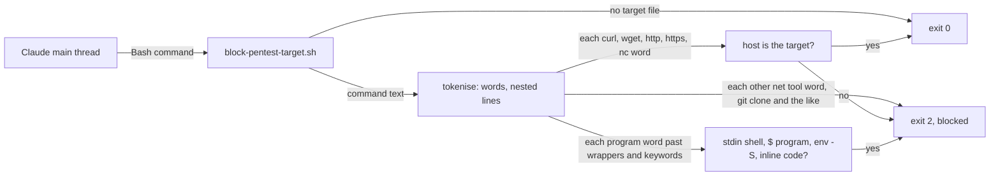
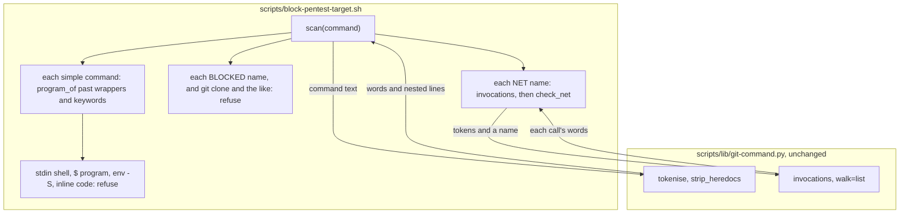
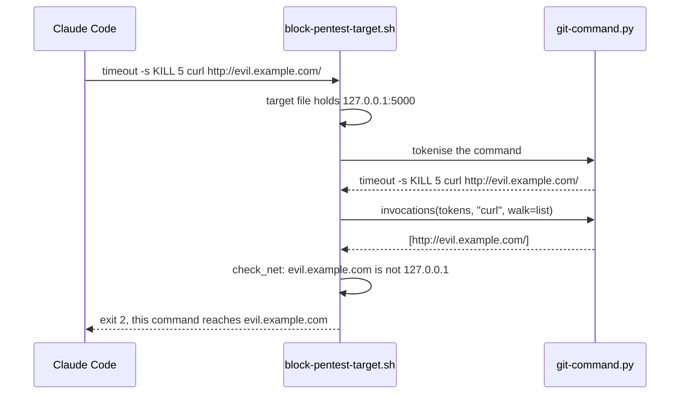

# target wrappers

**Version:** v1 · **Status:** Built · **Type:** Bug · **Project type:** CLI/Library

**Shape doc:** docs/specs/guard-leads/shape.md
**Depends on:** None

During a live pentest, the target guard in `block-pentest-target.sh` judges
each curl, wget, httpie and nc that bash runs. It blocks the network tools
and the commands that it cannot read. This closes leads v2.6.0 N2, N4 and
v2.7.0 N5.

## Problem

The guard reads only the first word of each simple command. It skips
`NAME=value` and a wrapper word, but not the wrapper's options, so
`timeout 5 curl` reads as the program `5`. It knows seven tool names, and
it does not read a keyword, a shell that reads stdin, or a `$` program.

I ran these inputs against the real hook on 2026-11-16, in a scratch repo
whose `.git/zuko-pentest-target` holds `127.0.0.1:5000`. In each one, `URL`
is `http://evil.example.com/`.

| Input | Exit |
| --- | --- |
| `curl URL`, `( curl URL )`, `eval curl URL`, `bash -c "curl URL"` | 2 |
| `timeout 5 curl URL`, `timeout -s KILL 5 curl URL`, `env -i curl URL`, `env -u HOME curl URL`, `nice -n 5 curl URL`, `sudo -u root curl URL`, `time -p curl URL`, `exec curl URL` | 0 |
| `if true; then curl URL; fi`, `for i in 1; do curl URL; done`, `while true; do curl URL; break; done`, `{ curl URL; }`, `! curl URL` | 0 |
| `echo curl URL \| sh`, `printf 'curl URL\n' \| sh -s`, `sh < cmds.txt`, `bash -s`, `C=curl; $C URL`, `"$C" URL`, `timeout 5 $C URL`, `env -S 'curl URL'` | 0 |
| `ssh`, `scp`, `rsync`, `socat`, `telnet`, `ftp`, `aria2c`, `xh`, `openssl s_client`, `nslookup`, `dig`, `ping`, `git clone`, `git fetch`, `git ls-remote` to `evil.example.com` | 0 |

Facts this slice rests on, each run on 2026-11-16:

- `tokenise` already reads the string of `bash -c` and the words after
  `eval` as one more line. `bash -c "timeout 5 curl URL"` gives the line
  `timeout 5 curl URL`.
- `invocations(tokens, "curl", walk=list)` finds each `curl` word with all
  its words, after any wrapper or keyword: `then curl URL` gives `[URL]`.
- `tokenise` keeps `$C` and `"$C"` as the word `$C`, and splits `$( )` and
  backticks into their own commands.
- The release step's own commands in the window still pass today:
  `curl -s http://127.0.0.1:5000/health`, `kill 48211`, `git rev-parse
  --short HEAD`, `python3 .../release.py pick .` and
  `bash .../check-attack-pin.sh`.

## Slice test

| Check                         | Result                                                                          |
| ----------------------------- | ------------------------------------------------------------------------------- |
| Cuts every layer it needs     | Yes. The guard and the test that runs the real hook                             |
| One e2e test walks it         | Yes. `test-block-pentest-target.sh` feeds the real hook a payload for each form |
| Worth shipping alone          | Yes. It closes v2.6.0 N2, N4 and v2.7.0 N5                                      |
| Fits (≤5 scenarios, ≤2 areas) | Yes. 4 scenarios, 1 area (scripts)                                              |

**Path:** light. A bug fix in 2 files, with no new interface, data or
dependency. Pauses 1 and 3 merged, pause 2 skipped.

## Flow



The guard does nothing when no target file exists. With the file, each net
tool word is judged, wherever bash runs it. A command whose program or
script the guard cannot read is blocked.

## Acceptance criteria

```gherkin
Scenario: a wrapper, a keyword or a pipe does not hide a net tool
  Given .git/zuko-pentest-target holds 127.0.0.1:5000
  When block-pentest-target.sh judges timeout -s KILL 5 curl http://evil.example.com/
  Then it exits 2 with "Blocked: the pentest target is 127.0.0.1:5000; this command reaches evil.example.com."
  And timeout 5 curl, env -i curl, env -u HOME curl, nice -n 5 curl, sudo -u root curl, time -p curl and exec curl to http://evil.example.com/ are blocked the same way
  And if true; then curl ...; fi, for i in 1; do curl ...; done, while true; do curl ...; break; done, { curl ...; } and ! curl ... to http://evil.example.com/ are blocked the same way
  And echo curl http://evil.example.com/ | sh and /usr/bin/curl http://evil.example.com/ are blocked the same way

Scenario: a command the guard cannot read is blocked
  Given .git/zuko-pentest-target holds 127.0.0.1:5000
  When block-pentest-target.sh judges printf 'curl http://evil.example.com/\n' | sh -s
  Then it exits 2 with "could reach the network in a way the guard cannot check"
  And sh < cmds.txt, bash -s, C=curl; $C http://evil.example.com/, "$C" http://evil.example.com/, timeout 5 $C http://evil.example.com/ and env -S 'curl http://evil.example.com/' are blocked the same way
  And grep -rn curl docs/ is blocked the same way, because each curl word is judged and this one has no host (O1)

Scenario: a network tool that the guard does not read is blocked
  Given .git/zuko-pentest-target holds 127.0.0.1:5000
  When block-pentest-target.sh judges ssh evil.example.com
  Then it exits 2 with "could reach the network in a way the guard cannot check: ssh is not curl, wget, httpie or nc"
  And scp, sftp, rsync, socat, telnet, ftp, tftp, aria2c, xh, openssl, nmap, ping, dig, nslookup and host are blocked the same way
  And git clone, git fetch, git pull, git push and git ls-remote are blocked the same way, also as git -C /tmp clone

Scenario: the release step's own commands still pass
  Given .git/zuko-pentest-target holds 127.0.0.1:5000
  When block-pentest-target.sh judges curl -s http://127.0.0.1:5000/health
  Then it exits 0 and prints nothing
  And timeout 5 curl http://127.0.0.1:5000/, curl -s http://127.0.0.1:5000/api | jq ., kill 48211 and git rev-parse --short HEAD exit 0
  And python3 plugins/zuko/scripts/lib/release.py pick . and bash plugins/zuko/scripts/check-attack-pin.sh exit 0 (O4)
  And with no target file, ssh evil.example.com, printf 'curl x' | sh and C=curl; $C x exit 0
```

## Scope

**In:**

- Each `curl`, `wget`, `http`, `https`, `nc`, `ncat` and `netcat` word that
  bash runs, by name or by path, after any word, in a `bash -c` or `eval`
  string. Each one is judged by host, as today (O1).
- These tools are blocked outright: `ssh`, `scp`, `sftp`, `rsync`, `socat`,
  `telnet`, `ftp`, `tftp`, `aria2c`, `xh`, `openssl`, `nmap`, `ping`, `dig`,
  `nslookup`, `host`, and `git clone`, `fetch`, `pull`, `push` and
  `ls-remote` (O2).
- A shell that reads its commands from stdin: no `-c` string and no script
  file, or `-s`. A program word that starts with `$`. `env -S` and
  `env --split-string`. Each one is blocked as a command that the guard
  cannot check (O3).
- The program word is found past `NAME=value`, the shell keywords, and each
  wrapper with its options, so the stdin-shell, `$` and inline-code checks
  read `timeout 5 $C` and `sudo -u root python3 -c ...`.

**Out:**

- A shell or interpreter that runs a script file, such as `bash probe.sh` or
  `python3 probe.py`. The file can hold a curl. The release step runs
  `bash check-attack-pin.sh` and `python3 release.py` in the window, and D14
  stops commands, not code (O4).
- A `$` program after a wrapper that the guard does not know, such as
  `stdbuf -o0 $C URL`. A net tool's name is still read in each position.
- The `#@` and header leads (v2.6.0 N3, v2.7.0 N4). The guard already blocks
  them (shape, Not doing).
- Strix's own requests, which leave from its Docker sandbox (D120).

## Technical plan

### Approach

Three checks replace the walk of the first word in `scan`. Each net tool name
goes through `invocations` from `git-command.py`, as the git guards find git.
Each name in a new block list is refused. A `program_of` that reads past
wrapper options and keywords finds the program for the stdin-shell, `$`,
`env -S` and inline-code checks. The recursion into `-c` strings goes,
because `tokenise` already reads them (D138).

Relies on: D14, D27, D28, D52 (a command the parser cannot read is blocked),
D138 (a nested command is a command), D139 (a path to a program is that
program), D150 (a wrapper list misses one), and the drafted entries below.





### Changes

| File | Change |
| --- | --- |
| `plugins/zuko/scripts/block-pentest-target.sh:116` | Take `invocations` and `EVAL_LEADS` from `git-command.py` with the other helpers. |
| `plugins/zuko/scripts/block-pentest-target.sh:122` | New `BLOCKED` set (O2) and `GIT_NET = {"clone", "fetch", "pull", "push", "ls-remote"}`. `WRAPPERS` gains `exec`. New `WRAPPER_VALUES`: the options that take a value, such as `-u` for `sudo`, `-s` and `-k` for `timeout`, `-n` for `nice`, and `-u` and `-C` for `env`. |
| `plugins/zuko/scripts/block-pentest-target.sh:165` | `program_of` skips `NAME=value`, each `EVAL_LEADS` word, and each wrapper with its options, their values and the duration of `timeout`. `env -S` and `--split-string` refuse the command (O3). |
| `plugins/zuko/scripts/block-pentest-target.sh:219` | `scan` tokenises once. For each `NET` name, each call from `invocations(tokens, name, walk=without_redirections)` goes to `check_net`. A `BLOCKED` call, or a git call whose subcommand is in `GIT_NET`, refuses with "NAME is not curl, wget, httpie or nc". For each simple command, a program that starts with `$`, a shell with no `-c` string and no script file or with `-s`, and an interpreter with inline code refuse. `inline_value` and the depth argument go. |
| `plugins/zuko/scripts/block-pentest-target.sh:143` | `simple_commands` goes on with the outer command after a `$( )`, `<( )`, `>( )` or backtick, and drops the words of a `$(( ))` or `(( ))` (O5). |
| `plugins/zuko/scripts/tests/test-block-pentest-target.sh` | Each form in the scenarios through `blocks` and `allows`, with the 127.0.0.1:5000 target. |

Reusing: `tokenise`, `strip_heredocs`, `invocations`, `program_word` (it
reads `/usr/bin/curl` and `CURL.EXE` as curl), `EVAL_LEADS`, `check_net`,
`block_unverifiable`, and `blocks` and `allows` in the tests.

### Earn-it

- `BLOCKED` and `GIT_NET`: scenario 3. A name list is the smallest rule
  that refuses them (O2).
- `WRAPPER_VALUES`: scenario 2 needs `timeout 5 $C` to read `$C` as the
  program. Without the values, `sudo -u root` reads `root` as the program.

### Non-functionals

- **Load:** the guard reads only while the target file exists, during a
  live `/release`. It adds 24 `invocations` passes over the tokens, each
  linear in the command length.
- **At 10×:** the 64 KB limit of `tokenise` holds, and a long command is
  refused as one that will not parse.
- **Security surface:** the main thread's Bash commands during a live
  pentest. It trusts nothing in the command. It reads the target file and
  git's config in the dirs that the command names, as `tokenise` already
  does. It reads no secrets and stores nothing.
- **Proof it works**: `Blocked: the pentest target is 127.0.0.1:5000` on
  stderr for each blocked form in the scenarios, and the next release
  pentest lists no target-guard lead under Needs validation.
- **Rollout**: no flag. Rollback is `git revert` of the fix commit. With no
  target file the guard passes every command, so outside a live pentest
  nothing changes.

### Test plan

| Scenario | Test |
| --- | --- |
| 1, 2, 3 | `test-block-pentest-target.sh`: each form through `blocks`, with the message regex |
| 4 | the same file: each form through `allows`, with and without the target file |

**Command:** `bash plugins/zuko/scripts/tests/run.sh`

**E2E:** `test-block-pentest-target.sh` runs the real hook script on each
payload, as Claude Code runs it. `test-e2e-pentest-live.sh` must stay green,
because it sends the release step's curls through the guard.

**Replay:** a scratch script runs each logged Bash command through the hook
at the base and at the build, with a target file. It lists each command
whose exit code changes. The script and its output stay in the scratchpad,
because the logs hold private data. A new block of a command that the
release step runs in the window is a bug in the build.

**Result (2026-11-16):** `run.sh block-pentest-target` 166 passed, 0 failed.
The same test file against the guard on `main` fails 88 checks: 44 blocked
forms exit 0. `run.sh` 4814 passed, 0 failed, 2 skipped. An earlier run while
the replay loaded the machine failed 7 timed checks in `block-dangerous` and
`scope-pentester-bash`. Both files passed when they ran alone.

**Replay result (2026-11-16):** 27219 distinct logged commands, with
`127.0.0.1:5000` in the target file. 1366 are newly blocked and 0 newly pass.
Of the new blocks, 1075 are git network calls, 77 reach another host, 62
have a `$` program, 56 run inline code past a wrapper or keyword, 54 hold the word
`host`, 31 are a curl word with no host, and 11 are other cases. No changed
command touches `zuko-pentest-target`. The first two replays found the false
blocks in O5.

### Chunks

Single chunk.

### Risks

- **A false block during a live pentest.** `grep curl`, `git log -S ssh` and
  `echo host` now stop while the target file exists. O1 accepted it. The
  block costs a retry, and the file is gone after teardown.
- **A release step that needs a blocked tool.** No step in
  `skills/release/SKILL.md` runs one between writing and removing the target
  file. The replay and `test-e2e-pentest-live.sh` check it.

### Decisions to record

Recorded as D160, D161, D162.

## Review

2026-11-16 · 11 raw findings, 5 survived, 5 fixed, 1 lead needs validation.

- A01 Broken Access Control · `plugins/zuko/scripts/block-pentest-target.sh:195` · drop the fd number of a leading redirection, so `2>/dev/null $C` reads `$C` as the program · `56e8dc0`
- A01 Broken Access Control · `plugins/zuko/scripts/block-pentest-target.sh:265` · read past `function NAME` and `coproc` to the program · `be90fcb`
- A01 Broken Access Control · `plugins/zuko/scripts/block-pentest-target.sh:275` · refuse each prefix of `env --split-string` from `--s` · `afc89c3`
- A01 Broken Access Control · `plugins/zuko/scripts/block-pentest-target.sh:244` · a value option at the end of a short group, or a unique prefix of a long one, takes the next word · `fdc98bf`
- A01 Broken Access Control · `plugins/zuko/scripts/block-pentest-target.sh:300` · block a shell whose script is `/dev/stdin`, and `source` or `.` with no file or a stdin path · `45051e4`
- needs validation · `plugins/zuko/scripts/block-pentest-target.sh:365` · whether Git Bash on Windows has `sh.exe` on PATH for the hook's Bash calls, since the stdin-shell check compares `sh.exe` to SHELLS as typed · in Git Bash on Windows, run `type sh.exe bash.exe`

## Open items

| ID | What | Type | Raised at | Owner | Status | Answer |
| --- | --- | --- | --- | --- | --- | --- |
| O1 | During a live pentest, where does the guard look for a net tool's name? Today it reads only the first word, past wrappers with no options. | question | spec p1 | user | Resolved | Every word, as the git guards do (D150). `grep -rn curl docs/` is blocked while a live pentest runs. 2026-11-16 |
| O2 | Which network tools beyond curl, wget, httpie and nc does the guard stop? | question | spec p1 | user | Resolved | A fixed list, blocked outright: `ssh`, `scp`, `sftp`, `rsync`, `socat`, `telnet`, `ftp`, `tftp`, `aria2c`, `xh`, `openssl`, `nmap`, `ping`, `dig`, `nslookup`, `host`, and `git clone`, `fetch`, `pull`, `push` and `ls-remote`. 2026-11-16 |
| O3 | What does the guard do with a shell that reads stdin, and a `$` program word? | question | spec p1 | user | Resolved | Block both as a command that the guard cannot check. 2026-11-16 |
| O4 | A shell or interpreter that runs a script file passes, and the file can hold a curl. | question | spec p1 | user | Accepted risk | The release step runs `bash check-attack-pin.sh` and `python3 release.py` in the window. D14 stops commands, not code, and no lead names a script file. 2026-11-16 |
| O5 | The replay showed false blocks of the new `$` rule. `simple_commands` ended a command at the `)` of a `$( )`, so in `tail -n +$(grep ...) $G/body.md` the word `$G/body.md` read as a program. It also read the words of `$(( ... ))` and `(( ... ))` as a command. | flag | build | user | Decided alone | Chose: the splitter goes on with the outer command after a substitution, and drops arithmetic words. Other: accept the false blocks, which happen only while the target file exists. Undo: `git revert` the three `simple_commands` commits, `cb4d739`, `2947ad1` and `47cc195`. 2026-11-16 |

_Never delete this section or its rows. See references/ledger.md._

## Glossary

- **Pentest** — a penetration test: an attack on your own code to find holes before someone else does.
- **Live pentest** — the `/release` mode that sends real requests to a running app, with the target host in `.git/zuko-pentest-target`.
- **E2E** — an end-to-end test: it runs the real hook script as Claude Code runs it.
- **Lead** — a hole that a pentest traced but could not prove. The report lists it under Needs validation, with no severity.
- **Guard** — a zuko hook that reads a Bash command before it runs, and blocks it with exit 2.
- **Wrapper** — a program that runs another program, such as `timeout`, `env`, `nice` or `sudo`.
- **Tokenise** — split a command into the words that bash gives the program, with quotes removed.
- **Replay** — run each Bash command from the session logs through the old and the new hook, and list each verdict that changes.
- **Light path** — zuko's short route for a small bug fix: one pause in place of three, and one reviewer.
