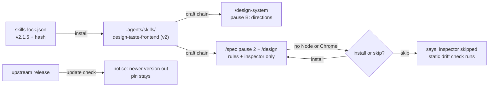
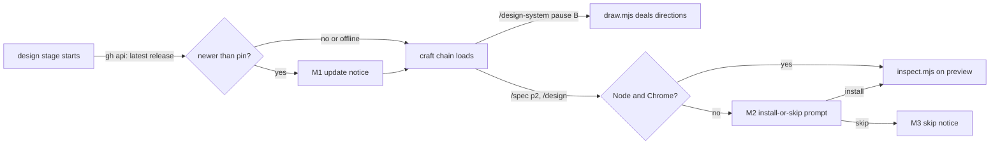
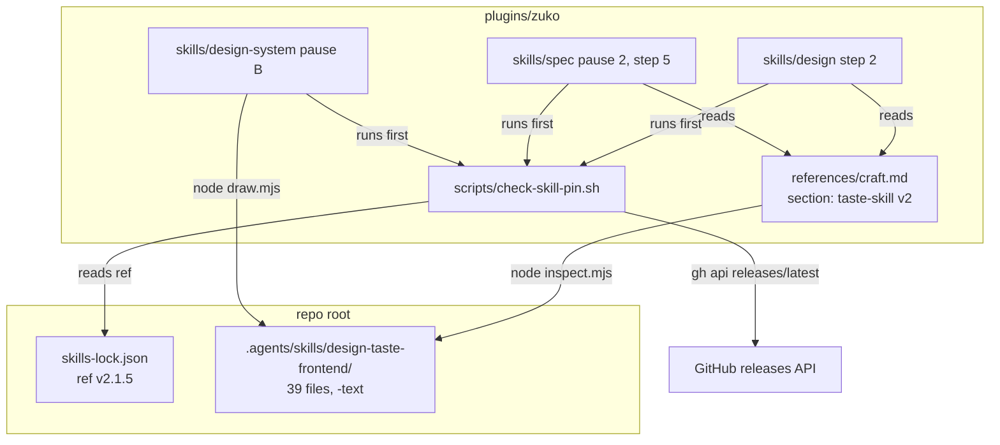
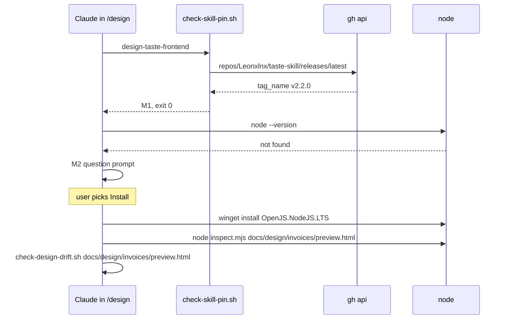

# Taste skill upgrade

**Version:** v1 · **Status:** Shipped · **Type:** Enhancement · **Project type:** CLI/Library
**Depends on:** None
**Page:** https://claude.ai/artifact/Q3Ag4zh5UGg8JV5W2aQBuf

The repo moves its vendored `design-taste-frontend` skill from the stale v1 copy to
upstream v2.1.5, and the zuko design stages say which parts of v2 they use. The lock
points at a path that already holds v2, so the next skills update would make this
change without anyone choosing it. Issue #121.

## Problem

- `.agents/skills/design-taste-frontend/SKILL.md` is one 1206-line file from
  2026-10-05. That is before upstream 2.0.0 on 2026-10-13.
- `skills-lock.json` points at `Leonxlnx/taste-skill`, `skills/taste-skill/SKILL.md`.
  That path holds v2.1.5 today, so the lock hash and the upstream file do not agree.
- A re-run of the skills tool replaces v1 with v2 silently. v2 is 39 files and 2.4 MB,
  with Node scripts and a direction library. No zuko stage was written for it.
- Only `plugins/zuko/skills/spec/SKILL.md:130` names the skill. `/design` and
  `/design-system` do not name it.
- v2 deals its own design directions. zuko says that one design system is the product's
  identity, and a slice composes from it. Without a rule, v2 can pull a slice away
  from the system.

## Slice test

| Check                         | Result                                                                              |
| ----------------------------- | ----------------------------------------------------------------------------------- |
| Cuts every layer it needs     | yes: vendored skill, lock, and the three stage files that load it                    |
| One e2e test walks it         | yes: one test checks the lock against the vendored files and the stage craft chains |
| Worth shipping alone          | yes: the silent swap risk goes, and the design stages get v2 on purpose              |
| Fits (≤5 scenarios, ≤2 areas) | yes: 5 scenarios, two areas (vendored skills, zuko design stages)                    |

**Path:** full. v2 is a new 40-file dependency that changes three stages, so this is
more than a version bump.

**Split out:** the rendered check (port of the v2 inspector idea next to
`check-design-drift.sh`) is the next slice, `rendered-drift-check`. It is a new
script with its own tests.

## Flow



The lock pins v2.1.5, the vendored folder matches it, and each design stage loads v2
for the part it uses. When Node is missing, the stage asks to install it or to skip.

## Acceptance criteria

```gherkin
Scenario: The vendored skill is v2.1.5 and the lock agrees
  Given skills-lock.json pins Leonxlnx/taste-skill at tag v2.1.5
  When the lock check runs on .agents/skills/design-taste-frontend
  Then the folder holds the 39 files of skills/taste-skill at v2.1.5
  And the hash in skills-lock.json matches those files

Scenario: A new upstream release is announced, not installed
  Given upstream publishes v2.2.0 after this slice ships
  When /design starts and its update check runs
  Then the vendored folder stays at v2.1.5
  And the user sees "design-taste-frontend: v2.2.0 is out, pinned at v2.1.5"
  And a move to v2.2.0 needs an edit to the pin in skills-lock.json

Scenario: /design-system uses the v2 direction library
  Given a product with no design system
  When /design-system reaches pause B, the direction test
  Then the craft chain names design-taste-frontend
  And the candidate directions can come from the v2 direction library

Scenario: /spec pause 2 and /design compose from the system, not from v2 directions
  Given a product whose design system has the tokens for the "Invoices" screen
  When /spec pause 2 or /design loads the craft chain
  Then the v2 house rules and the v2 inspector apply to the preview
  And no direction is dealt from the v2 library
  And every token in the preview comes from the design system

Scenario: Node or Chrome is not installed
  Given a machine without Node on the PATH
  When a design stage would run the v2 inspector
  Then the stage asks the user to install Node now or to skip the inspector
  And on install, the stage installs Node and then runs the inspector
  And on skip, the stage prints "v2 inspector skipped: Node not found"
  And the static check-design-drift.sh runs on the preview in both cases
```

## Scope

**In:**

- Re-vendor `skills/taste-skill` at v2.1.5 into `.agents/skills/design-taste-frontend/`.
- Pin the lock to v2.1.5 and update its hash.
- Name the skill in the craft chain of `/design` and `/design-system`, and say which
  part of v2 each design stage uses. `/spec` already names it.

**Out:**

- The rendered check next to `check-design-drift.sh`: slice `rendered-drift-check`.
- Ship v2 inside `plugins/zuko` for zuko users: not planned. The craft chain already
  says "whichever are installed".
- The `.claude/skills/*` links. On this Windows checkout they are 42-byte text files,
  because `core.symlinks` is false. This is a local Git setting, not a repo defect.
- `decisions.py active` fails on Windows with `UnicodeEncodeError` on `→`, because
  stdout is cp1252. That is why the session start says that `DECISIONS.md` could not
  be read. It is a separate bug for `/debug`.

## Interface

The interface is the craft-chain text in three stage files and four messages that the
user sees. There is no new command.



Each design stage checks the pin first, then loads the chain. Only `/design-system`
deals directions. The other two stages run the inspector, or ask before they skip it.

### Craft-chain text

| Stage file                                            | What v2 does there                                                                                   |
| ----------------------------------------------------- | ---------------------------------------------------------------------------------------------------- |
| `plugins/zuko/skills/design-system/SKILL.md` pause B  | `design-taste-frontend` deals the candidate directions with `scripts/draw.mjs`. The user picks one.   |
| `plugins/zuko/skills/spec/SKILL.md` pause 2, step 5   | House rules and `scripts/inspect.mjs` only. Do not run `draw.mjs`. Tokens come from the design system. |
| `plugins/zuko/skills/design/SKILL.md` step 2          | The same as `/spec` pause 2.                                                                          |

The chain order stays `frontend-design` → `design-taste-frontend` → `shadcn`, each
only when it is installed.

### Messages

| ID | When                                    | Text                                                                                                      |
| -- | --------------------------------------- | --------------------------------------------------------------------------------------------------------- |
| M1 | Upstream has a release newer than the pin | `design-taste-frontend: v2.2.0 is out, pinned at v2.1.5. Edit the pin in skills-lock.json to move.`       |
| M2 | Node or Chrome is missing               | Question prompt: "The v2 inspector needs Node. Node is not installed. Install it now?" Answers: "Install Node (Recommended)" and "Skip the inspector". |
| M3 | The user skips                          | `v2 inspector skipped: Node not found. check-design-drift.sh ran on docs/design/invoices/preview.html.`   |
| M4 | The install fails                       | `Node install failed: <installer output, last line>. v2 inspector skipped.` The drift check still runs.   |

M2 and M4 are about Node only: zuko installs no browser. When no browser is found, the stage prints `install Chrome, Edge or Chromium, or set CHROME_PATH` and skips (review F7). When
Node is older than 22, M2 says "The v2 inspector needs Node 22 or newer. Node v20.11.0
is installed." When the check is offline or `gh` is missing, no message shows and the
stage goes on.

## Technical plan

### Approach

The skills CLI re-vendors v2.1.5 with a `#v2.1.5` ref, so the lock records the ref and
the hash itself. One new script, `check-skill-pin.sh`, compares the pinned ref with the
latest upstream release. One new section in `craft.md` holds the v2 rules, so `/spec`
and `/design` read one text. A `.gitattributes` rule keeps the vendored bytes the same
on Windows and Linux, so that the hash agrees.

Relies on: D78, D79, D80 (drafted below). D22 and D26 stay as they are.



The three design stages run the pin check first. `/design-system` runs `draw.mjs`, and
the other two run `inspect.mjs` under the rules in `craft.md`.



`/design` gets the update notice, finds no Node, asks, installs it, then runs the
inspector and the static drift check.

### Changes

| File | What changes | Why |
| ---- | ------------ | --- |
| `.agents/skills/design-taste-frontend/` | Replaced by `npx skills add Leonxlnx/taste-skill#v2.1.5 --skill design-taste-frontend`. 39 files, 2.4 MB. | Scenario 1 |
| `skills-lock.json:3-8` | The CLI writes `"ref": "v2.1.5"` and the new `computedHash`. | Scenarios 1, 2 |
| `.gitattributes` (new) | `.agents/skills/** -text`. Git stores and checks out the bytes as they are. | Scenario 1: `src/local-lock.ts:194` hashes raw bytes, and this checkout turns LF into CRLF |
| `plugins/zuko/scripts/check-skill-pin.sh` (new) | Arg: a skill name. Reads its `source` and `ref` from `skills-lock.json` with `python3 -c`. Calls `gh api repos/{source}/releases/latest`. Prints M1 when the tag differs. Prints nothing and exits 0 when there is no entry, no `ref`, no `gh`, or no network. | Scenario 2 |
| `plugins/zuko/references/craft.md:93` | New section "taste-skill v2", after "References": which stage uses which part, the Node 22 and browser check, M2 to M4, and the installers from O7. | Scenarios 4, 5 |
| `plugins/zuko/skills/spec/SKILL.md:128-130` | Step 5: run `check-skill-pin.sh design-taste-frontend` first. For v2, use the "taste-skill v2" section of `craft.md`, and do not run `draw.mjs`. | Scenarios 2, 4 |
| `plugins/zuko/skills/design/SKILL.md:37-38` | Step 2 gets the same two lines as `/spec` step 5. | Scenarios 2, 4 |
| `plugins/zuko/skills/design-system/SKILL.md:97-100` | Pause B: run the pin check. When v2 is installed, `draw.mjs` deals the three candidate directions. The rejected ones go in the D-entry, as now. | Scenarios 2, 3 |
| `plugins/zuko/scripts/tests/test-skill-pin.sh` (new) | Unit tests with a stub `gh` on `PATH`: newer tag gives M1, same tag gives no output, no `gh` gives no output and exit 0, no lock entry gives exit 0. | Scenario 2 |
| `plugins/zuko/scripts/tests/test-e2e-taste-skill.sh` (new) | Walks the slice: the lock has `ref` v2.1.5, a Python copy of `computeSkillFolderHash` matches `computedHash`, `.gitattributes` has the rule, and the three stage files name the chain and the pin check. | Scenarios 1 to 4 |

Reusing: `run.sh` and its `expect_exit`, `expect_match` and `expect_no_match` helpers;
the stub-on-`PATH` pattern of the existing tests; `check-design-drift.sh` as it is.

### Earn-it

| Added | Triggered by |
| ----- | ------------ |
| `check-skill-pin.sh` | Scenario 2 needs a check that a test can run. A prompt rule that says "check upstream" cannot be tested. |
| `.gitattributes` rule | Scenario 1 fails on this Windows checkout without it: CRLF bytes give a different hash. |
| `craft.md` section | `/spec` and `/design` need the same v2 rules. One text keeps them in agreement. |

The script takes one skill name. It does not loop over every lock entry, because only
this skill has a pin.

### Non-functionals

|                      |                                                                                                    |
| -------------------- | -------------------------------------------------------------------------------------------------- |
| **Load**             | One `gh api` call each time a design stage starts. A few calls a day.                              |
| **Breaks first**     | The GitHub rate limit for anonymous calls (60 an hour). `gh` sends the user's token, so the limit is 5000. On a limit error, the script prints nothing. |
| **Security surface** | The script reads `skills-lock.json` from the project and sends `source` to `gh api` as one argument, never through a shell. Claude runs an installer only after the user picks "Install". No secrets. |
| **Proof it works**   | `design-taste-frontend: v2.2.0 is out, pinned at v2.1.5.` at the start of `/design`, the day upstream ships v2.2.0. |
| **Rollout**          | No flag. Rollback: `git revert` the slice commits. That puts back v1, the old lock and the old stage text. |

### Test plan

| Scenario | Test | Command |
| -------- | ---- | ------- |
| 1. The vendored skill is v2.1.5 and the lock agrees | `test-e2e-taste-skill.sh` | `bash plugins/zuko/scripts/tests/run.sh e2e-taste-skill` |
| 2. A new release is announced, not installed | `test-skill-pin.sh` | `bash plugins/zuko/scripts/tests/run.sh skill-pin` |
| 3. `/design-system` uses the direction library | `test-e2e-taste-skill.sh`: pause B names `draw.mjs` | as scenario 1 |
| 4. `/spec` and `/design` do not deal directions | `test-e2e-taste-skill.sh`: both name the `craft.md` section and "do not run `draw.mjs`" | as scenario 1 |
| 5. Node or Chrome is missing | Manual, on this machine: Node is not installed. Run `/design` on a preview, pick "Install", then confirm the inspector runs. | — |

**E2E:** `test-e2e-taste-skill.sh`. Scenario 5 is prompt behaviour and has no script, so
it is a manual check, done once in `/build` on this machine.

### Chunks

Single chunk. The vendored folder, the lock and `.gitattributes` must change in one
commit, or the hash test fails between commits.

### Risks

| Risk | Mitigation |
| ---- | ---------- |
| The Python hash does not sort paths the way JS `localeCompare` does (O6). | `/build` runs the real CLI first. When the test hash differs, fix the sort in the test before anything else. |
| Git normalises the vendored files on commit, before the `.gitattributes` rule applies. | Commit `.gitattributes` first in the same chunk. Then `git add --renormalize .agents/skills` and check that `git ls-files --eol` shows `-text`. |
| v2 instructions push their own house style against a product's design system in `/spec` and `/design`. | The `craft.md` section says that the design system's tokens win over the v2 house style. |
| `winget` asks for admin rights or a licence prompt. | That is the M4 path: print the last line, skip, and run the drift check. |

### Decisions to record

Recorded as D78, D79, D80.

## Review

2026-11-01 · 8 raw findings, 8 survived, 7 fixed, 1 recorded (A03 low, O12).

- A03 Software Supply Chain Failures · `skills-lock.json:6` · no change; the hash pins the bytes, recorded as O12 · `8ce43b8`
- correctness · `plugins/zuko/references/craft.md:135` · give `draw.mjs` its sector, brief and `--options 3` · `fb68d85`
- correctness · `plugins/zuko/references/craft.md:138` · deal pause B sheets with `--out .taste-skill/pause-b/<id>` · `52eac91`
- correctness · `plugins/zuko/references/craft.md:142` · run the Node check before any v2 script · `81ae58b`
- correctness · `plugins/zuko/references/craft.md:155` · no browser install; print how to get one and skip · `9341d0a`
- correctness · `plugins/zuko/references/craft.md:168` · give the skip line its real reason · `3a277da`
- correctness · `plugins/zuko/references/craft.md:161` · find a winget Node by its full path · `401fb7b`, `aff8174`
- correctness · `plugins/zuko/references/craft.md:136` · inspect app screens with `--app`, and say what a FAIL means · `73413b1`

## Open items

| ID  | What                                                                                                                           | Type     | Raised at | Owner | Status | Answer |
| --- | ------------------------------------------------------------------------------------------------------------------------------ | -------- | --------- | ----- | ------ | ------ |
| O1  | v2 deals its own directions. Which stages use the direction library, and which use only the house rules and the inspector?    | question | spec p1   | user  | Resolved | Only `/design-system` pause B uses the direction library. `/spec` pause 2 and `/design` use only the house rules and the inspector. 2026-11-01 |
| O2  | Does the lock pin tag v2.1.5, or does it follow upstream main?                                                                 | question | spec p1   | user  | Resolved | Pin tag v2.1.5. The user must also be told when upstream has a newer release. 2026-11-01 |
| O3  | The v2 inspector needs Node and Chrome. When they are missing, does the stage skip the inspector with a message, or stop?      | question | spec p1   | user  | Resolved | Ask the user to install or to skip. On install, install and run. On skip, print a message and run the static drift check. 2026-11-01 |
| O4  | v2 is 2.4 MB in 39 files, including an 869 KB `sites.json`. Is that size acceptable in the repo?                               | flag     | spec p1   | user  | Accepted risk | The v2 scripts read the library at run time. The copy is repo-local and does not ship to zuko users. 2026-11-01 |
| O5  | When does the update check from O2 run and tell the user?                                                                      | question | spec p1   | user  | Resolved | When a design stage starts: `/design-system`, `/spec` pause 2 and `/design` check before the craft chain loads. No notice when offline. 2026-11-01 |
| O6  | A Python copy of the CLI's `computeSkillFolderHash` gives the same hash. The CLI sorts paths with JS `localeCompare`.          | unproven | spec p3   | build | Accepted risk | `/build` runs the real CLI first, so the test matches the CLI-written hash or fails at once. A failure is a fix in one test function. 2026-11-01. Settled in build: the bytes agreed, the sort did not; JS `localeCompare` ignores case, so the test sorts by casefold. |
| O7  | Which installer does M2 run on each OS?                                                                                        | question | spec p3   | user  | Resolved | Windows: `winget install OpenJS.NodeJS.LTS`. macOS: `brew install node`. Other systems, or no `winget` or `brew`: print "install Node 22 or newer with your package manager" and take the M4 path. 2026-11-01 |
| O8  | `.gitignore` (bdb9494) ignores `.agents/skills/` as machine-local installs, but the spec vendors v2 into git. | flag | build | user | Decided alone | Chose: `git add -f` the 39 v2 files, as O4 accepted, so a fresh checkout and CI can run the hash test. Other: keep only `skills-lock.json` in git and untrack the folder. Undo: `git rm -r --cached .agents/skills/design-taste-frontend`, drop `.gitattributes` and the scenario 1 checks. 2026-11-01 |
| O9  | Run in place, the CLI cloned with `core.autocrlf=true` (CRLF bytes, a Windows-only hash) and copied into `.claude/skills/` over the tracked link, not into `.agents/skills/`. | flag | build | user | Decided alone | Chose: run the CLI in a scratch repo with `core.autocrlf=false`, copy its folder to `.agents/skills/` and its lock entry to `skills-lock.json`, and restore the `.claude/skills` link. Other: commit the CLI's in-place CRLF output. Undo: re-run `npx skills add Leonxlnx/taste-skill#v2.1.5` in place. 2026-11-01 |
| O10 | The full suite is red on Windows: 30 test files fail and 4 time out. | flag | build | user | Decided alone | Chose: ship with it red. The same 34 files fail the same way on `main` (worktree at bd36d9a, same 120 s limit). This slice adds no failure, and its own `e2e-taste-skill` (17) and `skill-pin` (19) pass. Other: fix the Windows failures first. Undo: none needed; the Windows suite is its own work, starting with the Python UTF-8 slice from /debug. 2026-11-01 |
| O11 | Interface said "M2, M3 and M4 use the same text with Chrome when Chrome is the missing part". No installer row installs a browser, so "Install Chrome" ran the Node installer. | flag | review | user | Decided alone | Chose: no install prompt for a browser; print `install Chrome, Edge or Chromium, or set CHROME_PATH` and skip. Other: add browser installers (`winget install --id Google.Chrome -e`, `brew install --cask google-chrome`). Undo: put the Chrome form back in M2 and add those installer rows to craft.md. 2026-11-01 |
| O12 | Review F8 (A03:2025 low): the lock moves `design-taste-frontend` to tag v2.1.5, adding 39 files of third-party code with Node scripts. No advisory is known for v2.1.5. | flag | review | user | Decided alone | Chose: no code change. `computedHash` pins the exact bytes, and `test-e2e-taste-skill.sh` fails when the vendored files differ from it. Other: also record the commit SHA of v2.1.5, because a tag can be moved. Undo: add the SHA as the `ref` and re-run the skills CLI. 2026-11-01 |

_Never delete this section or its rows. See references/ledger.md._

## Glossary

- **e2e** — end-to-end: one test that walks the whole slice as a user would
- **Vendor** — copy a third-party file into this repo, so that the repo does not
  download it at run time
- **Craft chain** — the ordered list of design skills that a zuko stage loads before UI work
- **Inspector** — `scripts/inspect.mjs` in v2: it opens the page in Chrome and measures
  the house rules
- **Direction** — one researched look in the v2 library: an idea, a type system, a palette
  and section layouts
