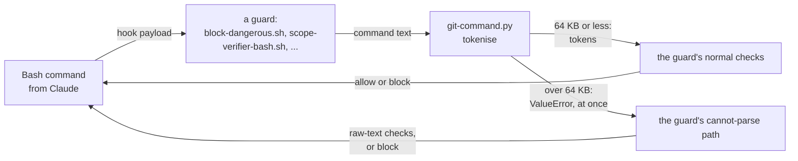
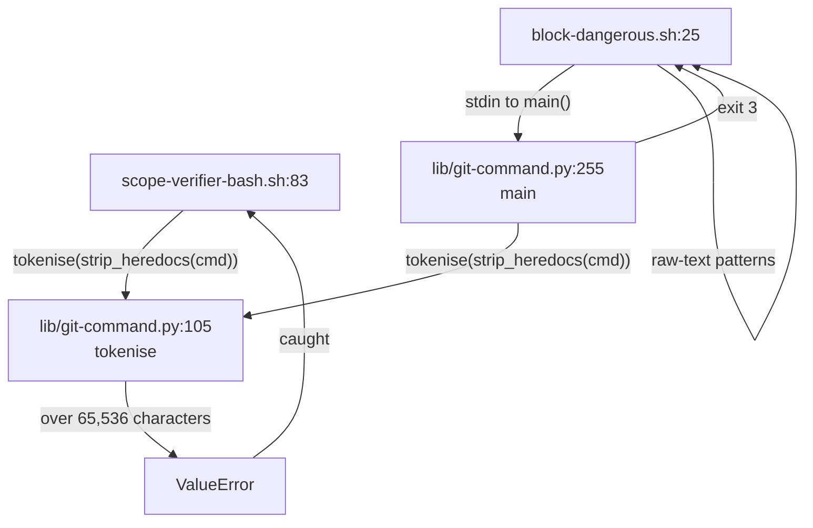
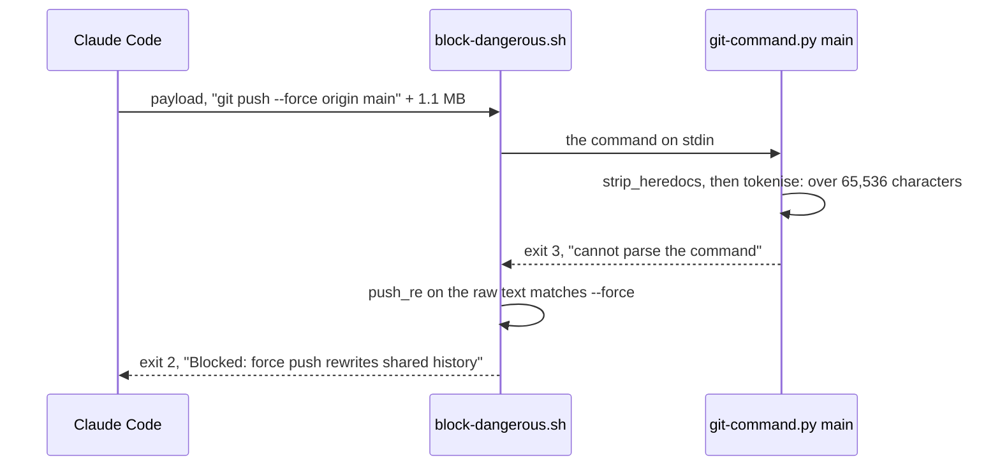

# Tokenise linear

**Version:** v1 · **Status:** Draft · **Type:** Bug · **Project type:** CLI/Library

**Depends on:** None

The command parser that six guards share refuses a command over 64 KB, so no
guard spends more than about 0.15 s parsing one. A long command takes each
guard's own cannot-parse path, and the flaky test that blocks `/release` stops.

## Problem

`git-command.py`'s `tokenise` is Python's `shlex`. `shlex` grows each word with
`self.token += nextchar` (`shlex.py:194`), so the parse time grows with the
square of a word's length.

| Input | `tokenise` | Guard on a 1.1 MB command |
| --- | --- | --- |
| 64 KB | 0.14 s | — |
| 128 KB | 0.32 s | — |
| 256 KB | 0.98 s | — |
| 1.1 MB | about 16 s | `scope-verifier-bash.sh` 19.6 s, `block-dangerous.sh` 21 s |

Two effects:

- `test-scope-verifier-bash.sh:176` gives the guard 20 s, so it fails about one
  run in two, on `main` too. `release.py plan` runs the suite, so `/release`
  is refused about half the time (2026-10-13).
- A hook that runs past its timeout does not block the call: "A timed-out
  `command`, `http`, or `mcp_tool` hook doesn't block the tool call"
  (code.claude.com/docs/en/hooks). The default timeout is 600 s, and
  `hooks.json` sets none. A long enough command would pass every guard
  unchecked. The size that reaches 600 s is about 6 to 7 MB, extrapolated and
  not measured.

## Slice test

| Check | Result |
| --- | --- |
| Cuts every layer it needs | yes. The shared parser, and the guards that call it through their existing refusal paths. |
| One e2e test walks it | yes. Real hook payloads of 1.1 MB, sent to `scope-verifier-bash.sh` and `block-dangerous.sh`. |
| Worth shipping alone | yes. `/release` stops failing on this test, and no guard can be timed out by a long command. |
| Fits (≤5 scenarios, ≤2 areas) | yes. 5 scenarios. One area: the shared parser and the tests of two of its callers. |

**Path:** light. A bug fix in three files, with no new interface, data or
dependency. Pauses 1 and 3 are one pause, and pause 2 is skipped.

## Flow



Each guard parses as today up to 64 KB. Over that, `tokenise` refuses at once,
and the guard does what it already does with a command it cannot parse.

| Guard | Its cannot-parse path today |
| --- | --- |
| `block-dangerous.sh:31` | Checks the raw text with stricter patterns. |
| `block-attribution.sh:36` | Checks the raw text of the whole command. |
| `scope-verifier-bash.sh:85` | Blocks: "a command that will not parse". |
| `scope-pentester-bash.sh:98` | Blocks: "a command that will not parse". |
| `block-pentest-target.sh:220` | Blocks while a live pentest runs. |
| `release-commit.py:65`, `:100` | Refuses the release-commit exception, so the main-branch guard blocks. |

## Acceptance criteria

```gherkin
Scenario: A long verifier command is refused at once
  Given the finding-verifier sends "git show main:" and 1,100,000 more characters
  When scope-verifier-bash.sh reads the hook payload
  Then it exits 2 with "a command that will not parse" and "over 65536 characters"
  And it finishes in under 2 seconds, where today it takes 19.6 seconds

Scenario: A long main-thread command is checked as raw text
  Given the main thread runs "git status" and 1,100,000 more characters
  When block-dangerous.sh reads the hook payload
  Then it exits 0, because the raw text holds no force push, no recursive delete and no commit
  And it finishes in under 2 seconds, where today it takes 21 seconds

Scenario: A long force push is still blocked
  Given the main thread runs "git push --force origin main" and 1,100,000 more characters
  When block-dangerous.sh reads the hook payload
  Then it exits 2 with "Blocked: force push rewrites shared history"

Scenario: A long heredoc body still parses
  Given the main thread runs "cat > notes.md <<'EOF'", a 200,000-character body, "EOF", then "git push --force origin main"
  When block-dangerous.sh reads the hook payload
  Then the body is removed before the size check, the command parses, and it exits 2 for the force push

Scenario: The release suite no longer fails on the verifier test
  Given the branch with this fix
  When run.sh scope-verifier-bash runs 5 times in a row
  Then all 5 runs pass, where on main 1 run of 2 failed on 2026-10-13
```

## Scope

**In:**

- `tokenise` raises `ValueError` for a command over 65,536 characters after
  the heredoc bodies and line continuations are removed.
- The test of the 1.1 MB verifier `git show` expects a block, not an allow.
- New cases in `test-block-dangerous.sh` for scenarios 2 to 4.

**Out:**

- A rewrite of `shlex` that parses any size in linear time. D51 rejects it.
- `"onFailure": "block"` on the guard hooks (O3).
- Raising the test's 20 s alarm. The guard would still take 20 s.

## Technical plan

### Approach

One check at the top of `tokenise`, after it removes the line continuations:
over the limit, raise `ValueError`. Every caller already catches that error
and takes its own refusal path, so no caller changes. `strip_heredocs` runs
before `tokenise` at every call site, so a long heredoc body never counts.



The verifier guard catches the error and blocks. `block-dangerous.sh` gets
exit 3 from `main` and checks the raw text.



Relies on: D31 (the commit guards fail closed on a payload they cannot read),
D9 (the verifier's Bash is scoped by a hook), and D51, drafted below.

### Changes

| File | Change | Why |
| --- | --- | --- |
| `plugins/zuko/scripts/lib/git-command.py:105` | `MAX_COMMAND_CHARS = 65536`. `tokenise` raises `ValueError("the command is over 65536 characters")` when the text is longer, after `CONTINUATION.sub`. | Scenarios 1 to 4. |
| `plugins/zuko/scripts/tests/test-scope-verifier-bash.sh:176` | The 1.1 MB verifier `git show` expects exit 2 and "over 65536 characters". The 20 s alarm stays. | Scenario 1. |
| `plugins/zuko/scripts/tests/test-block-dangerous.sh` | Scenarios 2 to 4 as hook payloads written to a file, as the `huge()` helper in `test-scope-verifier-bash.sh:164` does. An env var cannot hold 1.1 MB. Each case is timed, and each must finish in under 2 s. | Scenarios 2 to 4. |

Reusing: each caller's `except ValueError` path, unchanged. The `huge()`
payload helper's file handoff.

### Earn-it

| Added | Triggered by |
| --- | --- |
| `MAX_COMMAND_CHARS` | Scenarios 1 to 3. A bound on the parse is what stops the 20 s guard and the timeout. |

### Non-functionals

| | |
| --- | --- |
| **Load** | A parse is 0.14 s at most, at the limit. `block-dangerous.sh` parses twice for each Bash call, so a main-thread call spends 0.3 s at most there. |
| **Breaks first** | A real command over 64 KB, with no heredoc, is checked as raw text by `block-dangerous.sh` and blocked by the agent guards. The block message names the limit. |
| **Security surface** | The guards' input is Claude's command text. Over the limit, each guard takes a path that already exists and fails closed or checks raw text. No secret and no stored data. |
| **Proof it works** | `release.py plan` passes its test gate, and `run.sh scope-verifier-bash` passes 5 runs in a row. |
| **Rollout** | No flag. Rollback: `git revert` the fix commit. |

### Test plan

| Scenario | Test |
| --- | --- |
| 1. Verifier command refused | `test-scope-verifier-bash.sh`: the 1.1 MB `git show` case, exit 2, the message, and the time. |
| 2. Main-thread raw-text pass | `test-block-dangerous.sh`: a 1.1 MB `git status`, exit 0, under 2 s. |
| 3. Long force push blocked | `test-block-dangerous.sh`: a 1.1 MB force push, exit 2, the message. |
| 4. Long heredoc body | `test-block-dangerous.sh`: a 200,000-character body, then a force push, exit 2. |
| 5. Release suite | Run `run.sh scope-verifier-bash` 5 times by hand, then `release.py plan`. |

```bash
bash plugins/zuko/scripts/tests/run.sh scope-verifier-bash
bash plugins/zuko/scripts/tests/run.sh block-dangerous
bash plugins/zuko/scripts/tests/run.sh
```

**E2E:** `test-block-dangerous.sh` and `test-scope-verifier-bash.sh` send real
hook payloads of 1.1 MB to the real guards.

### Chunks

Single chunk. The tests first, then the one line in `git-command.py`.

### Risks

| Risk | Mitigation |
| --- | --- |
| A real main-thread command over 64 KB, with no heredoc, is blocked by an agent guard or over-blocked by the raw-text patterns. | Main-thread commands meet only `block-dangerous.sh` and `block-attribution.sh`, which check raw text and block only on a match. Write a long body in a heredoc, which is not counted. |
| A caller that does not catch `ValueError` crashes on a long command. | All six callers catch it today (Flow table). A crash in a hook exits non-zero, and each guard script turns that into a block. |

### Decisions to record

```markdown
## D51 · 2026-10-13 · The shared command parser refuses a command over 64 KB

Why: shlex grows a word one character at a time, so a 1.1 MB command took the
verifier guard 19.6 s and block-dangerous 21 s. A timed-out hook lets the call
through. At 64 KB a parse takes 0.14 s, and each caller already handles a
command it cannot parse.
Rejected: a rewrite of shlex that is linear for any size (a new parser in
every guard, which must match shlex token for token), a longer alarm in the
test (the guard still takes 20 s, and a timed-out hook lets the call through),
128 KB or 16 KB as the limit (O2).
Source: specs/tokenise-linear.md
Status: active
```

## Open items

| ID | What | Type | Raised at | Owner | Status | Answer |
| --- | --- | --- | --- | --- | --- | --- |
| O1 | A command is too long to parse quickly. Refuse to parse it over a limit, so each guard takes its own cannot-parse path, or parse every size with a new linear parser? | question | spec p1 | user | Open | — |
| O2 | What is the limit, after heredoc bodies are removed? | question | spec p1 | user | Open | — |
| O3 | Also set `"onFailure": "block"` on the guard hooks, so a hook that times out blocks the call? It needs Claude Code 2.1.295 or later; this machine has 2.1.296. | question | spec p1 | user | Open | — |

_Never delete this section or its rows. See references/ledger.md._

## Glossary

- **Quadratic** — the time grows with the square of the input, so twice the
  input takes four times as long.
- **Fail closed** — a guard that cannot check a command blocks it.
- **Heredoc** — the `<<'EOF' … EOF` block that gives a command a long body
  from inside the command text.
- **e2e** — end-to-end: one test that walks the whole slice.
- **Pentest** — a penetration test: `/release` attacks the code it ships, and a
  live pentest sends real requests to a running app.
