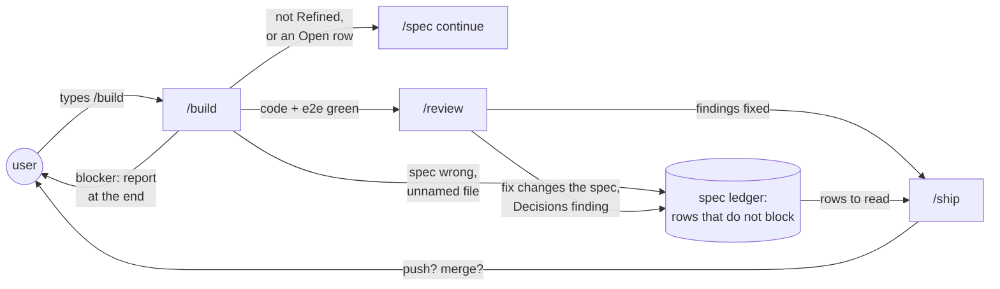
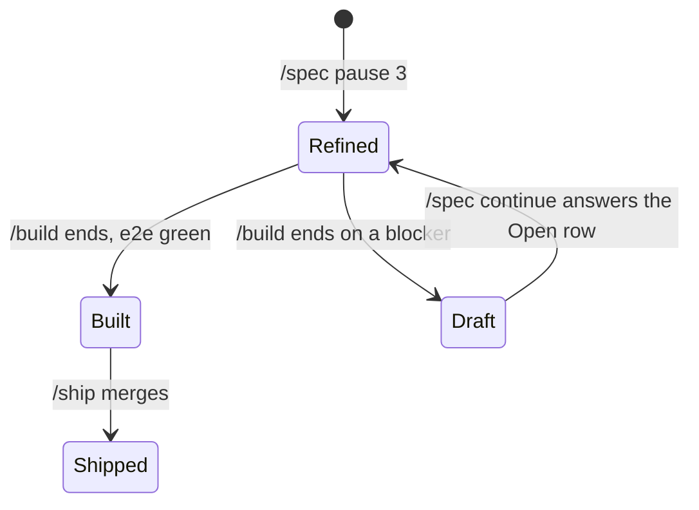
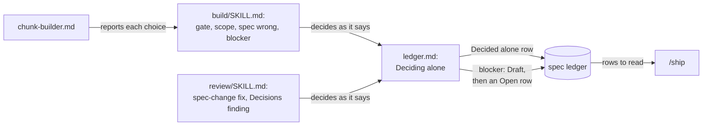
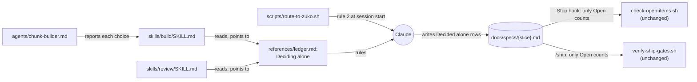
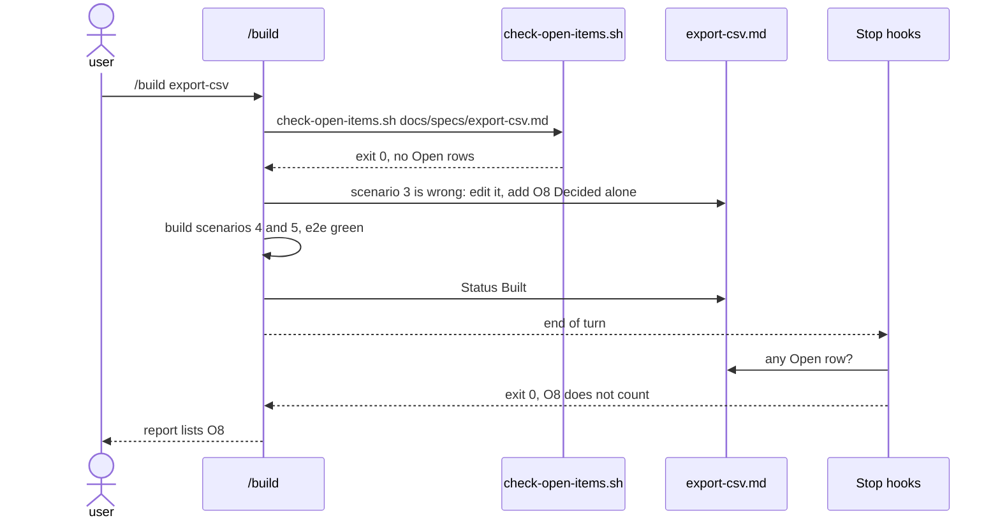

# Unattended build

**Version:** v1 · **Status:** Built · **Type:** Enhancement · **Project type:** CLI/Library

**Shape doc:** docs/specs/ask-up-front/shape.md
**Depends on:** stop-hook-scope, pause-questions

`/build` and `/review` run to the end without a stop to ask. Each choice they
make alone goes into the ledger as a row that does not block, and you read
them all at the PR.

## Problem

`/build` and `/review` stop in the middle of a run to ask, in five places. A
run that you leave alone waits for you. Since pause-questions, a `Refined` spec
reaches `/build` with zero Open rows. The stops that remain are choices that
come up during the run.

| Where it stops today | File |
| --- | --- |
| The gate walks each Open row with the user. | `skills/build/SKILL.md:37` |
| A file the plan did not name: "or you are drifting (stop)". | `skills/build/SKILL.md:104` |
| The spec turns out wrong: stop, set `Draft`, go back to `/spec`. | `skills/build/SKILL.md:149` |
| A fix changes what the spec approved: "proposed first and waits for a yes". | `skills/review/SKILL.md:208` |
| A Decisions finding: "never fixed without asking". | `skills/review/SKILL.md:213` |

## Slice test

| Check | Result |
| --- | --- |
| Cuts every layer it needs | yes. The `/build` and `/review` text, and the ledger rule they write to. |
| One e2e test walks it | yes. A contract test reads the text. The next real `/build` and `/review` are checked by hand. |
| Worth shipping alone | yes. A `/build` or `/review` run finishes without you, and its choices wait in the spec. |
| Fits (≤5 scenarios, ≤2 areas) | yes. 5 scenarios. Two areas: the build and review stages, and the ledger rule. |

**Path:** full. It adds a ledger status, which is a new interface, and it
changes more than three files.

## User story

As the person who runs zuko, I want `/build` and `/review` to finish without
me, so that I can leave a run and read each choice at the PR.

## Flow



The user types `/build`, and nothing asks again until `/ship` asks to push.
Each choice made on the way is a ledger row that `/ship` can show.

## States



A spec that turns out wrong no longer goes back to `Draft`. Only a blocker
does, at the end of the run.

## Acceptance criteria

```gherkin
Scenario: /build changes a wrong scenario and goes on
  Given the spec export-csv is Refined
  And its scenario 3 says that the CSV has a "VAT" column
  And the invoices table has no VAT field
  When /build reaches scenario 3
  Then it removes the VAT column from scenario 3 and edits the spec to match
  And it adds a row that does not block, with the old text, the choice and how to undo it
  And it goes on to scenario 4 with no question

Scenario: /build changes a file that the plan did not name
  Given the export-csv plan names exporters/ledger.py and tests/test_export.py
  When /build must also change invoice_cli/main.py to add the --csv flag
  Then it changes invoice_cli/main.py and adds a row that names the file
  And it goes on with no question

Scenario: /review fixes what it used to ask about
  Given a confirmed finding whose fix changes the approved message "No invoices for ACME-01"
  And a confirmed finding that the diff stores rows in SQLite, while D7 "Use Postgres, not SQLite" is active
  When /review fixes its findings
  Then it changes the message, and it changes the code to use Postgres
  And it adds one row for each fix, with no question
  And DECISIONS.md does not change

Scenario: /build hits a blocker
  Given export-csv scenario 4 uploads the CSV to S3
  And no AWS credentials are set in the environment
  When /build reaches scenario 4
  Then it builds and tests scenarios 1, 2, 3 and 5
  And at the end it sets the spec to Draft, adds the Open row "Scenario 4 needs AWS credentials" and reports
  And it asked nothing during the run

Scenario: /build refuses a spec that is not ready
  Given the spec export-csv is Draft, with O4 Open: "Is the CSV comma or semicolon separated?"
  When the user types /build export-csv
  Then /build prints O4 and "Run /spec continue export-csv to answer it."
  And it writes no code, and it asks no question
```

## Scope

**In:**

- The `/build` gate refuses a spec that is not `Refined` or has an Open row.
  It points to `/spec continue` and does not walk the rows.
- `/build` changes a wrong scenario, edits the spec and goes on, also when it
  drops a scenario (O2).
- `/build` changes a file that the plan did not name, and goes on.
- `/build` on a blocker builds the rest, then sets `Draft` with an Open row
  and reports at the end (O3).
- `/review` applies a fix that changes the approved spec.
- `/review` fixes a Decisions finding by changing the code to obey the entry,
  and never edits `DECISIONS.md` (O1).
- A chunk-builder makes a choice that changes only its own files, and
  reports it. `/build` adds the row (O7).
- A command in the plan that does not exist: `/build` uses the repo's real
  command, with no row (O9).
- Each of these choices adds a `Decided alone` row, which does not block
  (O5). Its Answer says Chose, Other and Undo (O6).
- `references/ledger.md`: the new status, a "Deciding alone" section, and
  rules 1, 4, 6 and 7.
- A contract test.

**Out:**

- The PR body that lists these rows first. decision-pr picks this up.
- A GitLab origin, where `/ship` opens no PR (shape O8). decision-pr picks
  this up.
- `/ship` still asks before it pushes and before it merges. Your global rules
  say so, and the shape keeps it.
- `/debug`, `/poc` and `/release` still ask where they ask today. No slice
  picks them up.

## Interface

The interface is the text that `/build`, `/review` and the chunk-builder read,
and the ledger row they write. A new section in `ledger.md` holds the rules
for deciding alone. The skills and the agent point to it, so the rules exist
in one place.



`/build` and `/review` decide as "Deciding alone" says, and each choice is a
row in the spec. A chunk-builder reports its choices to `/build`, which adds
the rows.

### The new section in ledger.md

It goes after "Asking at a pause" and before "What qualifies".

````markdown
## Deciding alone

`/build` and `/review` never stop to ask. When a choice comes up, make it, add
a row and go on.

| The choice | What to do |
| --- | --- |
| An approved scenario is wrong. | Change it, and edit the spec to match. Go on, also when the change drops the scenario. |
| A scenario needs a file that the plan did not name. | Change the file. |
| A `/review` fix changes what the spec approved: an interface, a message or the scope. | Apply the fix, and edit the spec to match. |
| A Decisions finding. | Change the code to obey the entry. Do not edit `DECISIONS.md`. Superseding the entry stays the user's call. |

Add one row for each choice. Its Status is `Decided alone`, its Type is
`flag`, and Raised at is `build` or `review`. The Answer has three parts and
the date:

- **Chose:** what you did.
- **Other:** the choice that you did not make.
- **Undo:** what the user does to get the other choice. Name the commit when
  a `git revert` is enough.

When the choice changes a scenario, put its old text in the What column.

```markdown
| O7 | Scenario 3 said "Then the CSV has the columns number, date, total and VAT". The invoices table has no VAT field. | flag | build | user | Decided alone | Chose: drop the VAT column. Other: add a VAT field to invoices. Undo: put back the old scenario 3, and add the field. 2026-10-12 |
```

**A blocker** is a thing that you cannot choose around: a missing secret, an
account or a paid service. Build and test each scenario that does not need
it. At the end, set the spec's Status to `Draft` first. Then add an Open
`question` row that names the blocker, and report it. Do not stop in the
middle of the run.
````

### The ledger rules

A new row in the Status table:

```markdown
| `Decided alone` | `/build` or `/review` made a choice without the user. The Answer says what was chosen, the other choice, and how to undo it. Does not block. |
```

Rule 1 gets a new sentence after the pause sentences. The rest stays:

```markdown
**1. Never guess silently.** At a pause in `/shape` or `/spec`, ask each
unknown, as "Asking at a pause" says. Do not write it down without asking. In
`/build` and `/review`, a choice made without the user is a `Decided alone`
row, as "Deciding alone" says. In any other stage, …
```

Rule 4, the last three sentences, before:

```markdown
`/build` still refuses to start with any Open row. It prints them, and walks
through each one with the user. Each becomes `Resolved` or `Accepted risk`
before a line of code is written.
```

After:

```markdown
`/build` still refuses to start with any Open row. It prints them and sends
the user to `/spec continue {slice}`. It asks nothing.
```

Rule 6, before:

```markdown
**6. New items can appear at any stage.** `/build` discovering a bad
assumption sets the spec back to `Draft`, adds a row and routes back.
`/review` finding an unconsidered case adds a row.
```

After:

```markdown
**6. New items can appear at any stage.** `/build` and `/review` add a
`Decided alone` row for each choice they make, and go on. Only a blocker sets
the spec back to `Draft`, at the end of the run. `/review` finding an
unconsidered case adds a row.
```

Rule 7: "`Accepted risk` and `Handed to SLICE` rows never count." becomes
"`Accepted risk`, `Decided alone` and `Handed to SLICE` rows never count."

"What qualifies" › "Belongs in it" gets a last line (O9):

```markdown
- a choice that /build or /review made alone, as "Deciding alone" says: it
  changes what the user approved
```

### /build

| Line | Before | After |
| --- | --- | --- |
| `build/SKILL.md:37` | Print the open rows, then work through them with the user one at a time. Each becomes: `Resolved` … or `Accepted risk` … An `unproven` row that a spike would settle → offer `/poc` instead of guessing. Only when every row is closed does the build begin. | A spec Status other than `Refined` also means the build does not start. Print the open rows, then "Run /spec continue {slice} to answer them." Then stop. Ask nothing, and do not answer a row yourself. |
| `build/SKILL.md:47` | Also confirm: spec Status is `Refined`, the acceptance criteria have not changed since approval, and the plan's commands actually exist in this repo. | Also confirm that the acceptance criteria have not changed since approval. A command in the plan that does not exist in this repo is not a choice: use the repo's real command, with no row. |
| `build/SKILL.md:82` | After all chunks return, **integrate serially**: … Do not hand integration to an agent. | (adds) Add a `Decided alone` row for each choice that a chunk reports. Make each choice that a chunk stopped on, then add its row. |
| `build/SKILL.md:104` | Stay in scope. Touching a file the plan did not name means either the plan was wrong (say so, add a ledger row) or you are drifting (stop). | Stay in scope. When a scenario needs a file that the plan did not name, change it and add a row, as `ledger.md` › "Deciding alone" says. A change that no scenario needs is drift. Do not make it. |
| `build/SKILL.md:139` | Print: chunks and their results, … and anything you did that the plan did not anticipate. Set spec Status to `Built`. | Print: chunks and their results, … anything you did that the plan did not anticipate, and each `Decided alone` row you added. Set spec Status to `Built`, unless a blocker set it to `Draft`. |

The section "When the spec turns out wrong" is replaced by two sections:

```markdown
## When the spec turns out wrong

You will sometimes find mid-build that a scenario is impossible, or that a
constraint is different. Do not stop to ask. Make the choice, edit the spec
to match, add a row and go on, as `ledger.md` › "Deciding alone" says. Go on
also when the choice drops a scenario.

## When a blocker stops a scenario

A blocker is a thing that you cannot choose around: a missing secret, an
account or a paid service. Do as `ledger.md` › "Deciding alone" says. Build
the rest, then set `Draft` and add an Open row at the end. The user answers
the row with `/spec continue {slice}`.
```

### /review

| Line | Before | After |
| --- | --- | --- |
| `review/SKILL.md:206` | One exception: a fix that changes something the user approved in the spec (an interface, a message, the scope) is proposed first and waits for a yes. | A fix that changes something the user approved in the spec (an interface, a message, the scope) is applied too. Edit the spec to match, and add a row, as `ledger.md` › "Deciding alone" says. |
| `review/SKILL.md:213` | A Decisions finding is never fixed without asking. Offer exactly two fixes — change the code, or supersede the entry through `/spec` — and wait for the user to pick. `/review` never edits `DECISIONS.md`. | A Decisions finding is fixed by changing the code to obey the entry. Add a row, as `ledger.md` › "Deciding alone" says, with "supersede the entry through `/spec`" as the other choice. `/review` never edits `DECISIONS.md`. |

### chunk-builder

| Line | Before | After |
| --- | --- | --- |
| `chunk-builder.md:50` | **The plan is wrong?** Stop. Report what you found and what you would do instead. Do not improvise around it — the other chunks are built on the same plan. | **The plan is wrong?** When the choice changes only your own files, make it and build on it. Report it with the other choice, so that `/build` can add the row. A choice that needs a file you do not own → stop and report it. `/build` makes that choice when it integrates. |
| `chunk-builder.md:58` | - Anything the plan got wrong. | - Anything the plan got wrong, and each choice you made: what you chose and the other choice. |

### route-to-zuko.sh, rule 2

Before:

```text
2. Never guess silently. At a /shape or /spec pause, ask each unknown in the
   question prompt. In other stages, write it into the spec's open-items
   ledger as an assumption.
```

After:

```text
2. Never guess silently. At a /shape or /spec pause, ask each unknown in the
   question prompt. In other stages, write it into the spec's open-items
   ledger.
```

## Technical plan

### Approach

All of the change is prompt text, plus tests. A new section in `ledger.md`,
"Deciding alone", holds the rules. `/build`, `/review` and the chunk-builder
point to it. `/build` and `/review` do not read `ledger.md` today, so each
gets it in its Read line. The hooks need no change: `check-open-items.sh`
blocks only a row whose Status cell is `Open`. A test run on 2026-10-12 showed
it: a `Decided alone` row at `Built` exits 0, and the same row at `Open` exits
2.





Relies on: D7 (every confirmed finding is fixed), D19 (`Refined` needs zero
Open rows), D35 (the Stop hooks judge only touched docs), D38 (prompt rules
are checked as text), D39 and D41 (the pauses ask, and the user types
`/build`), and the four entries drafted below.

### Changes

| File | Change | Why |
| --- | --- | --- |
| `plugins/zuko/references/ledger.md:43` | Add the `Decided alone` row to the Status table, after `Handed to SLICE`. | Scenarios 1 to 3: the new status. |
| `plugins/zuko/references/ledger.md:47` | Rule 1: add the sentence for `/build` and `/review`. | They write a `Decided alone` row, not an `assumption` row. |
| `plugins/zuko/references/ledger.md:62` | Rule 4: `/build` prints the Open rows, sends the user to `/spec continue` and asks nothing. | Scenario 5. |
| `plugins/zuko/references/ledger.md:75` | Rule 6: a choice adds a `Decided alone` row. Only a blocker sets `Draft`, at the end. | Scenarios 1 and 4. |
| `plugins/zuko/references/ledger.md:83` | Rule 7: `Decided alone` rows never count. | It says what the hook already does. |
| `plugins/zuko/references/ledger.md:128` | Add "Deciding alone" before "What qualifies", word for word from Interface. | One copy of the rules. |
| `plugins/zuko/skills/build/SKILL.md:17` | Add `${CLAUDE_PLUGIN_ROOT}/references/ledger.md` to the Read line. | The new lines point to it. |
| `plugins/zuko/skills/build/SKILL.md:37`, `:47`, `:82`, `:104`, `:139` | The five line edits in Interface › /build. | Scenarios 1, 2 and 5. |
| `plugins/zuko/skills/build/SKILL.md:149` | Replace "When the spec turns out wrong" with the two sections in Interface. | Scenarios 1 and 4. |
| `plugins/zuko/skills/review/SKILL.md:17` | Add `${CLAUDE_PLUGIN_ROOT}/references/ledger.md` to the Read line. | The new lines point to it. |
| `plugins/zuko/skills/review/SKILL.md:206`, `:213` | The two edits in Interface › /review. | Scenario 3. |
| `plugins/zuko/agents/chunk-builder.md:50`, `:58` | The two edits in Interface › chunk-builder. | O7. |
| `plugins/zuko/scripts/route-to-zuko.sh:36` | Rule 2 drops "as an assumption". | `/build` and `/review` now write `Decided alone` rows. |
| `plugins/zuko/scripts/tests/test-unattended-build.sh` | New contract test. It reuses the `section()` helper from `test-pause-questions.sh` and reads the hook's real output. | Scenarios 1 to 5. |
| `plugins/zuko/scripts/tests/test-check-open-items.sh:59` | Case 4: a `Decided alone` row passes at `Built`, in hook mode and in direct mode. | Proves that the row does not block. |
| `plugins/zuko/scripts/tests/test-pause-questions.sh:48`, `:77` | Match the new rule 1 and rule 2 text. | Both checks pin text that this slice changes. |

### Earn-it

Nothing new: no new layer, script, config or dependency. The one new section
is demanded by scenarios 1 to 4, which need one place for the rules.

### Non-functionals

| | |
| --- | --- |
| **Load** | `ledger.md` grows by about 35 lines, or 500 tokens. `/build` and `/review` now read it at start: about 2,400 tokens each. |
| **At 10×** | Nothing breaks. A run with many choices adds many rows, and each row is one line. |
| **Security surface** | Prompt text only. `/build` now edits the approved spec and changes files that the plan did not name, without asking. Each change is a row, and `/ship` still asks before it pushes. |
| **Proof it works** | The next real `/build` and `/review` run without a question prompt. `grep -c 'Decided alone' docs/specs/{slice}.md` counts the choices they made. |
| **Rollout** | No flag, because this is prompt text. Rollback: `git revert` the build commits. |

### Test plan

| Scenario | Test |
| --- | --- |
| 1. A wrong scenario | `test-unattended-build.sh`: the "Deciding alone" table row, the row format, and the new "When the spec turns out wrong" text. |
| 2. A file the plan did not name | `test-unattended-build.sh`: the table row and the new `build/SKILL.md:104` line. |
| 3. `/review` fixes | `test-unattended-build.sh`: the two table rows, both `review/SKILL.md` lines, and "never edits `DECISIONS.md`". |
| 4. A blocker | `test-unattended-build.sh`: the blocker paragraph and the build section. `test-check-open-items.sh` case 2 already proves that a `Draft` spec with an Open row passes. |
| 5. The gate refuses | `test-unattended-build.sh`: the gate text and rule 4. |
| All | `test-unattended-build.sh`: the old stop text is gone from each file. `test-check-open-items.sh`: a `Decided alone` row at `Built` passes. |

Commands:

```bash
bash plugins/zuko/scripts/tests/run.sh unattended-build
bash plugins/zuko/scripts/tests/run.sh check-open-items
bash plugins/zuko/scripts/tests/run.sh pause-questions
bash plugins/zuko/scripts/tests/run.sh
```

The e2e is `test-unattended-build.sh`. It reads the four Markdown files and
runs `route-to-zuko.sh` for its real output. The behaviour is checked by hand
at the next real `/build` and `/review` (O4).

### Chunks

Single chunk. Order: `ledger.md` first, then the skills and the agent, then
the session text. The tests come first in each step.

### Risks

| Risk | Mitigation |
| --- | --- |
| `/build` makes a large choice, such as a dropped scenario, and you see it only at the end. | The `/build` report lists each `Decided alone` row. Each row has an Undo, and `/ship` asks before it pushes. decision-pr puts the rows first in the PR. |
| A Decisions-finding fix is large, such as SQLite to Postgres. | One commit per finding, so a `git revert` undoes it. You can supersede the entry at the PR. |
| Claude still asks out of habit. | The test checks that the old stop text is gone. The next real run is checked by hand. |
| `/build` adds the blocker's Open row while the spec is still `Refined`, and the Stop hook fails the turn. | The text says to set `Draft` first. |
| A `Decided alone` row lacks a part, and nothing catches it (O8). | decision-pr can add a check when it reads the rows. |

### Decisions to record

Recorded as D42, D43, D44, D45.

## Open items

| ID | What | Type | Raised at | Owner | Status | Answer |
| --- | --- | --- | --- | --- | --- | --- |
| O1 | Assuming `/review` fixes a Decisions finding by changing the code to obey the entry. Superseding the entry stays your call at the PR. (from shape O5) | assumption | shape | user | Resolved | Change the code, and add a row. Superseding stays your call at the PR. 2026-10-12 |
| O2 | `/build` finds an approved scenario wrong in the middle of a run. What does it do? | question | spec p1 | user | Resolved | It changes the scenario, edits the spec to match, and adds a row with the old text. It goes on, also when a scenario is dropped. 2026-10-12 |
| O3 | `/build` hits a real blocker: a missing secret, an account or a paid service. What happens? | question | spec p1 | user | Resolved | It builds all that it can. At the end it sets the spec to `Draft` with an Open row, and reports. 2026-10-12 |
| O4 | How do we prove that `/build` and `/review` run without a stop? | question | spec p1 | user | Resolved | A contract test proves the text. The next real `/build` and `/review` show the behaviour, checked by hand. 2026-10-12 |
| O5 | What is the status of a row that `/build` or `/review` decided without the user? | question | spec p2 | user | Resolved | `Decided alone`. It does not match `Open`, so no hook blocks it. 2026-10-12 |
| O6 | How does the row's Answer say what was chosen? | question | spec p2 | user | Resolved | Three labelled parts: Chose, Other and Undo, then the date. 2026-10-12 |
| O7 | A chunk-builder finds the plan wrong. What does it do? | question | spec p2 | user | Resolved | It makes the choice when only its own files change, and reports it. `/build` adds the row. A choice that needs another chunk's file still stops that agent. 2026-10-12 |
| O8 | Does a script check that each `Decided alone` row has its Chose, Other and Undo parts? | question | spec p3 | user | Resolved | No. The rule is prompt text, and a contract test checks the text, as D38 does. decision-pr can add a check. 2026-10-12 |
| O9 | `/review`: "Deciding alone" said to add a row for each choice, a missing command too. "What qualifies" says that a thing the code answers in five minutes does not belong. | flag | review | user | Resolved | A missing command is not a choice: `/build` uses the real one, with no row. "What qualifies" says that a choice made alone belongs, because it changes what the user approved. 2026-10-12 |

_Never delete this section or its rows. See references/ledger.md._

## Glossary

- **Ledger** — the Open items table in a spec. Rows are resolved, never
  deleted.
- **Decisions finding** — a `/review` finding where the code does something
  that an active entry in `DECISIONS.md` rejected.
- **Blocker** — a thing that `/build` cannot choose around, such as a missing
  secret, an account or a paid service.
- **Contract test** — a test that checks the text of a prompt file, not what
  Claude does with it.
- **e2e** — end-to-end: one test that walks the whole slice as a user would.
