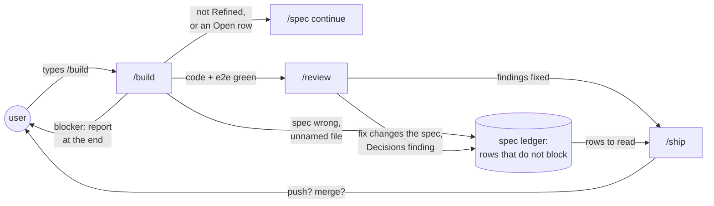
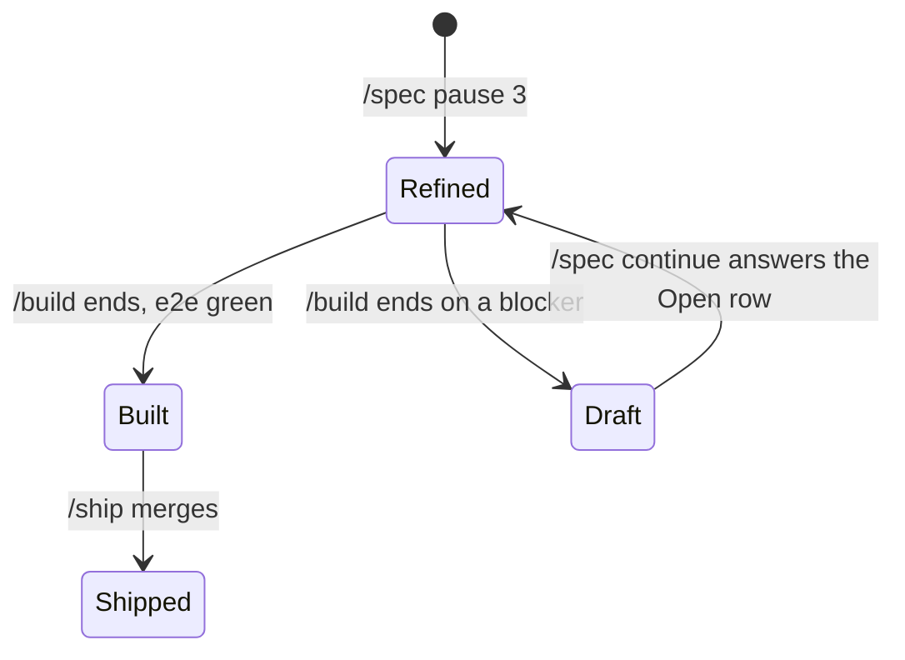

# Unattended build

**Version:** v1 · **Status:** Draft · **Type:** Enhancement · **Project type:** CLI/Library

**Shape doc:** docs/specs/ask-up-front/shape.md
**Depends on:** stop-hook-scope, pause-questions

`/build` and `/review` run to the end without a stop to ask. Each choice they
make alone goes into the ledger as a row that does not block, and you read
them all at the PR.

## Problem

`/build` and `/review` stop in the middle of a run to ask, in five places. A
run that you leave alone waits for you. Since pause-questions, a `Refined` spec
reaches `/build` with zero Open rows. The stops that remain are choices that
come up during the run.

| Where it stops today | File |
| --- | --- |
| The gate walks each Open row with the user. | `skills/build/SKILL.md:37` |
| A file the plan did not name: "or you are drifting (stop)". | `skills/build/SKILL.md:104` |
| The spec turns out wrong: stop, set `Draft`, go back to `/spec`. | `skills/build/SKILL.md:149` |
| A fix changes what the spec approved: "proposed first and waits for a yes". | `skills/review/SKILL.md:208` |
| A Decisions finding: "never fixed without asking". | `skills/review/SKILL.md:213` |

## Slice test

| Check | Result |
| --- | --- |
| Cuts every layer it needs | yes. The `/build` and `/review` text, and the ledger rule they write to. |
| One e2e test walks it | yes. A contract test reads the text. The next real `/build` and `/review` are checked by hand. |
| Worth shipping alone | yes. A `/build` or `/review` run finishes without you, and its choices wait in the spec. |
| Fits (≤5 scenarios, ≤2 areas) | yes. 5 scenarios. Two areas: the build and review stages, and the ledger rule. |

**Path:** full. It adds a ledger status, which is a new interface, and it
changes more than three files.

## User story

As the person who runs zuko, I want `/build` and `/review` to finish without
me, so that I can leave a run and read each choice at the PR.

## Flow



The user types `/build`, and nothing asks again until `/ship` asks to push.
Each choice made on the way is a ledger row that `/ship` can show.

## States



A spec that turns out wrong no longer goes back to `Draft`. Only a blocker
does, at the end of the run.

## Acceptance criteria

```gherkin
Scenario: /build changes a wrong scenario and goes on
  Given the spec export-csv is Refined
  And its scenario 3 says that the CSV has a "VAT" column
  And the invoices table has no VAT field
  When /build reaches scenario 3
  Then it removes the VAT column from scenario 3 and edits the spec to match
  And it adds a row that does not block, with the old text, the choice and how to undo it
  And it goes on to scenario 4 with no question

Scenario: /build changes a file that the plan did not name
  Given the export-csv plan names exporters/ledger.py and tests/test_export.py
  When /build must also change invoice_cli/main.py to add the --csv flag
  Then it changes invoice_cli/main.py and adds a row that names the file
  And it goes on with no question

Scenario: /review fixes what it used to ask about
  Given a confirmed finding whose fix changes the approved message "No invoices for ACME-01"
  And a confirmed finding that the diff stores rows in SQLite, while D7 "Use Postgres, not SQLite" is active
  When /review fixes its findings
  Then it changes the message, and it changes the code to use Postgres
  And it adds one row for each fix, with no question
  And DECISIONS.md does not change

Scenario: /build hits a blocker
  Given export-csv scenario 4 uploads the CSV to S3
  And no AWS credentials are set in the environment
  When /build reaches scenario 4
  Then it builds and tests scenarios 1, 2, 3 and 5
  And at the end it sets the spec to Draft, adds the Open row "Scenario 4 needs AWS credentials" and reports
  And it asked nothing during the run

Scenario: /build refuses a spec that is not ready
  Given the spec export-csv is Draft, with O4 Open: "Is the CSV comma or semicolon separated?"
  When the user types /build export-csv
  Then /build prints O4 and "Run /spec continue export-csv to answer it."
  And it writes no code, and it asks no question
```

## Scope

**In:**

- The `/build` gate refuses a spec that is not `Refined` or has an Open row.
  It points to `/spec continue` and does not walk the rows.
- `/build` changes a wrong scenario, edits the spec and goes on, also when it
  drops a scenario (O2).
- `/build` changes a file that the plan did not name, and goes on.
- `/build` on a blocker builds the rest, then sets `Draft` with an Open row
  and reports at the end (O3).
- `/review` applies a fix that changes the approved spec.
- `/review` fixes a Decisions finding by changing the code to obey the entry,
  and never edits `DECISIONS.md` (O1).
- Each of these choices adds a ledger row with a new status that does not
  block. The row says what was chosen, the other choice, and how to undo it.
- `references/ledger.md`: the new status, and rules 4 and 6.
- A contract test.

**Out:**

- The PR body that lists these rows first. decision-pr picks this up.
- A GitLab origin, where `/ship` opens no PR (shape O8). decision-pr picks
  this up.
- `/ship` still asks before it pushes and before it merges. Your global rules
  say so, and the shape keeps it.
- `/debug`, `/poc` and `/release` still ask where they ask today. No slice
  picks them up.

## Open items

| ID | What | Type | Raised at | Owner | Status | Answer |
| --- | --- | --- | --- | --- | --- | --- |
| O1 | Assuming `/review` fixes a Decisions finding by changing the code to obey the entry. Superseding the entry stays your call at the PR. (from shape O5) | assumption | shape | user | Resolved | Change the code, and add a row. Superseding stays your call at the PR. 2026-10-12 |
| O2 | `/build` finds an approved scenario wrong in the middle of a run. What does it do? | question | spec p1 | user | Resolved | It changes the scenario, edits the spec to match, and adds a row with the old text. It goes on, also when a scenario is dropped. 2026-10-12 |
| O3 | `/build` hits a real blocker: a missing secret, an account or a paid service. What happens? | question | spec p1 | user | Resolved | It builds all that it can. At the end it sets the spec to `Draft` with an Open row, and reports. 2026-10-12 |
| O4 | How do we prove that `/build` and `/review` run without a stop? | question | spec p1 | user | Resolved | A contract test proves the text. The next real `/build` and `/review` show the behaviour, checked by hand. 2026-10-12 |

_Never delete this section or its rows. See references/ledger.md._

## Glossary

- **Ledger** — the Open items table in a spec. Rows are resolved, never
  deleted.
- **Decisions finding** — a `/review` finding where the code does something
  that an active entry in `DECISIONS.md` rejected.
- **Blocker** — a thing that `/build` cannot choose around, such as a missing
  secret, an account or a paid service.
- **Contract test** — a test that checks the text of a prompt file, not what
  Claude does with it.
- **e2e** — end-to-end: one test that walks the whole slice as a user would.
