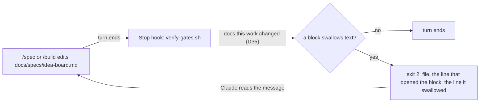
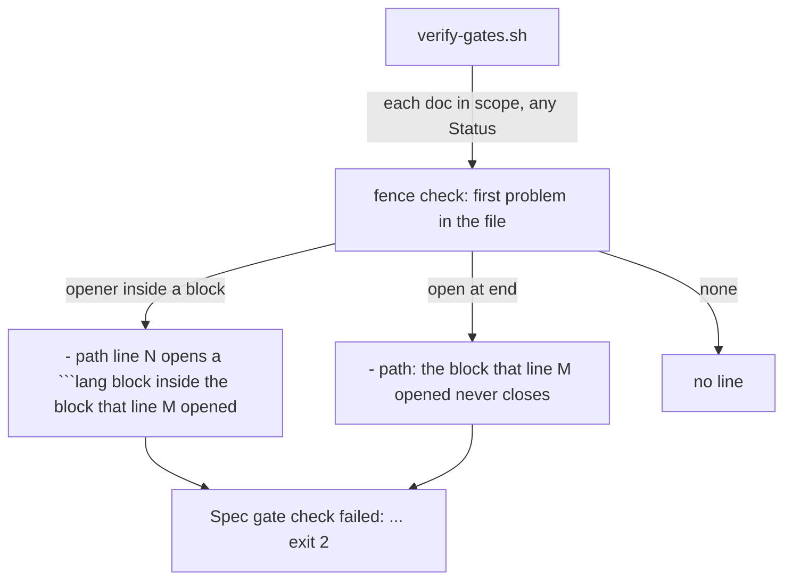
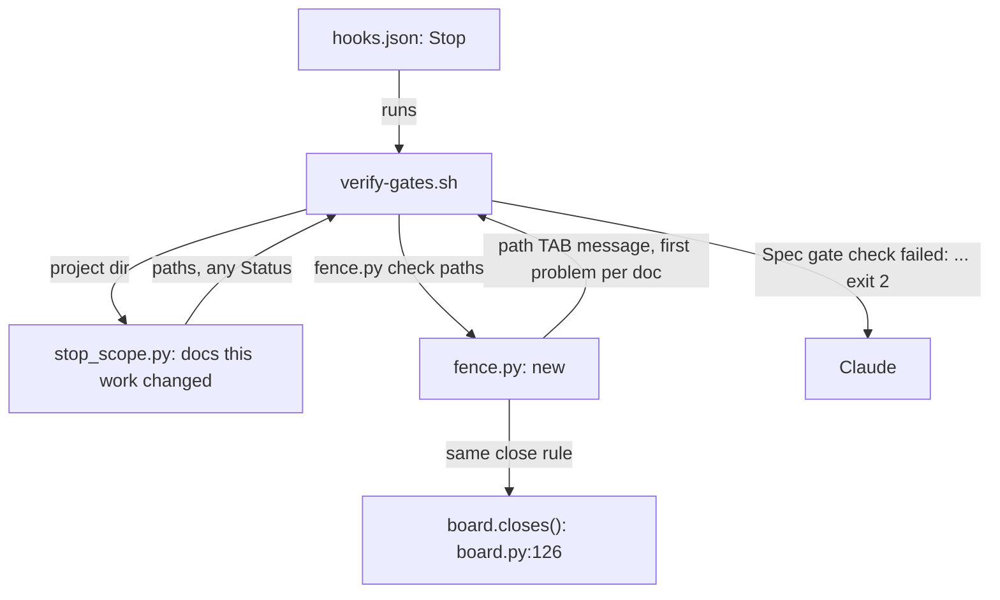

# Unclosed fence

**Version:** v1 · **Status:** Built · **Type:** Enhancement · **Project type:** CLI/Library

**Depends on:** None

The spec gate fails a zuko doc in which a code block swallows the text after it. A broken spec can then no longer reach a commit and quietly mislead the board, the gate card and the PR body.

## Problem

`docs/specs/idea-board.md` was committed twice, at `7ac7353` and `a5cb93f`, with a broken `## States` block. The ```` ```mermaid ```` fence on line 47 never closed. So the next fence, a second ```` ```mermaid ```` on line 55, did not open a block. It was text inside the first one. Every fence after that paired with the wrong partner, and `## Acceptance criteria` on line 116 sat inside a code block. Every tool that reads the spec agreed it had no Acceptance criteria section: `board.py`, `pr_body.py` and GitHub's renderer. Nobody saw it until replay showed a step with "added: Acceptance criteria" on 2026-10-26.

The file ends with no fence open, because the shifted pairs balance out. So a check for "a fence still open at the end of the file" passes this file.

## Slice test

| Check                         | Result                                                                                       |
| ----------------------------- | -------------------------------------------------------------------------------------------- |
| Cuts every layer it needs     | Yes. The fence check, the Stop hook that runs it, and the message the user sees              |
| One e2e test walks it         | Yes. Run `verify-gates.sh` on a fixture repo that holds the broken idea-board spec           |
| Worth shipping alone          | Yes. The next broken fence fails the turn it was written in, not weeks later                 |
| Fits (≤5 scenarios, ≤2 areas) | Yes. 4 scenarios. Areas: the spec gate, and the fence reader that `board.py` already has     |

**Path:** full. It adds a check and a new failure message to the spec gate, as glossary-gate did.

## User story

As the person who approves zuko specs, I want a spec with a broken code block to fail the turn that wrote it, so that the board and the PR never read a spec that is missing a section.

## Flow



When a turn ends, the Stop hook reads each zuko doc that this work changed. A doc in which a code block swallows text fails the turn, and the message names the lines. Claude then fixes the doc before the turn can end.

## Acceptance criteria

```gherkin
Scenario: a fence that opens inside an open block fails the turn
  Given docs/specs/idea-board.md is the version from a5cb93f, changed in this work
  And its ```mermaid fence on line 47 never closes, and a second ```mermaid fence opens on line 55
  When the turn ends
  Then verify-gates.sh exits 2
  And the message names docs/specs/idea-board.md, line 47 as the block that is still open, and line 55 as the fence inside it

Scenario: a fence still open at the end of the file fails the turn
  Given docs/specs/refunds.md at Draft ends inside a ```gherkin block that opened on line 40
  When the turn ends
  Then verify-gates.sh exits 2
  And the message names docs/specs/refunds.md and says the block from line 40 never closes

Scenario: a block nested inside a longer fence passes
  Given docs/specs/decision-pr.md shows a ````markdown block of four backticks on line 267, inside a `````text block of five that opens on line 257
  When the turn ends, with that file changed in this work
  Then verify-gates.sh reports no fence problem for it
  And each of the 47 specs and 4 shapes in docs/specs today passes the fence check

Scenario: a doc this work did not change is not judged
  Given main holds a spec with a broken fence, and this branch changed only docs/specs/replay.md
  When the turn ends
  Then verify-gates.sh reports no fence problem
```

## Scope

**In:**

- A fence check in the spec gate, run by the Stop hook on each spec or shape that this work changed, at any Status.
- Two signals. A fence line with a language name opens inside an open block, using the same fence character and a length at least that of the open fence. Or a block is still open at the end of the file.
- A message that names the file and the lines, so the fix is one edit.

**Out:**

- Docs outside `docs/specs/`, such as the skills and references. The gate judges zuko docs only (D35). Not in any slice.
- Fixing a broken fence for the user. The gate names the lines, and Claude makes the edit in the same turn.
- The ship gate. A spec reaches `/ship` only through turns that each passed the Stop hook.
- Old commits. History stays as it is. Replay keeps showing the 2 broken steps of idea-board as they were.

## Interface

The check adds two kinds of line to the spec gate's failure message. The message keeps its form: `Spec gate check failed:` on stderr, then one `- ` line for each problem, and exit 2. The path is printed as the gate prints it for every other problem, as `stop_scope.py` gives it.



The gate runs the check on each doc in scope. A doc gets one line at most, for its first problem, and the gate exits 2 when any doc has one.

**The two lines**

```text
Spec gate check failed:

- ./docs/specs/idea-board.md line 55 opens a ```mermaid block inside the block that line 47 opened. Close the block from line 47 first, or open it with a longer fence.
- ./docs/specs/refunds.md: the ```gherkin block that line 40 opened never closes. Close it.
```

| Part | Rule |
| --- | --- |
| Which problem | The first one in the file, from the top. After a block swallows text, each later fence pairs with the wrong partner, so a second line would name the wrong lines |
| The fence in the line | As written in the file, with its language name: ```` ```mermaid ````, ```` ~~~gherkin ````. An opener with no language name is printed as its fence only |
| Line numbers | 1-based, as an editor shows them |
| The fix part | Line one says "Close the block from line M first, or open it with a longer fence." Line two says "Close it." |

A doc that passes adds no line. When the fence check cannot read a doc, the gate fails with `- the fence check could not run: <error>`, as the glossary check does.

## Technical plan

### Approach

A new `lib/fence.py` walks each doc's fences with the close rule the readers use, `board.closes()` (`board.py:126`). It prints one line for the first problem in each doc. `verify-gates.sh` collects every doc in scope, at any Status, and runs `fence.py check` on them, as it runs `glossary.py missing` on the live docs.

Relies on: D35 (Stop hooks judge only the zuko docs this work changed), D36 (a zuko spec is known by its Version and Status line). Drafted below: D75, D76.



`verify-gates.sh` asks `stop_scope.py` which docs this work changed. It then hands all of them to `fence.py`, which reads each one with the board's close rule and reports its first problem.

```mermaid
sequenceDiagram
  participant H as Stop hook
  participant V as verify-gates.sh
  participant S as stop_scope.py
  participant F as fence.py
  H->>V: turn ends, stdin JSON
  V->>S: project dir
  S-->>V: ./docs/specs/idea-board.md
  V->>V: status and Open items checks; collect every doc
  V->>F: check ./docs/specs/idea-board.md
  F->>F: line 47 opens, line 55 opens inside it: first problem
  F-->>V: path, TAB, "line 55 opens a ```mermaid block inside the block that line 47 opened. ..."
  V-->>H: "Spec gate check failed:" then the line, exit 2
```

**How `fence.py` reads a doc**

| Part | Rule |
| --- | --- |
| A fence | `pr_body.FENCE`: up to 3 spaces, then 3 or more backticks or tildes |
| Opening | A fence while no block is open. Its language name is the first word after the marker |
| Closing | `board.closes()`: the same character, at least as long, nothing after it |
| Opener inside a block | A fence inside an open block that has a language name, the same character, and at least the open fence's length. Problem: `line <N> opens a <fence><lang> block inside the block that line <M> opened. Close the block from line <M> first, or open it with a longer fence.` |
| Open at end | The file ends with a block open. Problem: `the <fence><lang> block that line <M> opened never closes. Close it.` |
| Output | `<path>\t<problem>` for the first problem in each doc, in the order given. Nothing for a doc that passes |
| Exit | 0 printed. 2 bad usage or a doc that cannot be read, with `fence.py: cannot read <path>: <reason>` on stderr |

`verify-gates.sh` joins the two parts as `- <path> <problem>` for an opener inside a block, and `- <path>: <problem>` for a block open at the end. So the lines read as the Interface shows.

### Changes

| File | What changes | Why |
| --- | --- | --- |
| `plugins/zuko/scripts/lib/fence.py` | New. `check <path>...`, a `first_problem(text)` walker, and a docstring with the rules above | Scenarios 1, 2 and 3 |
| `plugins/zuko/scripts/verify-gates.sh:22` | The scope loop adds every doc to a new `docs` array, specs at any Status and shapes. After the glossary block, run `fence.py check "${docs[@]}"` and add one `- ` line for each line it prints. On a non-zero exit, add `- the fence check could not run: <error>` | Scenarios 1, 2 and 4 |
| `plugins/zuko/scripts/tests/test-fence.sh` | New. Each scenario, against `verify-gates.sh` with `CLAUDE_PROJECT_DIR` set to a fixture project. Also `fence.py` alone: a tilde fence, an indented fence, an opener with no language name, and a doc that cannot be read | Scenarios 1 to 4 |
| `plugins/zuko/scripts/tests/fixtures/fence/idea-board-a5cb93f.md` | New. The real broken spec, copied from `git show a5cb93f:docs/specs/idea-board.md` | Scenario 1 |

Reusing: `board.closes()` (`board.py:126`) and `pr_body.FENCE` (`pr_body.py:30`) for the fence rules, `stop_scope.py` for the scope, and the glossary block's shape in `verify-gates.sh:47` for the call and its error line.

### Earn-it

| Added | Triggered by |
| --- | --- |
| `fence.py` | Scenarios 1 and 2. `glossary.py` is about jargon, and `pr_body.py` reads rows for the ship gate and the PR body (D50). A fence check in either one would mix two jobs |
| The fixture file | Scenario 1 names the real broken file. A made-up example could miss what made the real one pass every other check |

### Non-functionals

|                      |                                                                               |
| -------------------- | ----------------------------------------------------------------------------- |
| **Load**             | One run per turn end, over the docs this work changed: usually 1 or 2 files of up to 400 lines |
| **Breaks first**     | At 10×, 20 docs of 4,000 lines is one linear pass each, well under a second. Nothing breaks first |
| **Security surface** | Runs locally in the Stop hook. Reads only the docs `stop_scope.py` lists. Prints file paths and line numbers. Writes nothing, touches no secret, makes no network call |
| **Proof it works**   | `bash plugins/zuko/scripts/tests/run.sh fence` passes, and a turn that writes an unclosed fence ends with `Spec gate check failed:` and the fence line |
| **Rollout**          | No flag. It ships with the next zuko release. Rollback: revert the commit, and the gate runs as before |

### Test plan

| Scenario | Test | Command |
| --- | --- | --- |
| 1. A fence that opens inside an open block fails the turn | `test-fence.sh`, with the fixture copy of the a5cb93f spec | `bash plugins/zuko/scripts/tests/run.sh fence` |
| 2. A fence still open at the end of the file fails the turn | `test-fence.sh` | `bash plugins/zuko/scripts/tests/run.sh fence` |
| 3. A block nested inside a longer fence passes | `test-fence.sh`: a copy of `docs/specs/decision-pr.md`, and a loop over every spec and shape in the repo through `fence.py check` | `bash plugins/zuko/scripts/tests/run.sh fence` |
| 4. A doc this work did not change is not judged | `test-fence.sh`: a fixture git repo with a broken spec on `main` and a branch that changes another spec | `bash plugins/zuko/scripts/tests/run.sh fence` |

**E2E:** the scenario 1 case in `test-fence.sh` runs `verify-gates.sh` as the Stop hook runs it, with stdin JSON and `CLAUDE_PROJECT_DIR`, on a project that holds the real broken spec. It checks the exit code and the exact line. The full suite: `bash plugins/zuko/scripts/tests/run.sh`.

### Chunks

Single chunk.

### Risks

| Risk | Mitigation |
| --- | --- |
| A spec shows a nested example with a fence of the same length as the outer one, which the rule flags | The message says to open the outer block with a longer fence, which is the correct fix in Markdown too. No doc in the repo does this today |
| The close rule drifts from the readers' rule | `fence.py` calls `board.closes()` itself, so a change to the rule reaches both |

### Decisions to record

Recorded as D75, D76.

## Review

2026-10-26 · 4 raw findings, 3 survived, 3 fixed.

- coverage · `plugins/zuko/scripts/verify-gates.sh:23` · a test that a Shipped spec with a broken fence fails the gate · `3de3bfb`
- coverage · `plugins/zuko/scripts/tests/test-fence.sh:77` · a test that an unclosed indented fence is found · `792d8fa`
- correctness · `plugins/zuko/scripts/lib/fence.py:38` · line numbers count newlines only, as an editor does · `a79ce19`

## Open items

| ID  | What | Type | Raised at | Owner | Status | Answer |
| --- | ---- | ---- | --------- | ----- | ------ | ------ |
| O1  | Does the check judge a changed spec at every Status, Shipped included, or only Draft and Refined, as the glossary check does? | question | spec p1 | user | Resolved | Every Status. Only the docs this work changed are judged, so an old spec never fails a turn. 2026-10-26 |
| O2  | Does the ship gate run the fence check too, or only the Stop hook? | question | spec p1 | user | Resolved | Only the Stop hook. Each turn that touched the spec already passed it. 2026-10-26 |

_Never delete this section or its rows. See references/ledger.md._

## Glossary

- **Fence** — the ```` ``` ```` or `~~~` line that opens or closes a code block in Markdown. Everything between two fences is code, not text or headings.
- **Language name** — the word after an opening fence, such as `mermaid` or `gherkin`. A closing fence never has one.
- **e2e** — end-to-end: one test that walks the whole slice as a user would.
