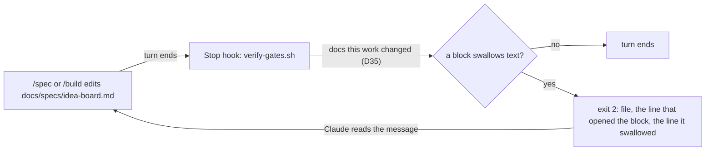

# Unclosed fence

**Version:** v1 · **Status:** Draft · **Type:** Enhancement · **Project type:** CLI/Library

**Depends on:** None

The spec gate fails a zuko doc in which a code block swallows the text after it. A broken spec can then no longer reach a commit and quietly mislead the board, the gate card and the PR body.

## Problem

`docs/specs/idea-board.md` was committed twice, at `7ac7353` and `a5cb93f`, with a broken `## States` block. The ```` ```mermaid ```` fence on line 47 never closed. So the next fence, a second ```` ```mermaid ```` on line 55, did not open a block. It was text inside the first one. Every fence after that paired with the wrong partner, and `## Acceptance criteria` on line 116 sat inside a code block. Every tool that reads the spec agreed it had no Acceptance criteria section: `board.py`, `pr_body.py` and GitHub's renderer. Nobody saw it until replay showed a step with "added: Acceptance criteria" on 2026-10-26.

The file ends with no fence open, because the shifted pairs balance out. So a check for "a fence still open at the end of the file" passes this file.

## Slice test

| Check                         | Result                                                                                       |
| ----------------------------- | -------------------------------------------------------------------------------------------- |
| Cuts every layer it needs     | Yes. The fence check, the Stop hook that runs it, and the message the user sees              |
| One e2e test walks it         | Yes. Run `verify-gates.sh` on a fixture repo that holds the broken idea-board spec           |
| Worth shipping alone          | Yes. The next broken fence fails the turn it was written in, not weeks later                 |
| Fits (≤5 scenarios, ≤2 areas) | Yes. 4 scenarios. Areas: the spec gate, and the fence reader that `board.py` already has     |

**Path:** full. It adds a check and a new failure message to the spec gate, as glossary-gate did.

## User story

As the person who approves zuko specs, I want a spec with a broken code block to fail the turn that wrote it, so that the board and the PR never read a spec that is missing a section.

## Flow



When a turn ends, the Stop hook reads each zuko doc that this work changed. A doc in which a code block swallows text fails the turn, and the message names the lines. Claude then fixes the doc before the turn can end.

## Acceptance criteria

```gherkin
Scenario: a fence that opens inside an open block fails the turn
  Given docs/specs/idea-board.md is the version from a5cb93f, changed in this work
  And its ```mermaid fence on line 47 never closes, and a second ```mermaid fence opens on line 55
  When the turn ends
  Then verify-gates.sh exits 2
  And the message names docs/specs/idea-board.md, line 47 as the block that is still open, and line 55 as the fence inside it

Scenario: a fence still open at the end of the file fails the turn
  Given docs/specs/refunds.md at Draft ends inside a ```gherkin block that opened on line 40
  When the turn ends
  Then verify-gates.sh exits 2
  And the message names docs/specs/refunds.md and says the block from line 40 never closes

Scenario: a block nested inside a longer fence passes
  Given docs/specs/decision-pr.md shows a ````markdown block of four backticks on line 267, inside a `````text block of five that opens on line 257
  When the turn ends, with that file changed in this work
  Then verify-gates.sh reports no fence problem for it
  And each of the 47 specs and 4 shapes in docs/specs today passes the fence check

Scenario: a doc this work did not change is not judged
  Given main holds a spec with a broken fence, and this branch changed only docs/specs/replay.md
  When the turn ends
  Then verify-gates.sh reports no fence problem
```

## Scope

**In:**

- A fence check in the spec gate, run by the Stop hook on each spec or shape that this work changed, at any Status.
- Two signals. A fence line with a language name opens inside an open block, using the same fence character and a length at least that of the open fence. Or a block is still open at the end of the file.
- A message that names the file and the lines, so the fix is one edit.

**Out:**

- Docs outside `docs/specs/`, such as the skills and references. The gate judges zuko docs only (D35). Not in any slice.
- Fixing a broken fence for the user. The gate names the lines, and Claude makes the edit in the same turn.
- The ship gate. A spec reaches `/ship` only through turns that each passed the Stop hook.
- Old commits. History stays as it is. Replay keeps showing the 2 broken steps of idea-board as they were.

## Open items

| ID  | What | Type | Raised at | Owner | Status | Answer |
| --- | ---- | ---- | --------- | ----- | ------ | ------ |
| O1  | Does the check judge a changed spec at every Status, Shipped included, or only Draft and Refined, as the glossary check does? | question | spec p1 | user | Open | — |
| O2  | Does the ship gate run the fence check too, or only the Stop hook? | question | spec p1 | user | Open | — |

_Never delete this section or its rows. See references/ledger.md._

## Glossary

- **Fence** — the ```` ``` ```` or `~~~` line that opens or closes a code block in Markdown. Everything between two fences is code, not text or headings.
- **Language name** — the word after an opening fence, such as `mermaid` or `gherkin`. A closing fence never has one.
- **e2e** — end-to-end: one test that walks the whole slice as a user would.
