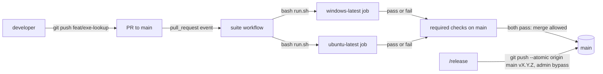
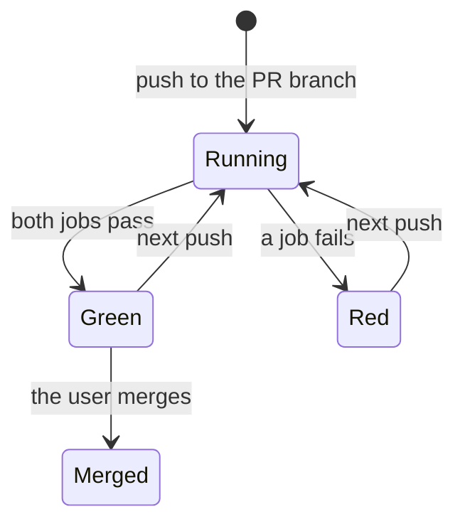
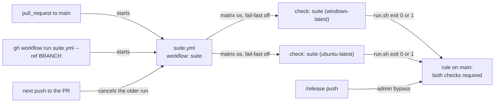

# Windows CI

**Version:** v1 · **Status:** Draft · **Type:** Technical · **Project type:** CLI/Library

**Shape doc:** docs/specs/os-agnostic-suite/shape.md
**Depends on:** portable-suite, windows-paths

Each PR to `main` runs `run.sh` on `windows-latest` and `ubuntu-latest`, and a red job blocks the merge. Slices 1 to 4 and 7 make the suite pass on both systems, and this slice keeps it that way.

## Problem

Nothing stops a change that breaks the suite on one OS only. The `windows-suite` workflow runs only on a push to `feat/portable-suite`, a shipped branch, or by hand. No job runs the suite on Linux in CI. `main` has no branch protection, so a red job cannot block a merge.

The Windows break that started this idea went unseen until a release: 596 checks failed in 38 files on `main` at 03962c3. On `main` today the Windows job still fails 26 checks, and `windows-paths` owns them. So this slice ships after `windows-paths` merges.

One Windows check is not steady. The `e2e-rendered-drift` check "a 404 page prints E6 with its status" timed out on `Page.navigate` in portable-suite runs 2 and 4, and passed in runs 1 and 3 (portable-suite O18). `cdp.mjs:178` gives the navigation 25 s. The cause is not known. A required job that fails at random blocks each merge until a person reruns it.

## Slice test

| Check                         | Result                                                                                                      |
| ----------------------------- | ----------------------------------------------------------------------------------------------------------- |
| Cuts every layer it needs     | yes — the workflow file, the required checks on `main`, and the Chrome 404 check                            |
| One e2e test walks it         | yes — one scratch PR to `main`: green, then red from a Windows-only check, then green after the revert      |
| Worth shipping alone          | yes — a PR that breaks the suite on Windows or Linux can no longer merge                                    |
| Fits (≤5 scenarios, ≤2 areas) | yes — 5 scenarios, two areas: CI (`.github/workflows/` and the `main` settings) and the Chrome 404 check     |

**Path:** full — it adds a CI trigger, a Linux job and a repo setting. It is not a bug fix, a rename or a bump.

## Flow



A push to a PR branch starts both jobs, and `main` takes the merge only when both pass. The release commit still goes straight to `main`, because the repo admin bypasses the rule.

## States



## Acceptance criteria

```gherkin
Scenario: A PR runs the suite on Windows and Linux
  Given windows-paths is merged to main
  And the branch feat/exe-lookup changes plugins/zuko/scripts/lib/program.py
  When the user opens a PR from feat/exe-lookup to main
  Then the checks "suite (windows-latest)" and "suite (ubuntu-latest)" each run bash plugins/zuko/scripts/tests/run.sh
  And the last count line of each job reads "N passed, 0 failed"
  And GitHub allows the merge

Scenario Outline: A check that passes on one OS only blocks the merge
  Given a PR adds a check to test-decisions.sh that <check>
  When both jobs finish
  Then the <red> job fails, and its log names the failed check
  And the <green> job passes
  And GitHub refuses the merge until the <red> job passes

  Examples:
    | check                                                      | red            | green          |
    | compares os.path.join("docs", "adr") with "docs/adr"       | windows-latest | ubuntu-latest  |
    | expects os.sep to be "\"                                   | ubuntu-latest  | windows-latest |

Scenario: The release commit still goes straight to main
  Given main requires both jobs
  And the user is the repo admin
  When /release runs git push --atomic origin main v2.6.0
  Then GitHub takes the push and the tag
  And no job had to pass first

Scenario: The user runs the suite by hand on a branch
  Given the branch feat/strix-live is on origin, with no PR
  When the user runs gh workflow run suite.yml --ref feat/strix-live
  Then both jobs run run.sh on feat/strix-live
  And a push to feat/portable-suite starts no job

Scenario: The Chrome 404 check is steady on Windows
  Given the e2e-rendered-drift check "a 404 page prints E6 with its status" timed out on Page.navigate in portable-suite runs 2 and 4
  When the windows-latest job runs 5 times in a row on the same commit
  Then the check passes in each of the 5 runs
  And this spec names the cause that was found and fixed
```

## Scope

**In:**

- The suite workflow runs on each PR to `main` and by hand. The push trigger on `feat/portable-suite` goes.
- Two jobs, `windows-latest` and `ubuntu-latest`, run the same `run.sh`.
- Both jobs are required checks on `main`. The repo admin bypasses them, so `/release` keeps its push to `main` (D1).
- The cause of the Chrome 404 timeout on Windows, found and fixed. No rerun and no SKIP.

**Out:**

- macOS in CI — not planned. The shape's Not doing list keeps it out.
- A run on each push to `main` — not planned (O3).
- The 26 `\` path failures and the 3 replay "stale fork" failures on Windows — `windows-paths`.
- `git.exe` from the repo root on Windows — `exe-lookup`.
- A faster Windows job, such as a cache — not planned. Nothing asks for it yet.

## Interface

The interface is the workflow file, the two check names that `main` requires, and the rule on `main`.



Each trigger starts the one workflow, which runs one job on each OS. Each job's result feeds the rule on `main`, and only the release push from the admin gets past it.

| Part | Value |
| --- | --- |
| File | `.github/workflows/suite.yml`, renamed from `windows-suite.yml`. The file now runs Linux too. |
| Workflow name | `suite` |
| Triggers | `pull_request` to `main`, and `workflow_dispatch`. The `push` trigger on `feat/portable-suite` goes. |
| Jobs | One job, `suite`, with a matrix `os: [windows-latest, ubuntu-latest]` and `fail-fast: false`. A red job then does not stop the other one, so scenario 2 shows which OS failed. |
| Check names | `suite (windows-latest)` and `suite (ubuntu-latest)`. The rule on `main` requires these two names. |
| Each job runs | checkout, Python 3.12, then `bash plugins/zuko/scripts/tests/run.sh` in `bash`. It stops after 30 minutes. |
| Older runs | A new push to the same PR cancels the run in progress. A run by hand is grouped by its branch. |
| Rule on `main` | Both checks are required. A PR does not have to hold the latest `main`. The repository admin bypasses the rule. |

What the user sees:

- **On the PR:** two checks. Each one links to its log. The log ends with the `run.sh` count line, such as `3596 passed, 0 failed`, and each failed check has its own `FAIL` line.
- **A blocked merge:** GitHub's own text on the PR. zuko adds no message.
- **From the terminal:** `gh pr checks` shows the two checks, and `gh run view --log-failed` prints the `FAIL` lines.
- **A run by hand:** `gh workflow run suite.yml --ref feat/strix-live` starts both jobs on that branch.

## Technical plan

The plan comes at pause 3. Pauses 1 and 2 drafted these entries from O1, O3, O4, O5 and O6.

### Decisions to record

The numbers assume that `strix-code` (D112 to D115) and `windows-paths` (D116, D117) merge first. `/build` renumbers them when that is not so.

```markdown
## D118 · 2026-11-09 · Both suite jobs are required on main, and the repo admin bypasses them

Why: a test that passes on one OS only must block the merge, not only show red. `/release` pushes its commit straight to `main` (D1), with no PR, so the admin bypasses the rule.
Rejected: not required (a red job can still be merged by mistake), required with no bypass (it blocks the release push, and D1 would have to change).
Source: specs/windows-ci.md
Status: active

## D119 · 2026-11-09 · The suite workflow runs on each PR to main and by hand, not on a push to main

Why: the PR is the last stop before `main`. A run after a squash merge repeats the PR's tree, and a Windows run takes 13 to 18 minutes.
Rejected: a run on each push to `main` too (a second run of the same tree after each merge).
Source: specs/windows-ci.md
Status: active

## D120 · 2026-11-09 · A Windows check that fails in some runs gets its cause fixed, and the required job never reruns it

Why: a required job that fails at random blocks each merge until a person reruns it. The Chrome 404 check timed out after 25 s in 2 of 4 portable-suite runs, and its cause is not known.
Rejected: a rerun of a failed file in CI (it also hides each new flaky test), a SKIP on Windows (Windows then never proves the 404 path), one rerun as D117 allows (each red run then needs a person).
Supersedes: D117
Source: specs/windows-ci.md
Status: active

## D121 · 2026-11-09 · A new push to a PR cancels its suite run in progress

Why: only the newest commit of a PR can merge, and a Windows run takes 13 to 18 minutes.
Rejected: letting each run finish (runs stack up on a busy PR, and only the last one counts).
Source: specs/windows-ci.md
Status: active

## D122 · 2026-11-09 · A PR does not have to hold the latest main before it merges

Why: with that rule, each merge sends every other open PR to an update and a new run of 13 to 18 minutes. A clash between two PRs still shows on the next PR run.
Rejected: requiring the latest `main` (one more update and full run after each merge).
Source: specs/windows-ci.md
Status: active
```

## Open items

| ID | What | Type | Raised at | Owner | Status | Answer |
| --- | --- | --- | --- | --- | --- | --- |
| O1 | Are the two jobs a required check on `main`, given that `/release` pushes its commit straight to `main` (D1)? | question | spec p1 | user | Resolved | Yes, required. The repo admin bypasses the rule, so the release push still goes through. No bypass was rejected, because it breaks D1, 2026-11-09 |
| O2 | The Windows job fails 26 checks on `main`, and `windows-paths` owns them. Does this slice ship before or after `windows-paths`? | question | spec p1 | user | Resolved | After. This slice depends on `windows-paths`, so its first PR run is green, 2026-11-09 |
| O3 | What starts the workflow? | question | spec p1 | user | Resolved | Each PR to `main`, and a run by hand. A push to `main` starts nothing: a run after a squash merge repeats the PR's tree. The `feat/portable-suite` trigger goes, 2026-11-09 |
| O4 | The Chrome 404 check times out on `Page.navigate` in some Windows runs. How does a required job treat it? (from windows-paths O3, portable-suite O18) | question | spec p1 | user | Resolved | Find the cause and fix it. The check passes in 5 Windows runs in a row. A rerun in CI and a SKIP were rejected, 2026-11-09 |

| O5 | When a new push reaches a PR branch while its run is in progress, what happens to the older run? | question | spec p2 | user | Resolved | It is cancelled. Only the newest commit gets a result, 2026-11-09 |
| O6 | Must a PR hold the latest `main` before it can merge? | question | spec p2 | user | Resolved | No. A PR merges when its own last run passed, 2026-11-09 |

_Never delete this section or its rows. See references/ledger.md._

## Glossary

- **CI** — continuous integration: a service that runs the tests on each change, before it merges.
- **GitHub Actions** — GitHub's CI. A workflow file in `.github/workflows/` says when to run and what to run.
- **Runner** — the machine that runs a job. `windows-latest` and `ubuntu-latest` are GitHub's hosted Windows and Linux machines.
- **workflow_dispatch** — the trigger that lets a person start a workflow by hand, from the Actions tab or `gh workflow run`.
- **Required check** — a job that must pass before GitHub lets a PR merge into a branch.
- **Bypass** — a person who can push to a protected branch without the required checks.
- **CDP** — Chrome DevTools Protocol: the messages that the drift check sends to drive headless Chrome.
- **Flaky** — a test that passes in some runs and fails in others on the same code.
- **e2e** — end-to-end: one test that walks the whole slice as a user would.
