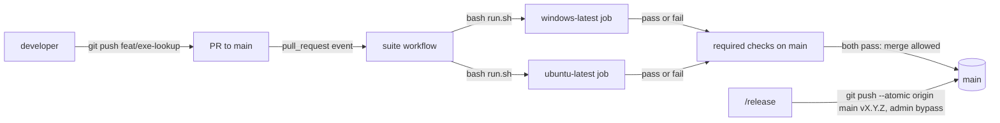
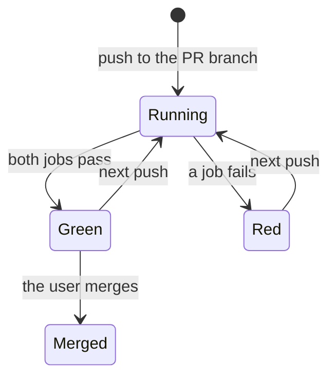
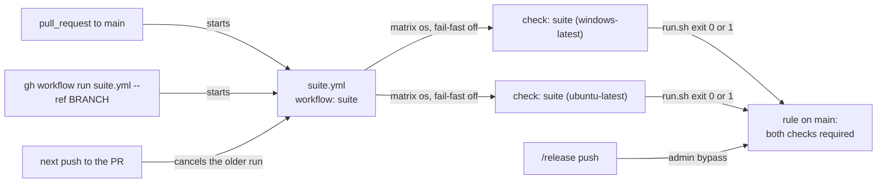
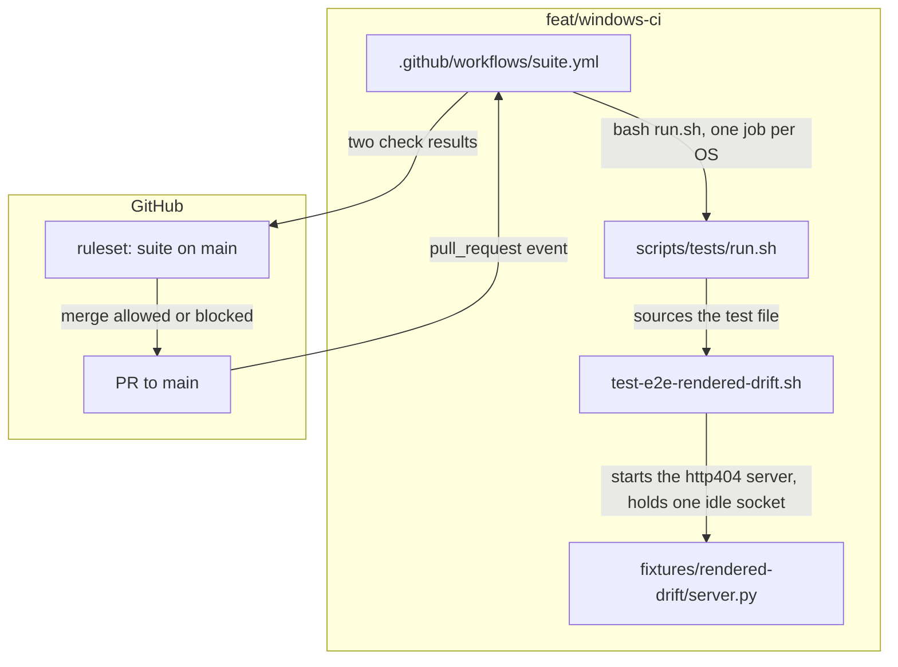
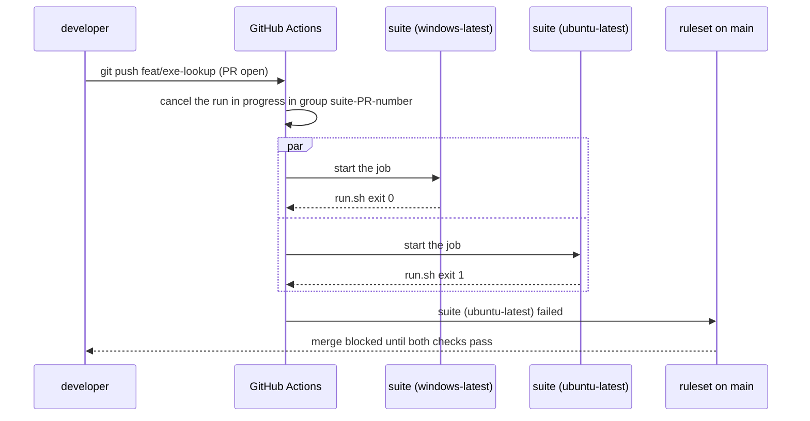

# Windows CI

**Version:** v1 · **Status:** Refined · **Type:** Technical · **Project type:** CLI/Library

**Shape doc:** docs/specs/os-agnostic-suite/shape.md
**Depends on:** portable-suite, windows-paths

Each PR to `main` runs `run.sh` on `windows-latest` and `ubuntu-latest`, and a red job blocks the merge. Slices 1 to 4 and 7 make the suite pass on both systems, and this slice keeps it that way.

## Problem

Nothing stops a change that breaks the suite on one OS only. The `windows-suite` workflow runs only on a push to `feat/portable-suite`, a shipped branch, or by hand. No job runs the suite on Linux in CI. `main` has no branch protection, so a red job cannot block a merge.

The Windows break that started this idea went unseen until a release: 596 checks failed in 38 files on `main` at 03962c3. On `main` today the Windows job still fails 26 checks, and `windows-paths` owns them. So this slice ships after `windows-paths` merges.

One Windows check is not steady. The `e2e-rendered-drift` check "a 404 page prints E6 with its status" timed out on `Page.navigate` in portable-suite runs 2 and 4, and passed in runs 1 and 3 (portable-suite O18). `cdp.mjs:178` gives the navigation 25 s. The cause is not known. A required job that fails at random blocks each merge until a person reruns it.

## Slice test

| Check                         | Result                                                                                                      |
| ----------------------------- | ----------------------------------------------------------------------------------------------------------- |
| Cuts every layer it needs     | yes — the workflow file, the required checks on `main`, and the Chrome 404 check                            |
| One e2e test walks it         | yes — one scratch PR to `main`: green, then red from a Windows-only check, then green after the revert      |
| Worth shipping alone          | yes — a PR that breaks the suite on Windows or Linux can no longer merge                                    |
| Fits (≤5 scenarios, ≤2 areas) | yes — 5 scenarios, two areas: CI (`.github/workflows/` and the `main` settings) and the Chrome 404 check     |

**Path:** full — it adds a CI trigger, a Linux job and a repo setting. It is not a bug fix, a rename or a bump.

## Flow



A push to a PR branch starts both jobs, and `main` takes the merge only when both pass. The release commit still goes straight to `main`, because the repo admin bypasses the rule.

## States



## Acceptance criteria

```gherkin
Scenario: A PR runs the suite on Windows and Linux
  Given windows-paths is merged to main
  And the branch feat/exe-lookup changes plugins/zuko/scripts/lib/program.py
  When the user opens a PR from feat/exe-lookup to main
  Then the checks "suite (windows-latest)" and "suite (ubuntu-latest)" each run bash plugins/zuko/scripts/tests/run.sh
  And the last count line of each job reads "N passed, 0 failed"
  And GitHub allows the merge

Scenario Outline: A check that passes on one OS only blocks the merge
  Given a PR adds a check to test-decisions.sh that <check>
  When both jobs finish
  Then the <red> job fails, and its log names the failed check
  And the <green> job passes
  And GitHub refuses the merge until the <red> job passes

  Examples:
    | check                                                      | red            | green          |
    | compares os.path.join("docs", "adr") with "docs/adr"       | windows-latest | ubuntu-latest  |
    | expects os.sep to be "\"                                   | ubuntu-latest  | windows-latest |

Scenario: The release commit still goes straight to main
  Given main requires both jobs
  And the user is the repo admin
  When /release runs git push --atomic origin main v2.6.0
  Then GitHub takes the push and the tag
  And no job had to pass first

Scenario: The user runs the suite by hand on a branch
  Given the branch feat/strix-live is on origin, with no PR
  When the user runs gh workflow run suite.yml --ref feat/strix-live
  Then both jobs run run.sh on feat/strix-live
  And a push to feat/portable-suite starts no job

Scenario: The Chrome 404 check is steady on Windows
  Given the e2e-rendered-drift check "a 404 page prints E6 with its status" timed out on Page.navigate in portable-suite runs 2 and 4
  When the windows-latest job runs 5 times in a row on the same commit
  Then the check passes in each of the 5 runs
  And this spec names the cause that was found and fixed
```

## Scope

**In:**

- The suite workflow runs on each PR to `main` and by hand. The push trigger on `feat/portable-suite` goes.
- Two jobs, `windows-latest` and `ubuntu-latest`, run the same `run.sh`.
- Both jobs are required checks on `main`. The repo admin bypasses them, so `/release` keeps its push to `main` (D1).
- The cause of the Chrome 404 timeout on Windows, found and fixed. No rerun and no SKIP.

**Out:**

- macOS in CI — not planned. The shape's Not doing list keeps it out.
- A run on each push to `main` — not planned (O3).
- The 26 `\` path failures and the 3 replay "stale fork" failures on Windows — `windows-paths`.
- `git.exe` from the repo root on Windows — `exe-lookup`.
- A faster Windows job, such as a cache — not planned. Nothing asks for it yet.

## Interface

The interface is the workflow file, the two check names that `main` requires, and the rule on `main`.



Each trigger starts the one workflow, which runs one job on each OS. Each job's result feeds the rule on `main`, and only the release push from the admin gets past it.

| Part | Value |
| --- | --- |
| File | `.github/workflows/suite.yml`, renamed from `windows-suite.yml`. The file now runs Linux too. |
| Workflow name | `suite` |
| Triggers | `pull_request` to `main`, and `workflow_dispatch`. The `push` trigger on `feat/portable-suite` goes. |
| Jobs | One job, `suite`, with a matrix `os: [windows-latest, ubuntu-latest]` and `fail-fast: false`. A red job then does not stop the other one, so scenario 2 shows which OS failed. |
| Check names | `suite (windows-latest)` and `suite (ubuntu-latest)`. The rule on `main` requires these two names. |
| Each job runs | checkout, Python 3.12, then `bash plugins/zuko/scripts/tests/run.sh` in `bash`. It stops after 30 minutes. |
| Older runs | A new push to the same PR cancels the run in progress. A run by hand is grouped by its branch. |
| Rule on `main` | Both checks are required. A PR does not have to hold the latest `main`. The repository admin bypasses the rule. |

What the user sees:

- **On the PR:** two checks. Each one links to its log. The log ends with the `run.sh` count line, such as `3596 passed, 0 failed`, and each failed check has its own `FAIL` line.
- **A blocked merge:** GitHub's own text on the PR. zuko adds no message.
- **From the terminal:** `gh pr checks` shows the two checks, and `gh run view --log-failed` prints the `FAIL` lines.
- **A run by hand:** `gh workflow run suite.yml --ref feat/strix-live` starts both jobs on that branch.

## Technical plan

### Approach

The workflow file gets a new name, two triggers and a matrix of two OSes. A repository ruleset on `main` then requires both checks, with the admin role on its bypass list. The Chrome 404 flake is in the test fixture, not in zuko. `server.py` serves with the single-threaded `HTTPServer`, so one idle connection from Chrome blocks it, and the real request waits until `Page.navigate` times out.

That cause was reproduced on Linux at pause 3. With one idle TCP connection open to the 404 server, `check-rendered-drift.sh` printed `CDP timeout: Page.navigate` after 26 s. With `ThreadingHTTPServer` and the same idle connection, it printed `HTTP 404` after 1 s. Without the idle connection, both servers answer in 1 s.

Relies on: D1, D86, D106, D125, D126, D127, D128, D129, D130



The PR starts the workflow, which runs `run.sh` on each OS. The two results go to the ruleset, which allows or blocks the merge.



### Changes

| File | What changes | Why |
| --- | --- | --- |
| `.github/workflows/windows-suite.yml` → `.github/workflows/suite.yml` (`git mv`) | `name: suite`. `on: pull_request: branches: [main]` and `workflow_dispatch`; the `push` trigger goes. `concurrency: group: suite-${{ github.event.pull_request.number \|\| github.ref }}`, `cancel-in-progress: true`. Job `suite`: `strategy: fail-fast: false, matrix: os: [windows-latest, ubuntu-latest]`, `runs-on: ${{ matrix.os }}`, `timeout-minutes: 30`, `defaults.run.shell: bash`. Steps: `actions/checkout@v4.2.2`, `actions/setup-python@v5.6.0` with `"3.12"`, `actions/setup-node@v4.4.0` with `node-version: "22"`, then `bash plugins/zuko/scripts/tests/run.sh`. | Scenarios 1, 2, 4; D126, D128 |
| `plugins/zuko/scripts/tests/fixtures/rendered-drift/server.py:39` | `http.server.HTTPServer` → `http.server.ThreadingHTTPServer`. Its threads are daemon threads, so the process still stops on the test's `stop_tree`. | Scenario 5 |
| `plugins/zuko/scripts/tests/test-e2e-rendered-drift.sh:116` | Before the 404 run, start one Python child that opens a TCP connection to the server and sends nothing. Stop it with `stop_tree` after the run. The check "a 404 page prints E6 with its status" keeps its name, and it now fails on every OS when the server is single-threaded. | Scenario 5 |
| `docs/ARCHITECTURE.md:28` | "which `.github/workflows/windows-suite.yml` runs on `windows-latest`" → "which `.github/workflows/suite.yml` runs on each PR, on `windows-latest` and `ubuntu-latest`". | The doc names the old file. |
| Ruleset on `main` (a GitHub setting, not a file) | Created by `/build` after the PR's first green run, with the command below. | Scenarios 1, 2, 3; D125, D129, D130 |

```bash
gh api -X POST repos/dzaffren/claude-plugin/rulesets --input - <<'JSON'
{"name": "suite on main", "target": "branch", "enforcement": "active",
 "conditions": {"ref_name": {"include": ["~DEFAULT_BRANCH"], "exclude": []}},
 "bypass_actors": [{"actor_id": 5, "actor_type": "RepositoryRole", "bypass_mode": "always"}],
 "rules": [{"type": "required_status_checks", "parameters": {
   "strict_required_status_checks_policy": false,
   "required_status_checks": [{"context": "suite (windows-latest)"}, {"context": "suite (ubuntu-latest)"}]}}]}
JSON
```

`actor_id` 5 is the admin repository role. The proof of that is the `current_user_can_bypass` field in the reply, which must read `always`.

Reusing: `run.sh` and its 600 s limit for each file (D106), `start_server` and `stop_tree` in `test-e2e-rendered-drift.sh`, and the action tags that `windows-suite.yml` already pins.

### Earn-it

| Added | Triggered by |
| --- | --- |
| The `ubuntu-latest` job | Scenario 2, a check that fails on Linux only. |
| `actions/setup-node` at Node 22 | `e2e-rendered-drift` fails without Node 22 (D86), and the default Node of the `ubuntu-latest` image is not known (O7). |
| The `concurrency` block | D128. |
| The ruleset | D125 and scenario 2: a red check must block the merge. |
| `ThreadingHTTPServer` and the idle connection in the test | Scenario 5. The idle connection makes the old failure happen on each run, on every OS. |

### Non-functionals

|                      |                                                                               |
| -------------------- | ----------------------------------------------------------------------------- |
| **Load**             | One run for each push to a PR: a few a day. Windows takes 13 to 18 minutes. Linux takes about 2.5 minutes on this machine, and is not measured on GitHub. |
| **Breaks first**     | At 10×, the free plan's limit of concurrent jobs queues the runs. The cancel of older runs (D128) is the first relief. Nothing else is needed at this size. |
| **Security surface** | `pull_request`, never `pull_request_target`: a PR from a fork runs on GitHub's VM with a read-only token, and GitHub asks the owner to approve a first-time contributor's run. `permissions: contents: read`. No secret is read. Only the admin role can bypass the ruleset. |
| **Proof it works**   | On the next PR after the merge, `gh pr checks` lists `suite (windows-latest)` and `suite (ubuntu-latest)` as `pass`. `gh api repos/dzaffren/claude-plugin/rulesets/{id} -q '.enforcement + " " + .current_user_can_bypass'` prints `active always`. |
| **Rollout**          | No flag. Order: push the branch, open the PR, wait for its first green run, create the ruleset, prove scenarios 2 and 3, then merge. Rollback: `gh api -X DELETE repos/dzaffren/claude-plugin/rulesets/{id}` removes the rule, and a `git revert` of the workflow commit gives back `windows-suite.yml`. |

### Test plan

| Scenario | Test | Command |
| --- | --- | --- |
| 1. A PR runs the suite on Windows and Linux | The windows-ci PR's own run | `gh pr checks {pr} --watch`, then `gh run view {run} --log \| grep -E '[0-9]+ passed, 0 failed'` for each job. After the ruleset: `gh pr view {pr} --json mergeStateStatus -q .mergeStateStatus` prints `CLEAN`. |
| 2. A check that passes on one OS only blocks the merge | Scratch PR `test/windows-ci-red`, from `feat/windows-ci` to `main`. Commit 1 adds the Windows-only check to `test-decisions.sh`. After its run, commit 2 swaps it for the Linux-only check. | `gh pr checks {scratch}` shows the right red job each time, and `gh pr view {scratch} --json mergeStateStatus -q .mergeStateStatus` prints `BLOCKED`. Then `gh pr close {scratch} --delete-branch`. |
| 2, cancel (D128) | The same scratch PR: a third commit pushed while the run of commit 2 is in progress | `gh run list --branch test/windows-ci-red --json conclusion -q '.[].conclusion'` holds `cancelled`. |
| 3. The release commit still goes straight to main | The ruleset reply | `gh api repos/dzaffren/claude-plugin/rulesets/{id} -q .current_user_can_bypass` prints `always`. The next real `/release` push is the full proof. |
| 4. The user runs the suite by hand | After the merge, at `/ship` | `gh workflow run suite.yml --ref feat/strix-live`, then `gh run list --workflow suite.yml --branch feat/strix-live`. `gh run list --workflow suite.yml --event push` is empty. |
| 5. The Chrome 404 check is steady | `test-e2e-rendered-drift.sh`, with the idle connection | `bash plugins/zuko/scripts/tests/run.sh e2e-rendered-drift` on Linux. It must fail with the old `server.py` and pass with the new one. Then `gh run rerun {run}` four times on the windows-ci PR's run, so five attempts in all, and `gh run view {run} --attempt {n} --log \| grep 'a 404 page prints E6'` shows `PASS` in each. |

**E2E:** the scratch PR `test/windows-ci-red` against the live ruleset. It walks scenarios 1 and 2, and the cancel rule.

### Chunks

Single chunk. Four files and one GitHub setting, and each proof needs the one before it.

### Risks

| Risk | Mitigation |
| --- | --- |
| Chrome does not start on `ubuntu-latest`, because Ubuntu 24.04 restricts unprivileged user namespaces and `cdp.mjs:83` passes no `--no-sandbox`. | The first PR run shows it (O7). When it fails, the workflow sets `sudo sysctl -w kernel.apparmor_restrict_unprivileged_userns=0` in a Linux-only step. That changes the CI VM only. `cdp.mjs` keeps the sandbox for users. |
| Other Linux tests fail on `ubuntu-latest` from an image difference, such as a missing tool. | Same first run. `/build` fixes each one before it creates the ruleset, so `main` never requires a red check. |
| The ruleset goes on before `suite.yml` is on `main`, so an open PR that lacks the file waits on two `Expected` checks. | O10: accepted. Each open PR merges `main` after the windows-ci merge. |
| `actor_id` 5 is not the admin role, and the release push is then blocked. | The `current_user_can_bypass` check in scenario 3 fails before the merge. `/build` corrects the ruleset with `gh api -X PUT`. |
| The fixture fix hides a real slow start of Chrome on Windows. | The five Windows attempts of scenario 5 must all pass. A timeout in any one of them reopens the cause. |

### Decisions to record

Recorded as D125, D126, D127, D128, D129, D130.

## Open items

| ID | What | Type | Raised at | Owner | Status | Answer |
| --- | --- | --- | --- | --- | --- | --- |
| O1 | Are the two jobs a required check on `main`, given that `/release` pushes its commit straight to `main` (D1)? | question | spec p1 | user | Resolved | Yes, required. The repo admin bypasses the rule, so the release push still goes through. No bypass was rejected, because it breaks D1, 2026-11-09 |
| O2 | The Windows job fails 26 checks on `main`, and `windows-paths` owns them. Does this slice ship before or after `windows-paths`? | question | spec p1 | user | Resolved | After. This slice depends on `windows-paths`, so its first PR run is green, 2026-11-09 |
| O3 | What starts the workflow? | question | spec p1 | user | Resolved | Each PR to `main`, and a run by hand. A push to `main` starts nothing: a run after a squash merge repeats the PR's tree. The `feat/portable-suite` trigger goes, 2026-11-09 |
| O4 | The Chrome 404 check times out on `Page.navigate` in some Windows runs. How does a required job treat it? (from windows-paths O3, portable-suite O18) | question | spec p1 | user | Resolved | Find the cause and fix it. The check passes in 5 Windows runs in a row. A rerun in CI and a SKIP were rejected, 2026-11-09 |
| O5 | When a new push reaches a PR branch while its run is in progress, what happens to the older run? | question | spec p2 | user | Resolved | It is cancelled. Only the newest commit gets a result, 2026-11-09 |
| O6 | Must a PR hold the latest `main` before it can merge? | question | spec p2 | user | Resolved | No. A PR merges when its own last run passed, 2026-11-09 |
| O7 | The suite has never run on `ubuntu-latest`. The image's Node may be older than 22, and Chrome's sandbox may fail on Ubuntu 24.04. | unproven | spec p3 | user | Accepted risk | No `/poc`. The windows-ci PR's first run is the proof, and `/build` fixes what fails there before it creates the ruleset, 2026-11-09 |
| O8 | Is the rule on `main` a repository ruleset or classic branch protection? | question | spec p3 | user | Resolved | A ruleset, with the admin role on its bypass list (D130), 2026-11-09 |
| O9 | May `/build` push `feat/windows-ci`, open its PR, create the ruleset after the first green run, and push and close the scratch PR `test/windows-ci-red`? | question | spec p3 | user | Resolved | Yes, all of it. Rollback is one `gh api -X DELETE` of the ruleset, 2026-11-09 |
| O10 | Once the ruleset is on, each open PR whose branch lacks `suite.yml` waits on two `Expected` checks. `feat/strix-code` (PR #134) is open now. | flag | spec p3 | user | Accepted risk | Each open PR merges `main` once after the windows-ci merge, and then gets its two checks, 2026-11-09 |
| O11 | The first PR run failed 3 `replay` "stale fork" checks on both OSes with `Committer identity unknown`. The plan named no change to `test-replay.sh`. | flag | build | user | Decided alone | Chose: give the squash merge at `test-replay.sh:317` the test identity that its other git calls already pass. A CI runner has no git user, so git cannot guess one. Other: set a git identity in a workflow step. Undo: revert `e65cccf`, and add a `git config --global` step to `suite.yml`. 2026-11-09 |
| O12 | `run.sh` said only "the test file exited non-zero partway through", so the CI log could not show why `e2e-pentest-live` stopped. The plan did not name `run.sh`. | flag | build | user | Decided alone | Chose: the FAIL line now gives the exit status and the number of checks recorded. Other: leave the message as it was. Undo: revert `e53b5b5`. 2026-11-09 |
| O13 | On `ubuntu-latest`, `e2e-pentest-live` exits 143 (SIGTERM) after 2 of its 31 checks, at `stop_tree "$app_pid"`, in 2 of 2 runs. It passes on `windows-latest` and on this Linux machine, also with no terminal and no git identity. The cause is not known. The next step is a throwaway PR that runs only that file on `ubuntu-latest` and logs the process groups. Claude Code's permission check refused that push. | question | build | user | Resolved | `/build` pushes the throwaway draft PR `test/windows-ci-debug`, on the user's word. It runs only `e2e-pentest-live` on `ubuntu-latest` and logs the process groups at `stop_tree`. Then `/build` closes it, deletes the branch, and fixes the cause it shows, 2026-11-09 |
| O14 | The debug PR (O13) showed the cause: a test file inherits `set -o monitor` from `run.sh`, the app shares the file's process group, and `stop_tree`'s `kill -TERM -- -$app_pid` reached the file itself on the runner's bash. The plan did not name `stop_tree`. | flag | build | user | Decided alone | Chose: `stop_tree` at `run.sh:107` signals `-pid` only when `ps -o pgid=` says the pid leads its own group, and sends a plain `kill` otherwise. The debug run passed `e2e-pentest-live` 31 of 31 on `ubuntu-latest`. Other: start each test file with `set +m`, which also changes the groups that its own jobs get. Undo: revert `5b0d304`. 2026-11-09 |

_Never delete this section or its rows. See references/ledger.md._

## Glossary

- **CI** — continuous integration: a service that runs the tests on each change, before it merges.
- **GitHub Actions** — GitHub's CI. A workflow file in `.github/workflows/` says when to run and what to run.
- **Runner** — the machine that runs a job. `windows-latest` and `ubuntu-latest` are GitHub's hosted Windows and Linux machines.
- **workflow_dispatch** — the trigger that lets a person start a workflow by hand, from the Actions tab or `gh workflow run`.
- **Required check** — a job that must pass before GitHub lets a PR merge into a branch.
- **Bypass** — a person who can push to a protected branch without the required checks.
- **CDP** — Chrome DevTools Protocol: the messages that the drift check sends to drive headless Chrome.
- **Flaky** — a test that passes in some runs and fails in others on the same code.
- **e2e** — end-to-end: one test that walks the whole slice as a user would.
- **Ruleset** — a set of GitHub rules for named branches, such as required checks, with a list of who can bypass them.
- **Matrix** — one job in a workflow that GitHub runs once for each value, here once for each OS.
- **Chrome sandbox** — Chrome's own wall around each page. On Linux it needs user namespaces, which Ubuntu 24.04 limits through AppArmor.
