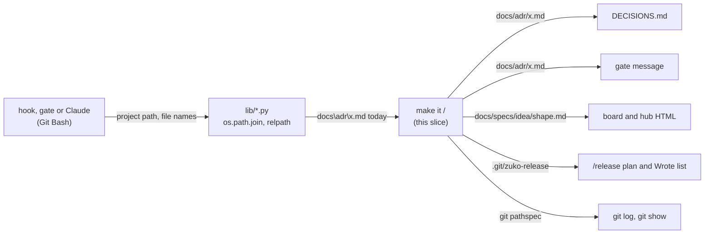
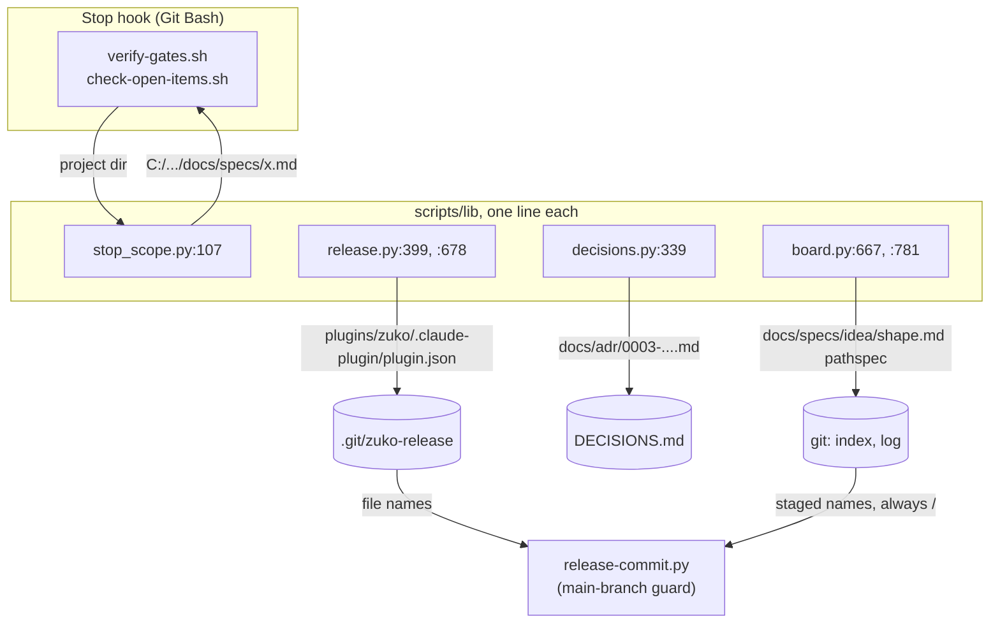
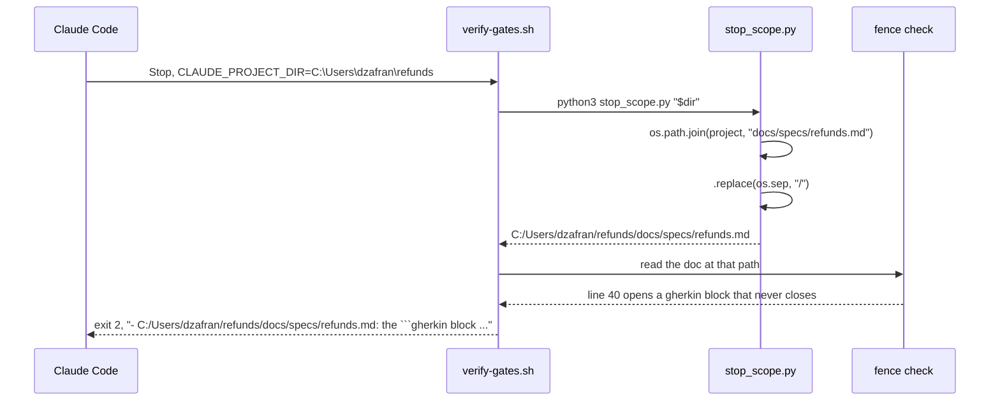

# Windows paths

**Version:** v1 · **Status:** Built · **Type:** Bug · **Project type:** CLI/Library

**Shape doc:** docs/specs/os-agnostic-suite/shape.md
**Depends on:** portable-suite

Each path that zuko prints, writes or compares uses `/` on every OS. On Windows, `DECISIONS.md`, the spec gates, the board and `/release` then give the same paths as on Linux, and the Windows suite can go green.

## Problem

On Windows, Python's `os.path` builds paths with `\`. zuko passes some of these paths on as text, so a Windows user gets `docs\adr\0001-use-make.md` where Linux gives `docs/adr/0001-use-make.md`. portable-suite found this in four Windows runs (its O17) and left it to this slice.

The last Windows run, 42538018070 on `feat/portable-suite`, gave 3507 passed, 33 failed and 3 skipped:

| Failed | Test files | Cause |
| --- | --- | --- |
| 26 | `adr-scan` 8, `e2e-adr-seed` 1, `fence` 3, `glossary` 5, `library` 1, `release` 3, `replay` 5 | a `\` path from `os.path`, in `decisions.py`, `stop_scope.py`, `board.py` and `release.py` |
| 6 | `coverage` 6 | a test file name with `\|` or a Latin-1 byte, which Windows does not store as written (portable-suite O25) |
| 1 | `e2e-rendered-drift` 1 | Chrome start time on the runner, not reproducible (portable-suite O18) |

What a Windows user sees today, from that run:

| Where | Windows gives | Linux gives |
| --- | --- | --- |
| `DECISIONS.md`, seeded from ADRs | `Why: seeded from docs\adr\0001-record-architecture-decisions.md.` | `docs/adr/0001-record-architecture-decisions.md` |
| the fence and glossary gates | `- C:/Users/RUNNER~1/.../one\docs/specs/idea-board.md line 55 opens ...` | one `/` path |
| the board's Replay strip | the shape's own changes are missing from each step | the shape is listed first |
| the hub's Ideas section | `cannot read docs/specs/csv-import\shape.md` | `docs/specs/csv-import/shape.md` |
| `/release` cut, Wrote list | `.git\zuko-release` | `.git/zuko-release` |

`/release` runs the suite as its tests gate. While any check fails, no version can be cut from Windows.

## Slice test

| Check                         | Result                                                                                          |
| ----------------------------- | ----------------------------------------------------------------------------------------------- |
| Cuts every layer it needs     | yes — the Python libraries that make the paths, the hooks and gates that print them, and the files they write |
| One e2e test walks it         | yes — `run.sh` in the `windows-suite` job; its checks in seven test files walk the five scenarios |
| Worth shipping alone          | yes — a Windows user gets correct paths in `DECISIONS.md`, the gates, the board and `/release`  |
| Fits (≤5 scenarios, ≤2 areas) | yes — 5 scenarios, two areas: `scripts/lib/*.py` and `test-coverage.sh`                          |

**Path:** full — the change touches more than three files. Pause 2 is skipped: no command, flag or message changes on Linux, and Windows comes to match the Linux text.

## User story

As a zuko user on Windows, I want zuko to print and write the same paths as on Linux, so that my decisions log, my gate messages, my board and my releases are correct.

## Flow



A hook or Claude starts a zuko Python script with a project path. The script builds a path with `os.path`, which gives `\` on Windows. This slice turns each such path into `/` before zuko prints it, writes it to a file, gives it to git or compares it.

## Acceptance criteria

```gherkin
Scenario: ADR seeding writes / paths into DECISIONS.md
  Given a repo on Windows with the ADR docs/adr/0003-ship-as-pip-package.md
  And that ADR has no Rejected section
  When /onboard runs the ADR scan and seeds DECISIONS.md
  Then the scan gives the file as docs/adr/0003-ship-as-pip-package.md
  And D3 in DECISIONS.md reads "Rejected: not recorded in docs/adr/0003-ship-as-pip-package.md"

Scenario: A spec gate names the doc with / only
  Given the project C:\Users\dzafran\refunds on Windows
  And docs/specs/refunds.md opens a ```gherkin block at line 40 that never closes
  When the Stop hook runs the spec gate
  Then the message reads "- C:/Users/dzafran/refunds/docs/specs/refunds.md: the ```gherkin block that line 40 opened never closes. Close it."
  And the message has no \ in it

Scenario: The board's Replay lists the shape on Windows
  Given the shape docs/specs/os-agnostic-suite/shape.md and the spec docs/specs/lf-checkout.md, both in git history
  When the user runs board.py render docs/specs/os-agnostic-suite/shape.md on Windows
  Then the first Replay step lists docs/specs/os-agnostic-suite/shape.md first, then docs/specs/lf-checkout.md
  And the hub's Ideas section names an unreadable shape as docs/specs/csv-import/shape.md

Scenario: /release names its files with / on Windows
  Given a repo on Windows at 2.5.1 with a feat commit since the tag
  And its marketplace.json lists the plugin ./plugins/zuko
  When release.py cut runs for 2.6.0 with a passing pentest report
  Then the plan lists plugins/zuko/.claude-plugin/plugin.json once
  And the Wrote list names .git/zuko-release, docs/security/v2.6.0/report.md and docs/security/coverage.md
  And no line of the plan or the Wrote list has a \ in a path
  And the release marker lists plugins/zuko/.claude-plugin/plugin.json, so the main-branch guard lets the v2.6.0 commit through

Scenario: The suite passes on Windows and on Linux
  Given this branch
  When the windows-suite job runs plugins/zuko/scripts/tests/run.sh on windows-latest
  Then the last line reads "N passed, 0 failed, K skipped"
  And the 8 coverage checks whose file names hold | or a Latin-1 byte print SKIP with the reason
  And run.sh on Linux passes every check that it passes on main
```

## Scope

**In:**

- Each path that a zuko Python script prints, writes to a file, gives to git or compares as text. The Windows run names five places: `decisions.py:339`, `stop_scope.py:107`, `board.py:667` and `:781`, and `release.py:678`.
- An absolute path that zuko prints, such as the project path in a gate message: `\` becomes `/`, and the drive letter stays.
- Each other place that a grep at pause 3 finds, where zuko's Python prints, writes, gives to git or compares an `os.path` path. Each one gets its own test.
- The 8 checks in sections 6 and 7 of `test-coverage.sh`, whose file names Windows does not store as written: on Windows they print SKIP with the reason, by D105. 6 of them fail there today.
- Scenario 5 also passes when only `e2e-rendered-drift` "a 404 page prints E6" fails, and a rerun of that file passes.

**Out:**

- A `\` path that the user types as an argument, such as `--dir docs\adr`. zuko's hooks run in Git Bash, where the user types `/`. No slice picks it up; a later bug report can.
- Native Windows shells (cmd, PowerShell) — out of the shape.
- A Windows job on each PR, and the `e2e-rendered-drift` timeout (portable-suite O18) — `windows-ci`.
- How zuko's Python finds `git.exe` — `exe-lookup`.

## Technical plan

### Approach

Each place where zuko's Python turns an `os.path` result into text gets `.replace(os.sep, "/")`, the idiom that `stop_scope.py:78` already uses. On Linux and macOS `os.sep` is `/`, so nothing changes there. The pause 3 grep found one place more than the Windows run named: `release.py:399`, whose `\` names reach the release plan and the release marker. Two new checks pin the cases that the suite does not cover, and the 6 `coverage` checks print SKIP on Windows when git cannot track their file names as written.

Relies on: D30, D35, D104, D105, D116, D117



The gates print the doc paths that `stop_scope.py` gives them. The ADR scan writes its paths into `DECISIONS.md`. The board gives the shape's path to git. `release.py` writes the release marker, and the main-branch guard compares the marker with git's staged names, which always use `/`.



The path turns into `/` once, in `stop_scope.py`, before any gate reads it. So each gate message shows the same path, and Git Bash and native Python both open it.

### Changes

| File | What changes | Why |
| --- | --- | --- |
| `plugins/zuko/scripts/lib/decisions.py:339` | `rel = os.path.relpath(path, project).replace(os.sep, "/")`. The scan's `file`, its skip reasons and the seeded `Why:` and `Rejected:` lines all read `rel`. | Scenario 1 |
| `plugins/zuko/scripts/lib/stop_scope.py:107` | Print `path.replace(os.sep, "/")`. A project given as `C:\Users\...` then prints as `C:/Users/...`. | Scenario 2 |
| `plugins/zuko/scripts/lib/board.py:667` | The shape's relpath gets `.replace(os.sep, "/")`, so the git pathspec, the blob key and the Replay's `file` match the spec paths. | Scenario 3 |
| `plugins/zuko/scripts/lib/board.py:781` | The error names the doc by its repo path with `/`: `rel` for the shape, `docs/specs/NAME.md` for a spec. Today only the folder prefix is replaced, and `csv-import\shape.md` stays. | Scenario 3 |
| `plugins/zuko/scripts/lib/release.py:399` | `inner` gets `.replace(os.sep, "/")` after `normpath`. The `..` and `isabs` checks still run on the folded path. The compare with `.claude-plugin/plugin.json` then holds on Windows, so the root plugin is not listed twice. | Scenario 4, found by the grep (O1) |
| `plugins/zuko/scripts/lib/release.py:678` | `write_marker` returns its relpath with `/`. | Scenario 4 |
| `plugins/zuko/scripts/tests/test-stop-scope.sh` | New check. It gives the project as `cygpath -w` gives it on Windows, and as it is on Linux. Each printed line then starts with the project in `/` form and has no `\`. | Scenario 2; no current check passes a `\` project |
| `plugins/zuko/scripts/tests/test-release.sh` | New check after the cut of section 19, zuko's shape: the marker lists `plugins/zuko/.claude-plugin/plugin.json` once, and `.claude-plugin/plugin.json` once. | Scenario 4; the plan text checks do not read the marker |
| `plugins/zuko/scripts/tests/test-coverage.sh:303,323` | Before sections 6 and 7 run, check that `git ls-files -z` holds the exact name. When it does not, print SKIP for each check of that section, with the reason "Windows does not store this file name as written". | Scenario 5, O2, by D105 |

Reusing: the `.replace(os.sep, "/")` idiom of `stop_scope.py:78`, and `skip` from `tests/run.sh:62`.

The grep covered each `os.path` call in `scripts/`, `hooks/`, `skills/` and `agents/`, the Python inside the `.sh` hooks too. Each other call opens a file, checks it or compares two native paths, such as `board.py:884`. None of them prints a path, writes one to a file or gives one to git.

### Earn-it

| Added | Triggered by |
| --- | --- |
| The new check in `test-stop-scope.sh` | Scenario 2: today no test gives the project with `\`, and the Stop hook can get it that way from `CLAUDE_PROJECT_DIR` |
| The new check in `test-release.sh` | Scenario 4: the main-branch guard reads the marker, and no check reads it for a nested plugin |
| The name check in `test-coverage.sh` | Scenario 5 and O2: a check whose setup Windows refuses prints SKIP (D105) |

Nothing else is added. No helper: six one-line sites do not earn one.

### Non-functionals

|                      |                                                                               |
| -------------------- | ----------------------------------------------------------------------------- |
| **Load**             | One string replace for each path. No change in run time. |
| **Breaks first**     | Nothing scales here. A new `os.path` path that is printed without the replace shows `\` again on Windows. The `windows-suite` job finds it, and `windows-ci` makes that job run on each PR. |
| **Security surface** | No new input. At `release.py:399`, the replace runs after `normpath`, so a `source` of `..\evil` still folds and is refused. The main-branch guard (D30) still compares the marker with git's staged names. On Windows it now matches a release commit with a nested plugin, which it blocked before. On Linux it compares the same names as today. |
| **Proof it works**   | The `windows-suite` job on `feat/windows-paths` ends with `N passed, 0 failed, K skipped`, and the 8 SKIP lines of `coverage` give their reason. |
| **Rollout**          | No flag. Rollback: revert the commit. Linux and macOS output does not change. |

### Test plan

| Scenario | Test | Command |
| --- | --- | --- |
| 1. ADR seeding writes / paths | `test-adr-scan.sh` (8 checks that fail on Windows today), `test-e2e-adr-seed.sh` | `bash plugins/zuko/scripts/tests/run.sh adr-scan`, then `run.sh e2e-adr-seed` |
| 2. A spec gate names the doc with / only | `test-fence.sh` (3), `test-glossary.sh` (5), the new check in `test-stop-scope.sh` | `run.sh fence`, `run.sh glossary`, `run.sh stop-scope` |
| 3. The board's Replay lists the shape | `test-replay.sh` (5), `test-library.sh` (1) | `run.sh replay`, `run.sh library` |
| 4. /release names its files with / | `test-release.sh` (3, and the new marker check) | `run.sh release` |
| 5. The suite passes on Windows and on Linux | `windows-suite` job; `test-coverage.sh` SKIP lines | Linux: `bash plugins/zuko/scripts/tests/run.sh`. Windows: `gh workflow run windows-suite.yml --ref feat/windows-paths`, then `gh run watch` |

On Linux, scenarios 1 to 4 pass before and after the change, because `os.sep` is `/`. Only the Windows run proves them, as D104 says.

**E2E:** the `windows-suite` job's run of `plugins/zuko/scripts/tests/run.sh` on `feat/windows-paths`. `/build` asks the user once, pushes the branch, and starts it with `gh workflow run` (O4). When the only failure is `e2e-rendered-drift` "a 404 page prints E6", one rerun of the job is allowed (D117).

### Chunks

Single chunk. The fixes are six lines in four files, and the tests that prove them are the same suite run.

### Risks

| Risk | Mitigation |
| --- | --- |
| A Windows run takes about 17 minutes, and the first one may find a cause that the logs did not show. | Each new cause becomes a Decided alone row with its fix, as portable-suite O6 did. `/build` may need two or three runs. |
| The `coverage` name check reads the wrong thing, and a real failure turns into a SKIP. | The check compares the exact bytes from `git ls-files -z` with the name that the test wrote. On Linux the names are stored, so the 8 checks run and must pass. |
| Another branch also writes D116 or D117. | `feat/strix-code` drafts D112 to D115, so this spec starts at D116, as guard-paths O4 did. `/build` checks the highest number on `main` before it appends. |

### Decisions to record

Recorded as D116, D117. D112 to D115 are taken on `feat/strix-code`, which is not merged yet.

## Review

2026-11-09 · 1 raw finding, 0 survived. Clean.

## Open items

| ID | What | Type | Raised at | Owner | Status | Answer |
| --- | --- | --- | --- | --- | --- | --- |
| O1 | The Windows run names five places. Does this slice fix only those, or also each other place that a grep at pause 3 finds? | question | spec p1 | user | Resolved | The five, and each other place that the pause 3 grep finds. Each one gets its own test, 2026-11-09 |
| O2 | The 6 `coverage` checks fail on Windows because their file names hold `\|` or a Latin-1 byte (portable-suite O25). Are they in this slice, as a SKIP with its reason by D105? | question | spec p1 | user | Resolved | Yes. On Windows they print SKIP with the reason, by D105. Without them the Windows suite cannot reach 0 failed, 2026-11-09 |
| O3 | `e2e-rendered-drift` "a 404 page prints E6" fails in some Windows runs from Chrome's start time (portable-suite O18). Is a run where only that check fails good enough for scenario 5? | question | spec p1 | user | Resolved | Yes, when a rerun of that file passes. `windows-ci` keeps the fix, 2026-11-09 |
| O4 | The `windows-suite` job runs on a push to `feat/portable-suite`, or by `workflow_dispatch`. Scenario 5 needs a Windows run of this branch. How does `/build` get one? | question | spec p1 | user | Resolved | `/build` asks the user once, then pushes `feat/windows-paths` and runs `gh workflow run windows-suite.yml --ref feat/windows-paths`. The workflow file stays as it is, 2026-11-09 |
| O5 | `/build` says to watch each test fail before the code. On Linux `os.sep` is `/`, so no check of scenarios 1 to 4 can fail there before the fix. | flag | build | user | Decided alone | Chose: take the red from Windows run 42538018070, where the 26 checks failed, and show that each new check fails on Linux when the fixed line writes `\` again. Other: push the tests alone first, for a red Windows run before the fix. Undo: revert the four `fix` commits, push, and run the `windows-suite` job. 2026-11-09 |
| O6 | Scenario 5 said "Then the last line reads "N passed, 0 failed, K skipped"". Windows run 42542336065 at `5ae665f` gave 3535 passed, 3 failed, 11 skipped. The 3 are `replay` "stale fork", which gets 2 Replay steps where it expects 3 (`[[1, 1]]` for `[[1, 7, 7]]`). | flag | build | user | Decided alone | Chose: leave the 3 red. Run 42538018070 on the base tree of `feat/portable-suite` failed them the same way, before this fix, so the cause is not a `\` path. The other 30 failures of that run now pass or print SKIP, and `e2e-rendered-drift` passed, so D117 was not used. Other: trace them here, with more Windows runs. Undo: none needed; take the log of run 42542336065 to `/debug`. 2026-11-09 |
| O7 | Scenario 5 said "And the 6 coverage checks whose file names hold \| or a Latin-1 byte print SKIP with the reason". The code skips each check of sections 6 and 7, which is 8: 6 fail on Windows, and 2 pass there but read the same name. | flag | review | user | Decided alone | Chose: the scenario and the Scope now say 8, as the Test plan does. Other: skip only the 6 that fail. Undo: run the two pick checks in each section outside the `stored` test in `test-coverage.sh`, and say 6 again. 2026-11-09 |

_Never delete this section or its rows. See references/ledger.md._

## Glossary

- **`os.path`** — Python's path module. On Windows it joins and splits paths with `\`, on Linux and macOS with `/`.
- **`os.sep`** — the separator that `os.path` uses on this OS: `\` on Windows, `/` elsewhere.
- **Git Bash (MSYS)** — the bash that comes with Git for Windows. zuko's hooks run in it on Windows.
- **ADR** — architecture decision record: one short file that states one design choice and why. The ADR scan turns them into D-entries.
- **pathspec** — the file paths that a `git log` or `git show` command limits itself to.
- **SKIP** — a test line that names a check and the reason it did not run. It never counts as a pass (D105).
- **`workflow_dispatch`** — a GitHub Actions trigger that runs a workflow on a chosen branch when someone asks for it.
- **e2e** — end-to-end: one test that walks the whole slice as a user would.
