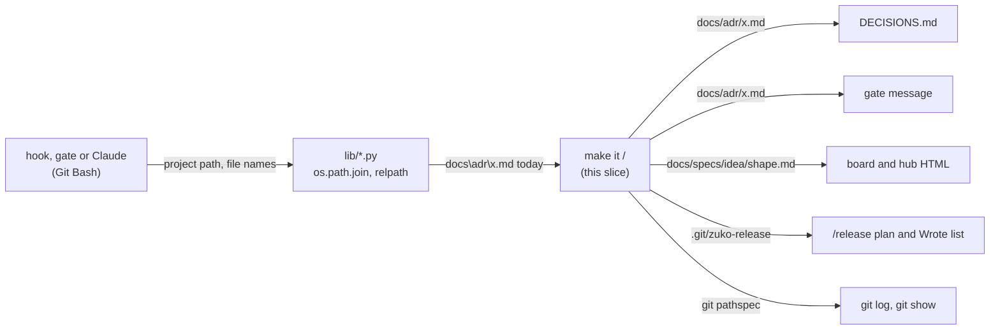

# Windows paths

**Version:** v1 · **Status:** Draft · **Type:** Bug · **Project type:** CLI/Library

**Shape doc:** docs/specs/os-agnostic-suite/shape.md
**Depends on:** portable-suite

Each path that zuko prints, writes or compares uses `/` on every OS. On Windows, `DECISIONS.md`, the spec gates, the board and `/release` then give the same paths as on Linux, and the Windows suite can go green.

## Problem

On Windows, Python's `os.path` builds paths with `\`. zuko passes some of these paths on as text, so a Windows user gets `docs\adr\0001-use-make.md` where Linux gives `docs/adr/0001-use-make.md`. portable-suite found this in four Windows runs (its O17) and left it to this slice.

The last Windows run, 42538018070 on `feat/portable-suite`, gave 3507 passed, 33 failed and 3 skipped:

| Failed | Test files | Cause |
| --- | --- | --- |
| 26 | `adr-scan` 8, `e2e-adr-seed` 1, `fence` 3, `glossary` 5, `library` 1, `release` 3, `replay` 5 | a `\` path from `os.path`, in `decisions.py`, `stop_scope.py`, `board.py` and `release.py` |
| 6 | `coverage` 6 | a test file name with `\|` or a Latin-1 byte, which Windows does not store as written (portable-suite O25) |
| 1 | `e2e-rendered-drift` 1 | Chrome start time on the runner, not reproducible (portable-suite O18) |

What a Windows user sees today, from that run:

| Where | Windows gives | Linux gives |
| --- | --- | --- |
| `DECISIONS.md`, seeded from ADRs | `Why: seeded from docs\adr\0001-record-architecture-decisions.md.` | `docs/adr/0001-record-architecture-decisions.md` |
| the fence and glossary gates | `- C:/Users/RUNNER~1/.../one\docs/specs/idea-board.md line 55 opens ...` | one `/` path |
| the board's Replay strip | the shape's own changes are missing from each step | the shape is listed first |
| the hub's Ideas section | `cannot read docs/specs/csv-import\shape.md` | `docs/specs/csv-import/shape.md` |
| `/release` cut, Wrote list | `.git\zuko-release` | `.git/zuko-release` |

`/release` runs the suite as its tests gate. While any check fails, no version can be cut from Windows.

## Slice test

| Check                         | Result                                                                                          |
| ----------------------------- | ----------------------------------------------------------------------------------------------- |
| Cuts every layer it needs     | yes — the Python libraries that make the paths, the hooks and gates that print them, and the files they write |
| One e2e test walks it         | yes — `run.sh` in the `windows-suite` job; its checks in seven test files walk the five scenarios |
| Worth shipping alone          | yes — a Windows user gets correct paths in `DECISIONS.md`, the gates, the board and `/release`  |
| Fits (≤5 scenarios, ≤2 areas) | yes — 5 scenarios, two areas: `scripts/lib/*.py` and `test-coverage.sh`                          |

**Path:** full — the change touches more than three files. Pause 2 is skipped: no command, flag or message changes on Linux, and Windows comes to match the Linux text.

## User story

As a zuko user on Windows, I want zuko to print and write the same paths as on Linux, so that my decisions log, my gate messages, my board and my releases are correct.

## Flow



A hook or Claude starts a zuko Python script with a project path. The script builds a path with `os.path`, which gives `\` on Windows. This slice turns each such path into `/` before zuko prints it, writes it to a file, gives it to git or compares it.

## Acceptance criteria

```gherkin
Scenario: ADR seeding writes / paths into DECISIONS.md
  Given a repo on Windows with the ADR docs/adr/0003-ship-as-pip-package.md
  And that ADR has no Rejected section
  When /onboard runs the ADR scan and seeds DECISIONS.md
  Then the scan gives the file as docs/adr/0003-ship-as-pip-package.md
  And D3 in DECISIONS.md reads "Rejected: not recorded in docs/adr/0003-ship-as-pip-package.md"

Scenario: A spec gate names the doc with / only
  Given the project C:\Users\dzafran\refunds on Windows
  And docs/specs/refunds.md opens a ```gherkin block at line 40 that never closes
  When the Stop hook runs the spec gate
  Then the message reads "- C:/Users/dzafran/refunds/docs/specs/refunds.md: the ```gherkin block that line 40 opened never closes. Close it."
  And the message has no \ in it

Scenario: The board's Replay lists the shape on Windows
  Given the shape docs/specs/os-agnostic-suite/shape.md and the spec docs/specs/lf-checkout.md, both in git history
  When the user runs board.py render docs/specs/os-agnostic-suite/shape.md on Windows
  Then the first Replay step lists docs/specs/os-agnostic-suite/shape.md first, then docs/specs/lf-checkout.md
  And the hub's Ideas section names an unreadable shape as docs/specs/csv-import/shape.md

Scenario: /release names its files with / on Windows
  Given a repo on Windows at 2.5.1 with a feat commit since the tag
  When release.py cut runs for 2.6.0 with a passing pentest report
  Then the Wrote list names .git/zuko-release, docs/security/v2.6.0/report.md and docs/security/coverage.md
  And no line of the plan or the Wrote list has a \ in a path

Scenario: The suite passes on Windows and on Linux
  Given this branch
  When the windows-suite job runs plugins/zuko/scripts/tests/run.sh on windows-latest
  Then the last line reads "N passed, 0 failed"
  And the 6 coverage checks whose file names hold | or a Latin-1 byte print SKIP with the reason
  And run.sh on Linux passes every check that it passes on main
```

## Scope

**In:**

- Each path that a zuko Python script prints, writes to a file, gives to git or compares as text. The Windows run names five places: `decisions.py:339`, `stop_scope.py:107`, `board.py:667` and `:781`, and `release.py:678`.
- An absolute path that zuko prints, such as the project path in a gate message: `\` becomes `/`, and the drive letter stays.
- Each other place that a grep at pause 3 finds, where zuko's Python prints, writes, gives to git or compares an `os.path` path. Each one gets its own test.
- The 6 `coverage` checks whose file names Windows does not store as written: on Windows they print SKIP with the reason, by D105.
- Scenario 5 also passes when only `e2e-rendered-drift` "a 404 page prints E6" fails, and a rerun of that file passes.

**Out:**

- A `\` path that the user types as an argument, such as `--dir docs\adr`. zuko's hooks run in Git Bash, where the user types `/`. No slice picks it up; a later bug report can.
- Native Windows shells (cmd, PowerShell) — out of the shape.
- A Windows job on each PR, and the `e2e-rendered-drift` timeout (portable-suite O18) — `windows-ci`.
- How zuko's Python finds `git.exe` — `exe-lookup`.

## Open items

| ID | What | Type | Raised at | Owner | Status | Answer |
| --- | --- | --- | --- | --- | --- | --- |
| O1 | The Windows run names five places. Does this slice fix only those, or also each other place that a grep at pause 3 finds? | question | spec p1 | user | Resolved | The five, and each other place that the pause 3 grep finds. Each one gets its own test, 2026-11-09 |
| O2 | The 6 `coverage` checks fail on Windows because their file names hold `\|` or a Latin-1 byte (portable-suite O25). Are they in this slice, as a SKIP with its reason by D105? | question | spec p1 | user | Resolved | Yes. On Windows they print SKIP with the reason, by D105. Without them the Windows suite cannot reach 0 failed, 2026-11-09 |
| O3 | `e2e-rendered-drift` "a 404 page prints E6" fails in some Windows runs from Chrome's start time (portable-suite O18). Is a run where only that check fails good enough for scenario 5? | question | spec p1 | user | Resolved | Yes, when a rerun of that file passes. `windows-ci` keeps the fix, 2026-11-09 |
| O4 | The `windows-suite` job runs on a push to `feat/portable-suite`, or by `workflow_dispatch`. Scenario 5 needs a Windows run of this branch. How does `/build` get one? | question | spec p1 | user | Resolved | `/build` asks the user once, then pushes `feat/windows-paths` and runs `gh workflow run windows-suite.yml --ref feat/windows-paths`. The workflow file stays as it is, 2026-11-09 |

_Never delete this section or its rows. See references/ledger.md._

## Glossary

- **`os.path`** — Python's path module. On Windows it joins and splits paths with `\`, on Linux and macOS with `/`.
- **`os.sep`** — the separator that `os.path` uses on this OS: `\` on Windows, `/` elsewhere.
- **Git Bash (MSYS)** — the bash that comes with Git for Windows. zuko's hooks run in it on Windows.
- **ADR** — architecture decision record: one short file that states one design choice and why. The ADR scan turns them into D-entries.
- **pathspec** — the file paths that a `git log` or `git show` command limits itself to.
- **SKIP** — a test line that names a check and the reason it did not run. It never counts as a pass (D105).
- **`workflow_dispatch`** — a GitHub Actions trigger that runs a workflow on a chosen branch when someone asks for it.
- **e2e** — end-to-end: one test that walks the whole slice as a user would.
