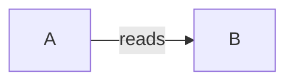
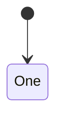
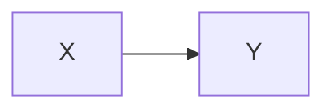
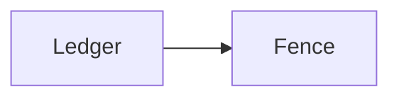

# Pause one

**Version:** v1 · **Status:** Draft · **Type:** Feature · **Project type:** CLI/Library

**Shape doc:** docs/specs/stages/shape.md
**Depends on:** None

Pause one opens with this text,
wrapped over two lines.

## Problem

Text.

## Flow



The flow moves from A to B.

## States



One state only.

## Acceptance criteria

````markdown

````

## Open items

| ID | What | Type | Raised at | Owner | Status | Answer |
| --- | --- | --- | --- | --- | --- | --- |


