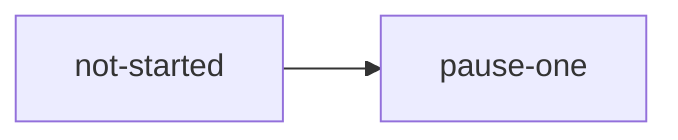

# Stage walk

**Project type:** CLI/Library · **Status:** Shaped

## Problem

One slice per stage,
so the board test can read
each stage rule.

## Slices

| # | Slice | What ships | Why this order |
| --- | --- | --- | --- |
| 1 | not-started | Ships the first thing. | First. |
| 2 | pause-one | Ships the second thing. | Second. |
| 3 | pause-two | Ships the third thing. | Third. |
| 4 | pause-three | Ships the fourth thing. | Fourth. |
| 5 | refined | Ships the fifth thing. | Fifth. |
| 6 | built | Ships the sixth thing. | Sixth. |
| 7 | reviewed | Ships the seventh thing. | Seventh. |
| 8 | shipped | Ships the eighth thing. | Eighth. |

| Where it stops today | After |
| --- | --- |
| not a slice | still not a slice |

## Open items

| ID | What | Type | Raised at | Owner | Status | Answer |
| --- | --- | --- | --- | --- | --- | --- |
